# Skill 依赖关系图谱

> 本仓库 34 个 Skill 的分层结构、依赖方向、协作链路与调用优先级。
> 既是架构说明，也是"遇到问题该用哪个 Skill"的索引。

| 元信息 | 值 |
|---|---|
| 版本 | v3（2026-10-27 重测重排） |
| Skill 总数 | **34** 个（全部含 `SKILL.md`） |
| 参考文档 | 84 份（`references/*.md`） |
| 可执行脚本 | 30 个（`scripts/*.py`） |
| 测试文件 | 16 个（`tests/**/test_*.py`） |
| 数据来源 | 扫描目录 + 统计跨 Skill 提及数，命令可复现（见 §6） |

> **术语**：本文的"依赖"指**调用关系**（A 建议在什么场景调用 B），不是代码依赖。
> "提及数" = 该 Skill 被**其他 SKILL.md** 正文提到的次数，用来衡量枢纽程度，不代表质量高低。

---

## 〇、怎么读这份文档

| 你想… | 看哪节 |
|---|---|
| 知道整个体系长什么样 | §1 分层总览 + §2 架构图 |
| 找某个具体场景用哪个 Skill | §5 调用优先级矩阵 |
| 理解几个 Skill 怎么串起来用 | §4 核心协作链路 |
| 判断哪个 Skill 是"地基" | §3 各层详解里的"提及数"列 |
| 了解体系当前的问题 | §6 健康度与已知缺口 |

---

## 一、分层总览

体系分三类：**纵向学习闭环（L0-L6）**、**横向赋能**、**专项与工程化**。

| 层 | 定位 | 数量 | 代表 Skill |
|---|---|---|---|
| **L0** 职业统筹 | 定方向、定节奏 | 1 | career-life-guidance |
| **L1** 知识库基础 | 所有笔记/知识的落脚点 | 3 | obsidian-knowledge-base-creator |
| **L2** 学习规划 | 学什么、按什么顺序 | 2 | learning-path-planner |
| **L3** 内容深度 | 把概念吃透 | 5 | tech-concept-deep-dive |
| **L4** 实践与质量 | 写出来、改好、跑起来 | 4 | project-based-learning |
| **L5** 复习巩固 | 记住并压缩 | 2 | knowledge-review-spaced |
| **L6** 求职输出 | 变现 | 2 | interview-prep-coach |
| **横向** 放大器 | 贯穿全层的能力 | 2 | ai-assisted-coding |
| **设计交付** | 把内容做成可交付的页面 | 5 | design-taste-frontend |
| **前端底座** | 页面里的动画与组件实现 | 5 | gsap-core |
| **工程化元工具** | 生成与维护项目/Skill 自身 | 3 | project-scaffolder |

> **关键判断**：L1 与 L3 是真正的枢纽层。L1 提供结构，L3 提供理解；
> 其余层要么在它之上规划（L2），要么消费它的产出（L5/L6）。

---

## 二、架构图

```mermaid
graph TB
    subgraph L0["L0 职业统筹"]
        career["career-life-guidance"]
    end

    subgraph L1["L1 知识库基础"]
        kb["obsidian-knowledge-base-creator"]
        sync["multi-kb-sync"]
        quality["note-quality-evaluator"]
    end

    subgraph L2["L2 学习规划"]
        path["learning-path-planner"]
        algo["algorithm-practice-trainer"]
    end

    subgraph L3["L3 内容深度"]
        concept["tech-concept-deep-dive"]
        source["source-code-reader"]
        system["system-design-planner"]
        paper["paper-reader"]
        bug["bug-troubleshooter"]
    end

    subgraph L4["L4 实践与质量"]
        project["project-based-learning"]
        code["code-practice-generator"]
        reviewcode["code-review-refactor"]
        devops["devops-deployment-guide"]
    end

    subgraph L5["L5 复习巩固"]
        review["knowledge-review-spaced"]
        cheatsheet["cheatsheet-generator"]
    end

    subgraph L6["L6 求职输出"]
        interview["interview-prep-coach"]
        article["tech-article-writer"]
    end

    subgraph X["横向赋能"]
        aicode["ai-assisted-coding"]
        english["english-for-developers"]
    end

    subgraph D["设计交付"]
        taste["design-taste-frontend"]
        processweb["process-oriented-web-design"]
        htmlpage["html-page-creator"]
        audit["frontend-audit-loop"]
        schedule["project-schedule"]
    end

    subgraph F["前端底座"]
        reactbits["react-bits"]
        gsapcore["gsap-core"]
        gsapplugins["gsap-plugins"]
        gsapscroll["gsap-scrolltrigger"]
        gsapperf["gsap-performance"]
    end

    subgraph E["工程化元工具"]
        optimizer["skill-optimizer"]
        scaffolder["project-scaffolder"]
        processization["project-processization"]
    end

    %% 主干
    kb --> sync
    kb --> quality
    kb --> path
    kb --> concept
    kb --> review

    career --> path
    career --> project
    career --> interview

    path --> interview
    path --> cheatsheet
    algo --> interview

    concept --> source
    concept --> system
    concept --> paper
    concept --> bug
    concept --> code
    concept --> project
    concept --> article
    concept --> cheatsheet
    concept --> review

    source --> concept
    system --> project
    system --> interview
    paper --> article
    bug --> devops
    bug --> quality
    bug --> reviewcode

    code --> project
    code --> reviewcode
    reviewcode --> project
    project --> devops
    project --> article

    review --> cheatsheet
    review --> quality
    quality --> review
    interview --> cheatsheet

    %% 横向（虚线：任意环节可调用）
    aicode -.-> concept
    aicode -.-> code
    aicode -.-> bug
    aicode -.-> reviewcode
    english -.-> source
    english -.-> paper
    english -.-> bug
    english -.-> interview

    %% 设计交付内部链路
    taste --> processweb
    taste --> htmlpage
    processweb --> htmlpage
    audit -.-> htmlpage
    audit -.-> processweb

    %% 前端底座（实现手段）
    reactbits -.-> htmlpage
    gsapcore -.-> gsapscroll
    gsapcore -.-> gsapplugins
    gsapperf -.-> gsapcore
    gsapscroll -.-> htmlpage
    gsapplugins -.-> htmlpage

    %% 工程化
    scaffolder --> processization
    optimizer -.-> scaffolder
    optimizer -.-> processization
```



> 实线 = 主链路依赖；虚线 = 可按需调用（横向能力、实现手段、方法论）。
> 设计交付组与主体系目前**没有引用边**，这是已知缺口，见 §6。

---

## 三、各层详解

### L0 职业统筹层

| Skill | 职责 | 提及数 |
|---|---|---|
| career-life-guidance | 身份校准、赛道选择、六篇人生时间线（决策/学习/项目/求职/长期/风控） | 6 |

它不产出知识，而是决定"要不要学、学多深、什么时候停"。所有 L2/L4/L6 的投入节奏都由它校准。

### L1 知识库基础层

| Skill | 职责 | 提及数 |
|---|---|---|
| obsidian-knowledge-base-creator | 知识库结构标准、笔记生成、结构校验；代码类知识点"底层逻辑四步" | **9** |
| note-quality-evaluator | 笔记质量评估与改进建议 | 8 |
| multi-kb-sync | 多库标签/模板/样式同步 | 1 |

**为什么是基础**：其他 Skill 产出的是"内容"，这一层决定内容**落在哪、长什么样、能不能被检索**。它一变，全体系的输出格式都要跟着变。

### L2 学习规划层

| Skill | 职责 | 依赖 | 提及数 |
|---|---|---|---|
| learning-path-planner | 分阶段路线、知识点优先级、项目建议 | kb、career | 11 |
| algorithm-practice-trainer | 算法题生成、复杂度分析 | 独立 | 1 |

### L3 内容深度学习层（内容枢纽）

| Skill | 职责 | 依赖 | 提及数 |
|---|---|---|---|
| tech-concept-deep-dive | 三位一体拆解（作用/原理/用法） | kb、source | **14（最高，除元工具外）** |
| source-code-reader | 源码阅读路线、核心流程、设计模式 | concept | 5 |
| system-design-planner | 系统设计八步法、容量估算 | concept | 4 |
| bug-troubleshooter | 排查五步法、根因分析 | concept、quality | 4 |
| paper-reader | 论文精读八步法 | concept | 2 |

**枢纽的含义**：14 个 Skill 在正文里建议"这里可以调 tech-concept-deep-dive"。
如果你只装一个 Skill，装它。

### L4 实践与代码质量层

| Skill | 职责 | 依赖 | 提及数 |
|---|---|---|---|
| project-based-learning | 项目方案、分步实现、验收标准 | concept、system、code、devops、career | 11 |
| code-practice-generator | 可运行练习、梯度题目 | concept、project | 7 |
| code-review-refactor | 五维评审、坏味道、安全重构 | code、project、bug | 6 |
| devops-deployment-guide | Docker/K8s、CI/CD、监控 | project、bug | 1 |

这一层的价值在于**闭环**：`code-practice` 产出 → `code-review-refactor` 评审重构 → `project` 组装 → `devops` 上线。

### L5 复习巩固层

| Skill | 职责 | 依赖 | 提及数 |
|---|---|---|---|
| knowledge-review-spaced | SM-2 间隔复习、今日清单 | kb、quality、concept | 11 |
| cheatsheet-generator | 5 类速查表、打印排版 | concept、system、path、interview、review | 11 |

`cheatsheet-generator` 是典型的**消费型 Skill**：自己不产生知识，只压缩别人的输出。

### L6 求职输出层

| Skill | 职责 | 依赖 | 提及数 |
|---|---|---|---|
| interview-prep-coach | 5 种题型框架、模拟面试 | path、concept、system、algo、project、career | 5 |
| tech-article-writer | 6 种文章类型、平台适配 | concept、paper、project | 1 |

### 横向赋能层

| Skill | 职责 | 提及数 |
|---|---|---|
| ai-assisted-coding | AI 辅助学/写/调/重构的工作流、Prompt 库、五条红线 | 8 |
| english-for-developers | 读文档报错、英文检索、写 commit/PR、英文面试 | 5 |

二者不占流水线位置——**任何一层都能调用**。

### 设计交付层（本次新增）

| Skill | 职责 | 提及数 |
|---|---|---|
| design-taste-frontend | 反"AI 味"的前端审美规范：字体、留白、动效节奏 | 0 |
| process-oriented-web-design | 流程导向的玻璃拟态看板生成 | 0 |
| html-page-creator | 通用单页 HTML 生成（自包含、可离线） | 0 |
| frontend-audit-loop | 网页改造的多轮自检收敛（改—看—再改） | 0 |
| project-schedule | 排期表/周计划看板（可勾选、localStorage 持久化） | 0 |

**内部链路**：`design-taste-frontend` 定审美 → `process-oriented-web-design` / `html-page-creator` 出页面 → `frontend-audit-loop` 收敛。

### 前端底座层（本次新增）

| Skill | 职责 | 提及数 |
|---|---|---|
| gsap-core | GSAP 核心 API 与时间线模型 | 3 |
| gsap-scrolltrigger | 滚动驱动动画 | 3 |
| gsap-plugins | 插件体系（Flip、Draggable 等） | 2 |
| gsap-performance | 动画性能与掉帧排查 | 1 |
| react-bits | React 交互动效组件实现 | 0 |

这四个 GSAP Skill 是**实现手段**而非流程环节：页面里需要动效时才按需加载。

### 工程化元工具

| Skill | 职责 | 依赖 | 提及数 |
|---|---|---|---|
| skill-optimizer | Skill 健康检查、文档/测试生成；全体系的方法论来源 | — | **19（页脚提及，不参与排名）** |
| project-scaffolder | 从需求到产物：WBS、生成、人机分工、12 维自检、工程底座 | **processization**（取 check_docs） | 0 |
| project-processization | 把 AI 搭好的项目转成学习指南 + 公开 README；文档防漂移 | 可选引用 scaffolder 的 CI 片段 | 1 |

**这两个是唯一有真实"代码级"耦合的一对**：

```
project-scaffolder  --复制-->  project-processization/scripts/check_docs.py
project-processization  --参考-->  project-scaffolder/references/ci-snippets.md
```

方向是单向的（scaffolder 依赖 processization 的脚本），反向只是文档指引，不构成循环依赖。

---

## 四、核心协作链路

### 链路 1：完整学习闭环（最常用）

```
career-life-guidance（定方向）
  → learning-path-planner → tech-concept-deep-dive → code-practice-generator
  → code-review-refactor → project-based-learning → devops-deployment-guide
  → knowledge-review-spaced → cheatsheet-generator → interview-prep-coach
```

### 链路 2：问题解决闭环

```
bug-troubleshooter → tech-concept-deep-dive（补原理）
  → code-review-refactor（消除同类隐患）→ note-quality-evaluator（更新笔记）
  → knowledge-review-spaced（纳入复习）
```

### 链路 3：深度研究闭环

```
english-for-developers → paper-reader → tech-concept-deep-dive
  → source-code-reader → project-based-learning → tech-article-writer
```

### 链路 4：知识库管理闭环

```
obsidian-knowledge-base-creator → note-quality-evaluator
  → multi-kb-sync（多库同步）→ knowledge-review-spaced（排期复习）
```

### 链路 5：AI 提效闭环

```
任意任务 → ai-assisted-coding（给上下文 + 结构化 Prompt）
  → AI 产出候选 → 人逐行看懂 + 运行/测试验证
  → code-review-refactor（评审 AI 代码）→ 沉淀 Prompt 与踩坑
```

### 链路 6：代码质量闭环

```
code-practice-generator / project-based-learning（产出）
  → code-review-refactor（五维评审 + 小步重构）
  → 回归验证 → 进入简历/GitHub（衔接 career / interview）
```

### 链路 7：项目与指南交付（本次新增）

```
project-scaffolder（需求分析 → 产物规划 → 生成 → 12 维自检）
  → project-processization（生成公开 README + 私密学习指南）
  → check_docs.py 进 CI（文档漂移变红）
  → skill-optimizer（对 Skill 自身做健康检查）
```

### 链路 8：页面交付（本次新增）

```
design-taste-frontend（定审美与规范）
  → process-oriented-web-design / html-page-creator（出页面）
  → gsap-* / react-bits（按需加动效）
  → frontend-audit-loop（多轮自检收敛）
```

---

## 五、调用优先级矩阵

| 场景 | 首选 | 辅助 | 输出落点 |
|---|---|---|---|
| 定职业/转行方向 | career-life-guidance | learning-path-planner | — |
| 学习新技术 | learning-path-planner | tech-concept-deep-dive、ai-assisted-coding | cheatsheet-generator |
| 深入理解概念 | tech-concept-deep-dive | source-code-reader、ai-assisted-coding | note-quality-evaluator |
| 练习技术点 | code-practice-generator | tech-concept-deep-dive | knowledge-review-spaced |
| 综合项目实战 | project-based-learning | system-design-planner、devops-deployment-guide | tech-article-writer |
| 审查/重构代码 | code-review-refactor | ai-assisted-coding、source-code-reader | — |
| 遇到 Bug | bug-troubleshooter | tech-concept-deep-dive、english-for-developers | note-quality-evaluator |
| 准备面试 | interview-prep-coach | system-design-planner、algorithm-practice-trainer、english-for-developers | cheatsheet-generator |
| 读论文/英文资料 | paper-reader | english-for-developers、tech-concept-deep-dive | tech-article-writer |
| 用 AI 提效 | ai-assisted-coding | code-review-refactor | — |
| 提升技术英语 | english-for-developers | ai-assisted-coding | — |
| 复习巩固 | knowledge-review-spaced | note-quality-evaluator | cheatsheet-generator |
| 管理多库 | multi-kb-sync | obsidian-knowledge-base-creator | note-quality-evaluator |
| 写技术文章 | tech-article-writer | tech-concept-deep-dive、paper-reader | — |
| **从零做一个项目** | project-scaffolder | system-design-planner、ai-assisted-coding | project-processization |
| **给已有项目补学习指南** | project-processization | code-review-refactor | 私密指南 + 公开 README |
| **做一个好看的页面** | design-taste-frontend | html-page-creator、gsap-core | frontend-audit-loop |
| **做排期/周计划看板** | project-schedule | design-taste-frontend | — |
| **优化 Skill 本身** | skill-optimizer | project-processization（文档断言） | — |

---

## 六、健康度与已知缺口

### 实测指标（2026-10-27）

| 指标 | 数值 |
|---|---|
| Skill 总数 | 34 |
| 含 `SKILL.md` | 34（100%） |
| 含 `references/` | 28 |
| 参考文档总数 | 84 |
| 含可执行脚本 | 4 个（obsidian 17、skill-optimizer 6、processization 6、scaffolder 1） |
| 含测试 | 3 个（skill-optimizer 8、processization 7、scaffolder 1，共 16 个测试文件） |
| 内容枢纽 | tech-concept-deep-dive（14） |
| 基础 Skill | obsidian-knowledge-base-creator（9） |
| 职业总纲 | career-life-guidance（6） |
| 横向放大器 | ai-assisted-coding（8）、english-for-developers（5） |

**复现命令**（在仓库根执行）：

```bash
# 总数与元数据
for d in */; do [ -f "$d/SKILL.md" ] && echo "$d"; done | wc -l

# 跨 skill 提及数
python - <<'PY'
from pathlib import Path
texts = {p.name: (p/"SKILL.md").read_text(encoding="utf-8").lower()
         for p in Path(".").iterdir() if (p/"SKILL.md").exists()}
for name in texts:
    print(sum(name.lower() in t for o, t in texts.items() if o != name), name)
PY
```

### 缺口 1：设计/前端两组是"孤岛"

`design-taste-frontend`、`html-page-creator`、`process-oriented-web-design`、`frontend-audit-loop`、`react-bits`、`project-schedule` 的提及数全部为 0——**没有任何其他 SKILL.md 引用它们**。

后果：主体系里的"项目实战"（project-based-learning）产出网页时，不会自动想到调用它们；用户也不知道两组能力存在。

修复方向（择一）：
1. 在 `project-based-learning` / `tech-article-writer` 的协作段加一句"需要页面交付时调用 design-taste-frontend / html-page-creator"；
2. 或在 `career-life-guidance` 的技能地图里列出这两个专项组。

### 缺口 2：工程化元工具与学习体系没有互相引用

`project-scaffolder` 的提及数为 0。它其实是"从零做项目"最该被推荐的入口，但没有任何学习类 Skill 指向它。

修复方向：在 `project-based-learning` 的协作段补一句"从零搭项目骨架用 project-scaffolder"。

### 缺口 3：只有 3 个 Skill 有测试

16 个测试文件集中在 3 个 Skill（skill-optimizer、processization、scaffolder）。其余 31 个是纯文档型，没有可执行的验收手段。

这不算缺陷（文档型 Skill 本来就没有代码），但意味着：**改这些 Skill 时只能靠人读**，无法回归。若要提升，可参照 `skill-optimizer` 的自检清单做结构校验。

---

## 七、版本演进

### v3（2026-10-27）

1. **重测全部数据**：34 个 Skill、84 份参考文档、30 个脚本、16 个测试文件；
2. **新增两组**：设计交付（5 个）、前端底座（5 个）；
3. **工程化元工具独立成组**：skill-optimizer / project-scaffolder / project-processization，并标注二者之间真实的脚本级依赖；
4. **补齐 8 条协作链路**（原 6 条 + 工程化交付、页面交付）；
5. **如实记录三个缺口**（见 §6），而不是把图"画得看起来连通"。

### v2（2026-09-08）

纳入 career-life-guidance，新增 ai-assisted-coding、english-for-developers、code-review-refactor，统一 SM-2 复习口径，obsidian 基座升到 v6.2。

### v1（2026-08-31）

初版：16 个学习 Skill + 1 个基础 Skill 的分层结构。

---

> **维护规则**：新增或删除 Skill 时，同步改三处——§1 数量、§3 对应层表格、§6 实测指标；
> 有新的跨 Skill 引用时，补 §4 链路与 §2 的边。
