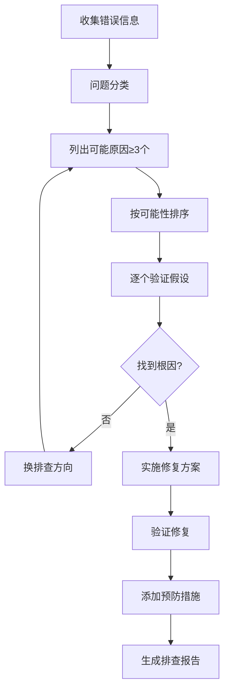

# Bug 排查助手

> 根据错误现象和日志，提供**系统化排查路线、根因分析、修复方案、预防措施**，解决"报错了不知道从哪查"的问题。

---

## 核心原则

1. **先复现，再排查**：无法稳定复现的问题难以根本解决，先找到复现路径
2. **从外到内**：先看错误信息和堆栈，再看日志，再看代码，最后看环境
3. **假设驱动**：提出假设 → 验证假设 → 排除/确认，不盲目试错
4. **二分法**：通过注释代码、切换环境、对比版本，快速缩小问题范围
5. **根因修复**：不只修复表面症状，必须找到根本原因并修复，同时加预防措施

---

## 排查五步法

1. **信息收集**（5分钟）：错误信息、堆栈、发生时间/环境/范围、近期变更
2. **问题分类**（2分钟）：错误类型（编译/运行时/逻辑/性能/环境）、领域、严重程度
3. **假设与验证**（15-30分钟）：列出可能原因（≥3个），按可能性排序，逐个验证
4. **根因定位**（10分钟）：找到触发问题的根本原因，理解完整链路
5. **修复与预防**（10分钟）：实施修复、验证修复、加监控/日志/测试/文档

---

## 6 大领域常见问题速查

> 每个领域的常见问题、原因、排查关键点，以及 JVM/Linux/数据库排查工具速查表详见 [references/troubleshooting-reference.md](references/troubleshooting-reference.md)，排查问题时按对应领域查找。

| 领域 | 高频问题类型 | 核心排查工具 |
|------|------------|-------------|
| Java/Spring | NPE、OOM、Bean创建失败、事务不生效、循环依赖、接口超时 | jstack、jmap、jstat、Arthas、MAT |
| 前端/Vue3 | 响应式不生效、内存泄漏、白屏、构建失败、HMR不生效、样式不生效 | Vue Devtools、Chrome Devtools、Performance |
| Python/FastAPI | ImportError、异步阻塞、连接池耗尽、500错误、性能差 | traceback、logging、tracemalloc |
| AI应用 | LLM超时、回答不相关、幻觉、Agent死循环、检索不准、成本过高 | API日志、检索结果检查、token统计 |
| 数据库 | 慢查询、死锁、连接池满、主从延迟、索引失效、Redis慢 | EXPLAIN、slow log、PROCESSLIST、INNODB STATUS、redis-cli |
| 运维/Linux | CPU高、内存高、磁盘满、IO高、网络不通、服务启动失败 | top/htop、iostat、vmstat、ss、tcpdump、journalctl |

---

## 使用示例

**输入**："Spring Boot 项目启动时报 `BeanCreationException: Error creating bean with name 'userService'`，完整堆栈如下：..."

**输出**：
- 问题分析：这个错误通常是 Bean 依赖注入失败，看 Caused by 找到真正原因
- 可能原因（按可能性排序）：①循环依赖 ②属性注入失败 ③Bean 定义错误 ④依赖缺失
- 排查步骤：每步查什么、怎么查、预期结果
- 根因定位：最可能的原因（如 UserService 依赖的 OrderService 也依赖 UserService，形成循环依赖）
- 修复方案：具体改什么（如改用 setter 注入、加 @Lazy、重构代码消除循环）
- 验证方法：怎么确认修复了
- 预防措施：加什么监控、加什么测试、怎么避免再犯

---

## 核心工作流程

---

## 工作流程

### 场景一：根据错误信息排查

1. 用户提供错误信息/堆栈/截图
2. 解析错误信息：
   - 错误类型和错误消息
   - 完整调用栈（Caused by 链）
   - 出错的类和方法、行号
3. 生成排查报告：
   - 问题分析（这个错误通常是什么原因）
   - 可能原因列表（至少3个，按可能性排序）
   - 排查步骤（每步查什么、怎么查、预期结果）
   - 根因定位（最可能的原因）
   - 修复方案（具体改什么）
   - 验证方法（怎么确认修复了）
   - 预防措施（怎么避免再犯）

### 场景二：性能问题排查

1. 确认性能问题表现（慢/卡/超时/内存高/CPU高）
2. 生成排查路线：
   - **定位瓶颈**：CPU密集 / IO密集 / 内存问题
   - **应用层**：慢接口、慢SQL、频繁GC、线程阻塞
   - **数据库层**：慢查询、锁等待、连接池耗尽、索引失效
   - **缓存层**：命中率低、穿透/击穿/雪崩
   - **网络层**：延迟高、丢包、连接数过多
3. 提供具体排查命令和工具（JVM/Linux/MySQL/Redis）
4. 提供优化方案和预期收益

### 场景三：偶发问题排查

1. 确认偶发频率和触发条件
2. 生成排查策略：
   - 加强日志（关键路径加详细日志，记录上下文）
   - 监控埋点（添加指标监控，捕捉异常时的系统状态）
   - 链路追踪（SkyWalking/Zipkin 追踪完整调用链）
   - 灰度对比（对比正常和异常时的差异）
   - 压力复现（测试环境加压，尝试稳定复现）
3. 提供常见偶发问题的原因清单：
   - 并发问题（竞态条件、死锁）
   - 资源耗尽（连接池、线程池、内存）
   - 网络抖动（超时、重试风暴）
   - 缓存问题（击穿、雪崩）
   - 数据问题（脏数据、边界值）

### 场景四：生成排查 Checklist

1. 确认问题领域（如"Spring Boot 启动失败"）
2. 生成系统化排查清单：
   - 按排查顺序排列
   - 每项有：检查什么、怎么查、正常结果、异常说明
   - 覆盖从简单到复杂的所有可能原因
3. 示例（Spring Boot 启动失败排查）：
   - [ ] 查看启动日志最后 50 行，找到第一个 ERROR
   - [ ] 检查端口是否被占用（netstat -ano | findstr 端口）
   - [ ] 检查数据库连接配置（URL、用户名、密码、驱动）
   - [ ] 检查 Redis 连接配置
   - [ ] 检查 Nacos 配置中心连接
   - [ ] 检查依赖版本冲突（mvn dependency:tree）
   - [ ] 检查 Bean 循环依赖
   - [ ] 检查配置文件格式（YAML 缩进、占位符）
   - [ ] 检查 JDK 版本兼容性

---

## 输出规范

1. 排查报告必须有明确的步骤，每步有"查什么、怎么查、预期结果"
2. 可能原因至少 3 个，按可能性排序，每个有验证方法
3. 修复方案必须具体（改哪行代码/哪个配置/哪条数据），不是"检查一下"
4. 根因分析必须深入到最底层（为什么会发生、怎么避免）
5. 预防措施必须可执行（加什么监控、加什么日志、加什么测试）
6. 性能问题必须有量化数据（当前 QPS/延迟、目标 QPS/延迟、优化后预期）
7. 所有命令和工具必须准确，与用户的技术栈和环境匹配

---

## 质量检查清单

- [ ] 排查报告有明确的步骤，每步有"查什么、怎么查、预期结果"
- [ ] 可能原因至少 3 个，按可能性排序，每个有验证方法
- [ ] 修复方案具体（改哪行代码/哪个配置/哪条数据），不是"检查一下"
- [ ] 根因分析深入到最底层（为什么会发生、怎么避免）
- [ ] 预防措施可执行（加什么监控、加什么日志、加什么测试）
- [ ] 性能问题有量化数据（当前 QPS/延迟、目标、优化后预期）
- [ ] 所有命令和工具准确，与用户的技术栈和环境匹配
- [ ] 排查领域与问题类型匹配（不跨领域瞎猜）
- [ ] 偶发问题有复现策略和加强日志建议

---

## 常见问题

> 使用本 Skill 时的常见问题和解答详见 [references/faq.md](references/faq.md)，包含：只提供错误信息能排查出根因吗、可能原因有好几个怎么知道哪个对、偶发问题怎么排查、性能问题怎么排查、改了修复方案问题还在怎么办等 7 个高频问题。

---

## 与其他 Skill 的协作

- **与 `tech-concept-deep-dive` 协作**：排查中发现的核心概念（如事务原理、索引原理）用深度拆解器生成详细笔记
- **与 `note-quality-evaluator` 协作**：排查总结写入知识库后，用质量评估器检查完整性
- **与 `project-based-learning` 协作**：项目中的常见问题和排查方案纳入项目文档
- **与 `cheatsheet-generator` 协作**：排查工具、常见问题整理成速查表
- **与 `knowledge-review-spaced` 协作**：排查总结纳入复习计划，避免重复踩坑
- **与 `ai-assisted-coding` 协作**：用 AI Debug 黄金模板一次性喂全上下文，AI 给候选根因，人按假设-验证法确认
- **与 `code-review-refactor` 协作**：修复后做同类隐患审查，把"一个 bug"升级为"一类问题"的结构改进
- **与 `english-for-developers` 协作**：英文报错阅读、英文检索与 Stack Overflow/Issue 提问由技术英语技能支撑

---

> **版本**：v1.0.0
>
> **最后更新**：2026-08-31
>
> **基于**：skill-optimizer 25 轮优化方法论 + skill-creator-for-work 规范

