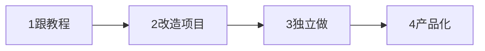

# 项目实战方法论（最高频核心文件）

> 目录
> 1. 为什么项目是普通背景者的第一硬通货
> 2. 项目认知：新手 6 大误区
> 3. 项目规划：灵感来源 / 难度分级 / 求职组合
> 4. 从 0 到 1 开发 9 步流程（每步含产出物）
> 5. 完整项目实现指南的写作模板
> 6. 工程化实践清单
> 7. 用 AI 辅助做项目
> 8. 独立解决问题能力（Debug / 查资料 / 提问）
> 9. 项目包装与求职衔接
> 10. 从教程到独立的四阶段进阶
> 11. Mermaid 图清单

---

## 1. 为什么项目是第一硬通货

对无名校背景、无相关经验的人，**可验证的项目成果同时替代"学历标签"和"工作经验"**。学校教知识点、教程教跟敲，但都不教"怎么从一个想法走到一个能上线、有人用、能讲清楚的产品"——这正是面试区分度所在。项目篇必须写到"新手照着做就能做出来"，而不是给个题目让他自己悟。

---

## 2. 项目认知：新手 6 大误区（每个写"为什么错+怎么做对"）

1. 以为要学完所有知识才能做项目 → 学完 20% 核心就动手，边做边学
2. 只做 TodoList/计算器级玩具项目 → 玩具只用于学习，不写进简历；求职项目要有技术含量和真实价值
3. 跟教程敲一遍就当成自己的项目 → 跟敲只是学习，须经"跟教程→改造→独立做→做产品"才算
4. 做完就扔，不部署不写文档不维护 → 能在线访问 + README + 演示才有说服力
5. 一个项目堆 10 个框架炫技 → 技术选型服务需求，小而美 > 大而全
6. 只写代码不思考需求和用户价值 → 企业要"能解决问题的工程师"，要讲得清为谁解决什么问题

---

## 3. 项目规划

### 3.1 灵感四大来源（每个来源给 5-10 个具体点子）
- 解决自己的问题（学习/生活/工作中的痛点，如笔记管理、面试整理、时间追踪、记账）
- 模仿现有产品并改进（做简化版或加新能力，如简化版 Notion、AI 增强版番茄钟）
- 技术驱动（想学某技术，找一个用得上它的项目：学 WebSocket 就做协作工具，学 RAG 就做文档问答）
- 垂直行业需求（结合用户熟悉的行业做 AI+行业工具，如简历优化、英语学习、合同审查）

### 3.2 难度分级 L1-L4（给判断标准 + 示例 + 能否写简历）
- L1 入门：跟教程能做，只用于学习，不写简历
- L2 进阶：独立做、有完整前后端和数据库，可写但竞争力一般
- L3 求职级：有技术亮点、工程化、能在线访问，简历核心
- L4 产品级：有真实用户/数据/迭代，面试降维打击

### 3.3 求职项目组合（一般 3 个，各证明一种能力）
| 项目 | 证明能力 | 优先级 |
|------|---------|--------|
| 一个完整全栈应用（增删改查+登录+部署） | 工程基础、全链路交付 | P0 |
| 一个方向核心应用（如 RAG/Agent 等目标岗位技术） | 方向专业能力 | P0 |
| 一个有真实用户的小产品 | 产品思维、自驱、闭环能力 | P1 加分 |

选项目原则：能做完 > 技术炫；小而美 > 大而全；真实需求 > 虚构需求；能上线 > 只在本地。

---

## 4. 从 0 到 1 开发 9 步流程（每步必须给"产出物"）

1. **需求分析**：问题陈述模板（谁在什么场景遇到什么问题、现有方案不足）；用户画像；用 MoSCoW 定 MVP（Must/Should/Could/Won't，第一版只做 Must）。产出：一页纸需求文档
2. **技术选型**：需求驱动、成熟优先、熟悉优先、适度尝新（只用 1 个新技术做亮点）；给 2-3 套可选栈。产出：技术选型表（技术/用途/为什么选/备选）
3. **架构设计**：画分层架构图；模块单一职责、低耦合；设计数据模型（ER 图/表结构/索引/关系）；设计 API（RESTful、接口表、错误码）。产出：架构图 + ER 图 + API 文档
4. **任务拆解（WBS）**：项目→模块→功能→任务，每任务 ≤4h；用看板（Todo/Doing/Done）；顺序=先搭骨架→再主流程→再辅助功能→最后优化部署。产出：带优先级和完成标准的任务清单
5. **开发实现**：先跑通端到端主流程再优化；用"垂直切片"（一个功能前后端数据库全做完再做下一个，而非先写完全部前端）；完成小任务即 commit、每天 push；卡点先自查 30 分钟，超 2h 要求助。产出：可运行代码 + 持续提交记录
6. **测试调试**：手动走查完整用户路径；核心逻辑写单元测试；测边界（空/超长/非法/并发/断网）；跨浏览器与移动端。产出：测试清单 + 核心单测
7. **部署上线（新手最薄弱，要最详细）**：
   - 前端：Vercel/Netlify（push 自动部署、免费、绑域名）
   - 后端：PaaS（Railway/Render，简单）或云服务器 + Docker + Nginx
   - 数据库：云数据库或服务器自建，做备份
   - 域名/HTTPS：买域名、国内服务器需备案、Let's Encrypt 免费证书
   - CI/CD：GitHub Actions 自动测试与部署；密钥用环境变量，禁止硬编码
   - 监控：日志、错误监控（Sentry 免费额）、可用性监控（UptimeRobot）
   - 产出：可在线访问 URL + 部署文档
8. **文档包装**：README（简介/截图/Demo/技术栈/功能/快速开始/目录结构/部署/亮点）、架构文档、3-5 分钟演示视频。产出：完整 README + 演示视频 + 在线 Demo
9. **推广迭代**：获取第一批用户（朋友、技术社区、目标用户聚集地）；收集反馈（反馈入口/访谈/埋点）；按反馈排期每 1-2 周一版。产出：用户数据 + 迭代记录

---

## 5. 完整项目实现指南的写作模板（每个项目一套）

一个能写进手册的项目指南必须包含：

1. 项目背景与目标（解决什么问题、目标用户、为什么选它练手/求职）
2. 功能清单（MVP 功能 + 扩展功能，MoSCoW）
3. 技术栈选型及**每一项为什么选**（含备选）
4. 系统架构图（Mermaid graph：前端/API/业务/数据/外部服务分层）
5. 数据模型设计（表结构、关系、索引）
6. API 设计（接口清单：方法/路径/入参/出参/错误码）
7. **分阶段开发步骤，细化到每天/每周做什么**（这是"照着做就能做出来"的关键）
8. 核心技术难点与解决方案（给完整可运行代码，不要只给片段）
9. 工程化配置（目录结构、规范、Docker、CI）
10. 部署方案（一步步到可访问）
11. 项目亮点（面试怎么讲、量化指标怎么造，如响应时间、并发、优化前后对比）
12. 该项目高频面试问题 15-20 个 + 回答思路
13. 扩展方向（做完后还能加什么，体现成长性）

> 至少给 3 个项目：一个传统全栈、一个目标方向核心（如 RAG）、一个进阶方向（如 Agent/多智能体）；可选第 4 个"有真实用户的垂直产品"。

---

## 6. 工程化实践清单（新手最易忽略，却是"专业感"来源）

- Git：分支策略（main/feature/fix/hotfix）、Conventional Commits、PR 流程、.gitignore，给好/坏 commit 示例
- 代码规范：Lint + Formatter 完整配置、EditorConfig、提交前自动检查（给完整配置文件内容）
- 测试：怎么写第一个单测（完整示例）、Mock 外部依赖、覆盖率、前后端分别怎么测
- CI/CD：GitHub Actions 完整 yml（安装→lint→测试→构建→部署）
- Docker：前后端 Dockerfile + docker-compose.yml（给完整可复制内容）
- 目录结构：给前端/后端标准目录树

---

## 7. 用 AI 辅助做项目（新手效率倍增器，但要有红线）

- Cursor 工作流：让 AI 搭项目骨架、Composer 多文件开发、Agent 模式重构、@引用上下文
- 给 10 个可直接复制的项目开发 Prompt（搭骨架/写某功能/写测试/重构/写文档等）
- AI Debug 黄金模板：报错信息 + 复现步骤 + 期望结果 + 实际结果 + 已尝试方案 + 相关代码
- AI 代码审查 Prompt（查 bug/性能/安全/规范）
- 五条红线：① AI 代码必须逐行看懂 ② 涉及安全和钱的代码重点自审 ③ 不看就不许 commit ④ 要能独立讲清每个模块 ⑤ AI 是结对伙伴不是替代品，架构判断在你

---

## 8. 独立解决问题能力（学校不教、职场第一重要）

- **Debug 五步法**：复现 → 定位范围 → 提假设 → 验证假设 → 修复并回归
- 读报错：看错误类型、从下往上读堆栈、第一个报错常是根因
- 检索：提炼英文关键词、site:stackoverflow.com、先看官方文档和 GitHub Issues
- 读源码/栈：从入口顺藤摸瓜、用调试器打断点而非无脑 print
- **高质量提问 7 要素**：问题描述 + 复现步骤 + 期望 + 实际 + 环境 + 已尝试 + 最小可复现代码/截图；注明提问社区与礼仪
- 每解决一个难题写一篇踩坑笔记，沉淀个人知识库

---

## 9. 项目包装与求职衔接（详见 06-job-hunting）

- GitHub 主页与仓库优化；README 用标准模板
- 演示三件套：在线 Demo 链接 + 3-5 分钟视频 + 截图/GIF
- 简历用 STAR-R 写项目，每条量化（给 3 个项目的简历描述范例）
- 面试讲法：3 分钟电梯版 + 10 分钟详细版 + 边画架构边讲
- 准备项目高频问题（通用 + 各项目专项），并预演"项目被质疑（太简单/教程很多/没用户）怎么回应"

---

## 10. 从教程到独立的四阶段进阶（每阶段给做法 + 验收标准）

1. 跟教程做：理解每行代码而非复制，能改参数看变化
2. 改造教程项目：加功能/换技术栈/换 UI/优化性能/重构，遇到问题自己查
3. 独立做小项目：不看教程走完 9 步流程，做 2-3 个
4. 做有真实用户的产品：推广、运营、用数据迭代

---

## 11. 项目篇必备 Mermaid 图（Obsidian 原生渲染）

- 项目能力体系图
- 9 步开发流程图（含迭代回环）
- 四阶段进阶图
- 每个项目的系统架构图
- 方向专项图（如 RAG 数据流图、Agent 状态流转图）
- 部署架构图

> 绘图要求：节点动宾短语、一张图一个主题、配文字解读，不要为画图而画图。
