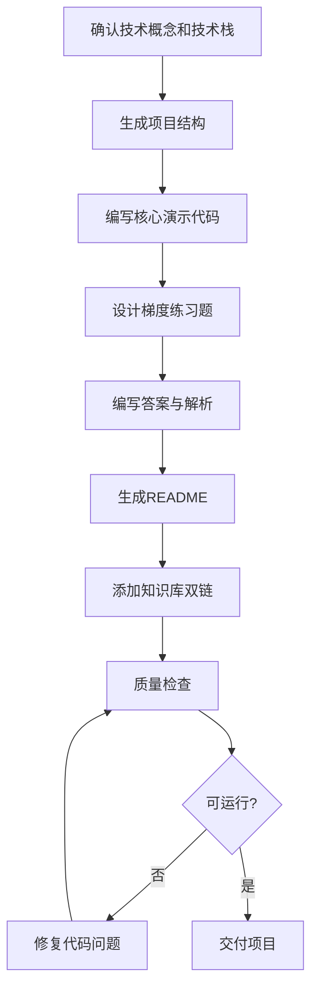

# 代码实践生成器

> 为技术概念生成**可独立运行、有梯度练习、有答案解析**的代码实践项目，解决"看懂了但写不出来"的问题。

---

## 核心原则

1. **可运行**：每个项目必须能在标准环境中直接运行，包含完整的依赖配置和启动说明
2. **最小完整**：项目只包含演示目标概念所需的最小代码，但结构完整、符合生产规范
3. **梯度练习**：练习题分基础→进阶→挑战三个难度，覆盖从"会用"到"精通"的路径
4. **答案解析**：每道题都有完整答案和详细解析，解析说明"为什么这样写"
5. **知识联动**：项目与知识库笔记双向链接，代码中的关键概念标注对应笔记

---

## 项目结构与模板概览

> 通用项目结构、README.md 模板、四大技术栈（Java/Vue3/Python/AI）的完整项目模板和配置文件示例详见 [references/project-starters.md](references/project-starters.md)，生成项目时按对应技术栈的模板执行。

| 技术栈 | 构建工具 | 核心目录 | 关键配置文件 |
|--------|---------|---------|-------------|
| Java/Spring Boot | Maven/Gradle | src/main/java, src/main/resources | pom.xml, application.yml |
| Vue3+TypeScript | Vite/npm | src/components, src/composables | package.json, vite.config.ts, tsconfig.json |
| Python/FastAPI | pip/venv | app/api, app/models, app/services | requirements.txt, main.py |
| AI/LangChain | pip/venv | src/chains, src/agents, src/retrievers | requirements.txt, .env.example, main.py |

**通用项目结构**：
```
project-name/
├── README.md              # 项目说明（概念介绍、运行步骤、练习指引）
├── 项目配置文件            # pom.xml / package.json / requirements.txt
├── src/                   # 源代码
│   ├── main/              # 核心演示代码
│   └── exercise/          # 练习题（只有题目，答案在 solutions/）
├── solutions/             # 练习题答案与解析（basic/advanced/challenge）
└── docs/                  # 补充文档（可选）
```

---

## 练习题设计规范

> 各难度级别的设计要求、四大技术栈的练习题示例、三种难度的答案解析模板详见 [references/exercise-patterns.md](references/exercise-patterns.md)，设计练习题时参考其中的示例和解析模板。

| 难度 | 数量 | 目标 | 形式 | 时间 |
|------|------|------|------|------|
| 基础题 | 3道 | 掌握基本用法，能照着写出来 | 填空、修改现有代码、实现简单功能 | 10-15分钟/道 |
| 进阶题 | 2道 | 理解底层机制，能灵活运用 | 实现完整功能、排查Bug、性能优化 | 30-45分钟/道 |
| 挑战题 | 1道 | 综合运用，达到生产环境水平 | 设计完整方案、实现复杂功能、源码级扩展 | 60-90分钟 |

---

## 使用示例

**输入**："生成一个 Vue3 响应式原理的练习项目，要包含 ref、reactive、computed 的用法和练习题"

**输出**：
- 完整项目结构（package.json、vite.config.ts、src/）
- 核心演示代码（ref/reactive/computed/effect 的用法演示）
- 6 道梯度练习题（基础 3 道 + 进阶 2 道 + 挑战 1 道）
- 每道题的完整答案和详细解析
- README.md（概念说明、运行步骤、练习指引、学习建议）
- 与 `[[Vue3响应式]]` `[[Proxy]]` 等知识库笔记双向链接

---

## 核心工作流程



---

## 工作流程

### 场景一：生成代码实践项目

1. 确认需求：
   - 目标技术概念/知识点
   - 技术栈（Java/Vue3/Python/AI）
   - 难度级别（基础/进阶/高级）
   - 是否需要练习题（默认需要）

2. 生成项目结构：按对应技术栈的模板生成完整项目目录和配置文件

3. 编写核心演示代码：
   - 代码必须可直接运行
   - 关键位置添加注释，标注对应知识库概念
   - 包含验证步骤（运行后能看到明确输出）

4. 设计练习题：按基础→进阶→挑战的梯度设计，每道题有明确的题目描述和验收标准

5. 编写答案与解析：
   - 答案代码完整可运行
   - 解析说明设计思路、关键决策、常见坑
   - 挑战题提供多种方案对比

6. 生成 README：包含概念说明、环境要求、运行步骤、练习指引、学习建议

7. 与知识库联动：
   - README 中添加对应知识库笔记的 `[[]]` 双链
   - 在知识库笔记中添加项目的引用链接

### 场景二：生成单题练习

1. 确认题目主题和难度
2. 生成题目描述（含输入输出示例、约束条件、验收标准）
3. 生成答案代码（含详细注释）
4. 生成解析（思路分析、关键步骤、常见错误、复杂度分析）
5. 生成相关题目（3-5道同类题，举一反三）

---

## 输出规范

1. 项目能在标准环境中直接运行（已验证启动命令）
2. 核心演示代码有明确的输出验证方式（运行后能看到明确结果）
3. 练习题数量：基础 3 道 + 进阶 2 道 + 挑战 1 道
4. 每道题有完整答案和详细解析（思路分析、关键步骤、常见错误、复杂度）
5. 代码注释中标注关键概念的知识库链接 `[[]]`
6. README 包含概念说明、环境要求、运行步骤、练习指引、学习建议
7. 项目结构符合对应技术栈的规范（目录结构、命名、配置文件）
8. 依赖版本明确，无模糊的"最新版本"
9. 挑战题提供多种方案对比（至少 2 种）
10. 所有代码可直接复制运行，无语法错误或缺失依赖

---

## 质量检查清单

- [ ] 项目能在标准环境中直接运行（已验证启动命令）
- [ ] 核心演示代码有明确的输出验证方式
- [ ] 练习题数量：基础3道 + 进阶2道 + 挑战1道
- [ ] 每道题有完整答案和详细解析
- [ ] 代码注释中标注了关键概念的知识库链接
- [ ] README 包含运行步骤和学习建议
- [ ] 项目结构符合对应技术栈的规范
- [ ] 依赖版本明确，无模糊的"最新版本"

---

## 常见问题

> 使用本 Skill 时的常见问题和解答详见 [references/faq.md](references/faq.md)，包含：生成的项目能直接运行吗、答案在哪里、可以只生成练习题吗、代码质量如何、难度怎么划分等 7 个高频问题。

---

## 与其他 Skill 的协作

- **与 `obsidian-knowledge-base-creator` 协作**：项目与知识库笔记双向链接，项目 README 可作为笔记的「实操」模块扩展
- **与 `tech-concept-deep-dive` 协作**：深度拆解器生成的代码示例可扩展为本 skill 的完整项目
- **与 `learning-path-planner` 协作**：学习路线中的项目练习，用本 skill 生成可运行的项目模板
- **与 `project-based-learning` 协作**：简单概念用本 skill 生成练习项目，复杂综合项目用项目驱动学习生成器
- **与 `ai-assisted-coding` 协作**：练习中用 AI 提效与引导，但先自己做再对照 AI，避免"AI 全包导致学不到"
- **与 `code-review-refactor` 协作**：练习题完成后做五维代码评审与小步重构，形成"生成→练习→评审→重构"闭环

---

> **版本**：v1.0.0
>
> **最后更新**：2026-08-31
>
> **基于**：skill-optimizer 25 轮优化方法论 + skill-creator-for-work 规范

