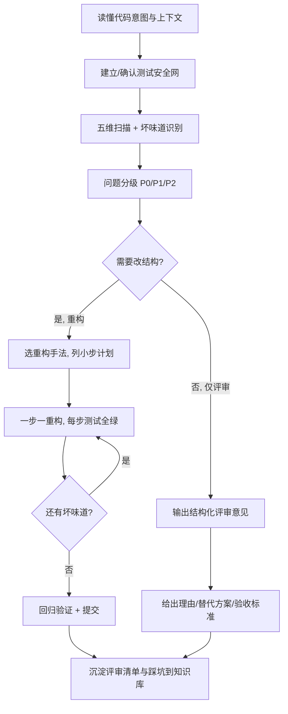

# 代码审查与重构教练

> 在"写得出"之后解决"写得好"：像资深 Reviewer 一样**发现问题、定位根因、小步安全重构、给出可执行评审意见**。它是代码侧的质量闭环，与评估笔记的 `note-quality-evaluator` 对称。

---

## 核心原则

1. **先理解再评判**：评审前先弄清这段代码"要解决什么问题、在什么约束下写的"，不脱离上下文挑风格毛病
2. **行为不变是重构的底线**：重构只改内部结构、不改可观察行为；没有测试先补特征测试，再动手（详见 references）
3. **小步快跑、随时可回退**：一次一个重构手法、一个 commit，每步测试全绿，禁止"大爆炸式重写"
4. **问题分级、区分轻重**：正确性/安全 > 性能 > 可维护性 > 风格；先阻断性问题，再优雅性问题，不为洁癖过度设计
5. **给意见必给理由和替代方案**：每条评审说清"问题是什么、为什么是问题、怎么改"，不写"这里不好，优化下"
6. **适度设计、拒绝炫技**：设计模式为真实变化点服务，YAGNI/KISS；不为了用模式而引入不必要的抽象

---

## 能力分级概览

| 等级 | 你能做到 | 典型产出 | 验收标准 |
|------|---------|---------|---------|
| R1 能挑错 | 找出明显 bug 与风格问题 | 问题清单 | 覆盖空值/边界/异常/命名 |
| R2 会按维评审 | 按 5 维系统化 Review 并分级 | 结构化评审报告 | 每条问题有位置、级别、理由、建议 |
| R3 会安全重构 | 在测试保护下用标准手法小步重构 | 重构计划+逐步 diff | 重构前后行为一致、测试全绿 |
| R4 懂原则与模式 | 用 SOLID/设计模式诊断并改进设计 | 结构级改进方案 | 说清取舍，不过度设计 |
| R5 会评审协作 | 专业给出/接收 Review、主导 PR 质量 | PR 评审结论、改进落地 | 意见可执行、团队可接受、闭环跟踪 |

> 坏味道目录、SOLID 与设计原则、重构手法表、五维评审清单、重构安全流程见 [references/review-refactor-playbook.md](references/review-refactor-playbook.md)。

---

## 使用示例

**输入**："帮我 review 这段 Service 代码，看看有没有问题、该怎么重构"（附代码）

**输出**：
- **结构化评审报告**：按正确性/安全/性能/可维护/测试五维，问题按 P0/P1/P2 分级，每条含位置、原因、最小修复建议
- **坏味道识别**：指出长函数、重复、深嵌套、魔法数、职责混杂等具体位置
- **根因诊断**：违反了哪条设计原则（单一职责/开闭/依赖倒置等）
- **重构计划**：先补哪些特征测试 → 按什么顺序用哪些重构手法 → 每步如何保持测试绿
- **重构后代码**：分步 diff（改前→改后）与设计取舍说明，而非一次性大改
- **验收方式**：如何用测试证明行为不变、还需补哪些用例
- 与 `bug-troubleshooter`、`ai-assisted-coding`、`code-practice-generator` 的衔接

---

## 核心工作流程

---

## 工作流程

### 场景一：对一段代码做完整 Code Review

1. **理解意图**：先复述这段代码要做什么、输入输出、调用方与约束，不确定先问
2. **五维扫描**：正确性与边界 → 安全 → 性能 → 可维护性（坏味道/原则）→ 测试覆盖
3. **问题分级**：P0 会出错/有安全隐患（必须改）、P1 设计/性能问题（应改）、P2 风格/可读性（建议改）
4. **结构化输出**：每条给位置、级别、问题、原因、修改建议；最后给总体结论（可合入/改后合入/打回重做）
5. **正向反馈**：写得好的地方也指出，评审不是单向挑刺

### 场景二：在测试保护下安全重构

1. **先建安全网**：重构前确保有覆盖现有行为的测试；没有就先写"特征测试"锁定当前行为（哪怕行为有 bug，也先记录再决定是否修）
2. **列坏味道与目标**：明确要消除哪些坏味道、目标结构是什么，避免边改边加需求
3. **选手法、拆小步**：每次只用一种重构手法（提取函数→改名→移动职责→…），每步独立可提交
4. **每步测试全绿**：改一点就跑测试，红了立刻回到上一绿状态，不累积改动
5. **行为不变验证**：重构前后跑同一套测试、对比关键输出；不借重构之名偷偷改逻辑（要改行为另开步骤）

### 场景三：用设计原则/模式改进设计

1. 从坏味道反推被违反的原则（如"每加一种类型都要改同一处 switch"→违反开闭原则）
2. 只在**有真实变化点/重复痛点**时引入模式，列出"不引入会怎样、引入的成本"
3. 优先最简单方案（KISS/YAGNI）：能用组合/策略解决就不上复杂框架
4. 给重构前后结构对比（职责划分、依赖方向）与取舍，说明何时该停止抽象
5. 模式落地后用测试与调用方代码验证确实降低了耦合、提升了扩展性

### 场景四：评审 AI 生成的代码

1. AI 代码默认"未经证实"，按五维清单逐条过，重点查正确性边界与安全红线（联动 `ai-assisted-coding`）
2. 让 AI 自陈"这段最可能出问题的 3 个点"，再独立验证，不被它的自信带偏
3. 检查是否过度设计、是否引入了项目里不存在的依赖/API（幻觉）
4. 用第二个会话/模型交叉评审，利用分歧发现盲点
5. 评审通过仍需"人能逐行讲清"，再合入

### 场景五：专业地给出与接收 Review（PR 协作）

1. **给意见**：对事不对人，用"这段代码/这里"而非"你"；P0/P1/P2 标注；nit 前缀表示吹毛求疵；每条可执行
2. **PR 评审流程**：先看设计与接口 → 再看主流程 → 最后抠细节与风格；大 PR 建议拆分
3. **接收意见**：先理解对方顾虑，有分歧用数据/示例讨论，不情绪化；认同的及时改并回复说明
4. **闭环**：每条意见都有"接受修改 / 解释保留 / 另开 issue"的明确去向，不遗漏
5. 沉淀团队高频问题为评审清单与编码规范，减少重复争论

---

## 输出规范

1. 评审报告固定五维：**正确性与边界、安全、性能、可维护性、测试**；问题统一标 P0/P1/P2
2. 每条问题四要素齐全：**位置（文件/函数/行）、问题、为什么是问题、修改建议**；禁止只说"优化一下"
3. 先给总体结论（可合入 / 改后合入 / 打回）与阻断项数量，再展开细节
4. 重构必须给"测试安全网现状 → 小步计划 → 逐步 diff → 行为不变验证"，不允许无测试的大改
5. 一次只推荐一种可落地的重构手法并说明触发的坏味道，不堆砌模式名词
6. 引入设计原则/模式时必须给取舍（成本、收益、何时不该用），坚持 KISS/YAGNI
7. 代码示例分语言给出、可编译可运行，标注文件名；改前改后对照呈现
8. 性能问题先要求量化/定位（证据），不做无依据的"感觉慢"式优化
9. 安全问题具体到攻击面与防护写法（注入/越权/敏感信息/依赖漏洞），不给模糊提醒
10. 评审语气对事不对人；产出与知识库联动（沉淀清单/原则笔记，用 `[[]]` 双链）

---

## 质量检查清单

- [ ] 已先理解代码意图与上下文，未脱离场景挑毛病
- [ ] 五维覆盖完整，问题按 P0/P1/P2 分级
- [ ] 每条意见含位置/问题/原因/建议，可直接执行
- [ ] 阻断性问题（正确性、安全）优先且无遗漏
- [ ] 重构前确认/补齐了测试安全网
- [ ] 重构小步进行，每步测试全绿、行为不变
- [ ] 设计原则/模式的引入有真实变化点与取舍说明，无过度设计
- [ ] 性能结论有证据，安全问题有具体防护
- [ ] 给了总体结论与验收/回归方式
- [ ] 评审意见对事不对人，沉淀为知识库双链笔记或团队清单

---

## 与其他 Skill 的协作

- **与 `bug-troubleshooter` 协作**：排查是"找当前错误根因"，本 Skill 是"主动发现潜在缺陷与坏味道并改进结构"；排查修复后用本 Skill 做同类隐患审查
- **与 `ai-assisted-coding` 协作**：AI 生成代码先过本 Skill 五维评审再合入；也可让 AI 按本 Skill 清单做初审，人做最终判断
- **与 `code-practice-generator` 协作**：练习题完成后用本 Skill 评审代码质量并给出重构方向，形成"生成→练习→评审→重构"闭环
- **与 `project-based-learning` 协作**：项目每个里程碑做一次自评审/重构，工程化质量直接决定简历项目说服力
- **与 `source-code-reader` 协作**：读优秀框架源码学"好结构长什么样"，为本 Skill 的重构目标提供范式
- **与 `system-design-planner` 协作**：系统设计定宏观架构，本 Skill 负责微观代码结构与实现质量
- **与 `note-quality-evaluator` 协作**：二者对称——一个评笔记、一个评代码，共用"分维度+分级+可执行建议"的评审范式
- **与 `tech-concept-deep-dive` 协作**：SOLID、设计模式、重构手法等概念用深度拆解器沉淀成原理笔记
- **与 `career-life-guidance` 协作**：本 Skill 落地其"代码工程素养（P1 支撑维度）"，也是面试中代码质量与设计能力的来源

---

> **版本**：v1.0.0
>
> **最后更新**：2026-09-08
>
> **基于**：skill-optimizer 25 轮优化方法论 + skill-creator-for-work 规范 + 与 note-quality-evaluator 对称的代码质量闭环
