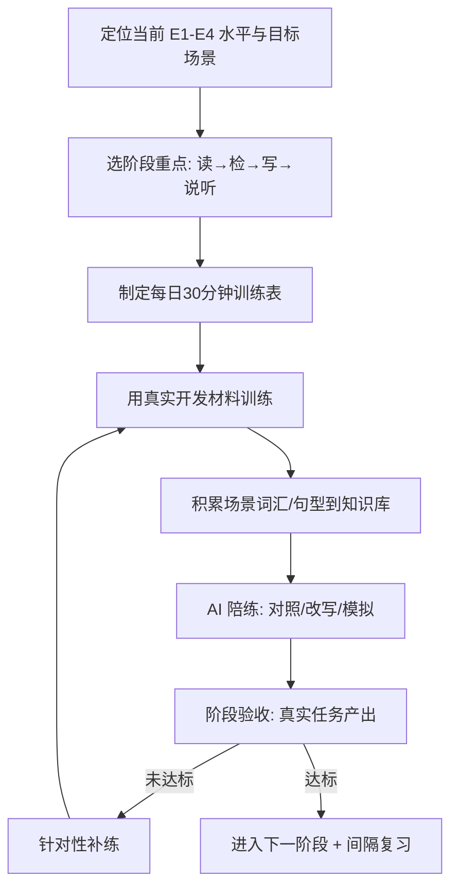

# 开发者技术英语训练教练

> 不教应试英语，只训练"能直接换钱、换效率、换机会"的开发者英语：**读得懂文档报错、搜得到答案、写得清协作内容、开得了英文会议与面试**。

---

## 核心原则

1. **工具定位，不为考试**：一切训练围绕真实开发任务（读报错、查资料、提 Issue、写 PR、开会），学完当天就能用在代码工作里
2. **输入优先、以用带学**：先攻克"读"（投入产出比最高），再补"写"，最后练"说听"；在真实材料里学，不孤立背单词
3. **场景化最小词汇**：只记高频技术词与固定句型（报错、文档、协作各一套），不背 GRE 式大词表；专业术语本来就是你要学的技术
4. **每天 30 分钟 > 周末 5 小时**：少量高频、长期不断，配合间隔复习，杜绝"收藏即学会"
5. **可验证、有验收**：每个阶段有明确产出（独立读完一篇官方文档、独立提一个英文 Issue、做一次英文站会汇报），不用"感觉变好"当成果
6. **AI 当陪练**：用 AI 做翻译对照、改写、模拟对话与面试，降低开口和动笔门槛（联动 `ai-assisted-coding`）

---

## 能力分级与阶段目标

| 阶段 | 读 | 检 | 写 | 说听 | 周期参考（每天30min） |
|------|----|----|----|------|---------------------|
| E1 扫盲 | 借助翻译看懂报错大意 | 会把中文报错翻成英文关键词 | 能写规范 Commit Message | —— | 0–1 个月 |
| E2 阅读流畅 | 独立读懂官方文档 Quickstart、SO 高赞回答 | 会组合关键词、用 site: 精准搜 | 能写 Bug 复现 Issue 草稿 | 能听懂技术视频大意（配字幕） | 1–3 个月 |
| E3 写作流畅 | 流畅读源码注释/Changelog/RFC | 能用英文在 SO/GitHub 追问 | 能独立写 PR 描述、README、回答问题 | 能做英文 Daily Standup 简报 | 3–6 个月 |
| E4 协作流畅 | 快速读英文技术资料并总结 | 能用英文精准描述问题并搜到解 | 能写技术博客、参与英文社区讨论 | 能参加英文会议、通过英文技术面试 | 6–12 个月 |

> 详细训练计划、场景词汇句型、模板与练习方法见 [references/tech-english-playbook.md](references/tech-english-playbook.md)。

---

## 使用示例

**输入**："我看官方文档和报错都要靠翻译，想 3 个月内能独立读文档、会用英文搜答案，给我每天 30 分钟的计划"

**输出**：
- 水平定位（对照 E1–E4 确认当前阶段与目标）
- 每日 30 分钟训练表（精读/泛读/词汇/写作/说听的时间配比，按阶段调整）
- 四类能力的**真实材料清单**（官方文档、Stack Overflow、GitHub Issue、技术视频从易到难）
- 可直接套用的模板：英文检索式、报错阅读步骤、Commit/PR/Issue 模板、站会句型
- 每周/每阶段验收清单（如"不借助翻译读完一篇 Getting Started 并复述步骤"）
- 用 AI 陪练的具体 Prompt 与方法
- 与 `ai-assisted-coding`、`source-code-reader`、`paper-reader`、`career-life-guidance` 的联动路径

---

## 核心工作流程

---

## 工作流程

### 场景一：攻克"读"——文档 / 报错 / Issue

1. 选与当前所学技术**直接相关**的材料（正在学的框架官方文档最好，即学即用）
2. 报错阅读训练：按"错误类型 → 关键异常词 → Caused by 链 → 报错位置"四步读，先猜大意再查证
3. 精读一篇：第一遍不查词抓主干、第二遍查高频生词、第三遍用自己的话复述步骤
4. 把反复出现的技术词/固定句式收进词汇笔记（联动知识库，间隔复习）
5. 逐步撤掉翻译：整段翻译 → 只查词 → 关键词辅助 → 裸读

### 场景二：攻克"检"——英文检索与提问

1. 把中文问题翻译成"技术关键词 + 错误名 + 框架名"的英文检索式（去掉口语和冗余）
2. 掌握精准搜索：`"具体报错"`、`site:stackoverflow.com`、`框架 + 版本 + 关键词`
3. 学会读搜索结果：先看官方文档与高票 SO，再看 issue，最后看博客
4. 进阶：用英文在 SO/GitHub 追问或补充信息（套用问题模板）
5. 建立个人"报错英文关键词 → 根因"对照笔记，越搜越快

### 场景三：攻克"写"——Commit / PR / Issue / README

1. 从最固定的 Commit Message 起步（Conventional Commits：feat/fix/docs/refactor/test/chore）
2. 再练 Issue：标题一句话定位 + 复现步骤 + 期望/实际 + 环境 + 已尝试（与 `bug-troubleshooter` 的提问结构同源）
3. 练 PR 描述：改了什么、为什么、怎么测、有无风险/截图
4. 用 AI 把中式英文改写为地道技术表达，对照差异学习（不是直接复制）
5. 每篇都过"一个陌生人能否照着复现/理解"的可读性自检

### 场景四：攻克"说听"——站会 / 会议 / 英文面试

1. 从最低成本的 Daily Standup 三句话开始：昨天做了什么 / 今天计划 / 有无阻塞
2. 积累固定会议句型（提问、确认、表达不同意见、求助、总结）
3. 听：从配字幕的技术会议视频 → 关字幕 → 1.25 倍速，精听+泛听结合
4. 用 AI 模拟英文技术面试/站会，录音回听，纠正发音与表达
5. 面试场景联动 `interview-prep-coach`：把 STAR 项目讲述翻译成英文并演练

### 场景五：制定长期训练计划

1. 定位当前 E 阶段、明确目标场景（读文档 / 进外企 / 远程 / 英文面试）与可投入时间
2. 按阶段给每日 30 分钟配比与每周任务，指定真实材料
3. 设每阶段可验证的验收产出与时间节点
4. 词汇句型沉淀进知识库并用 `knowledge-review-spaced` 间隔复习
5. 每两周复盘：哪类材料仍卡、调整材料难度与时间配比

---

## 输出规范

1. 先做**水平定位**再给计划，明确当前 E 阶段、目标阶段与场景，不发一份对谁都一样的通用表
2. 训练计划必须落到"每天几分钟做什么、用什么材料、产出什么"，可立即执行
3. 词汇/句型按**场景**给（报错/文档/commit/PR/issue/站会），每个配真实例句，不堆孤立单词
4. 所有写作模板给**可直接填空**的英文骨架（Commit/Issue/PR/Standup），并附中文说明
5. 每阶段给**可验证验收标准**（真实任务产出），不用"提升语感"这类虚词
6. 材料推荐给真实、主流、可获得的来源，并标注难度顺序；版本相关内容提示以官方为准
7. 区分"必须掌握"与"遇到再查"，优先保高频，替用户做减法
8. 与知识库联动：词汇/句型/模板沉淀为 `[[]]` 笔记并纳入间隔复习
9. 强调 AI 陪练方法并给具体 Prompt，但写作产出要求用户理解后再用，不直接代写了事
10. 全程使用用户所用语言讲解，英文示例配必要的中文对照

---

## 质量检查清单

- [ ] 已做 E1–E4 水平定位，计划贴合当前水平与目标场景
- [ ] 每日训练具体到分钟、材料、产出，可立即执行
- [ ] 读/检/写/说听四类都有覆盖路径与阶段侧重
- [ ] 词汇句型场景化、带真实例句，无孤立大词表
- [ ] Commit/Issue/PR/Standup 模板可直接填空
- [ ] 每阶段有可验证的真实任务验收标准
- [ ] 材料来源真实主流且按难度排序
- [ ] 给出 AI 陪练的具体方法与 Prompt
- [ ] 词汇/模板沉淀为知识库双链并可纳入间隔复习
- [ ] 与 ai-assisted-coding / source-code-reader / paper-reader / interview-prep-coach / career-life-guidance 衔接清楚

---

## 与其他 Skill 的协作

- **与 `ai-assisted-coding` 协作**：用 AI 做英文材料精读对照、写作改写、模拟英文站会/面试，是本 Skill 的主力陪练
- **与 `source-code-reader` 协作**：读框架源码注释、标识符命名、RFC/设计文档时同步训练技术阅读
- **与 `paper-reader` 协作**：英文论文/技术文章阅读共用长难句拆解与专业词汇方法，本 Skill 打基础、论文阅读做进阶
- **与 `bug-troubleshooter` 协作**：英文报错阅读、英文检索、Stack Overflow / Issue 提问共用"问题结构化表达"
- **与 `tech-article-writer` 协作**：英文技术博客/README 写作在中文写作能力之上做英文表达迁移
- **与 `interview-prep-coach` 协作**：把项目 STAR、技术概念、行为问题转成英文并模拟英文面试
- **与 `knowledge-review-spaced` 协作**：场景词汇与固定句型用间隔重复巩固
- **与 `career-life-guidance` 协作**：本 Skill 是其"英语能力职业落地（支撑维度）"的专职训练手册，服务外企/远程/国际机会

---

> **版本**：v1.0.0
>
> **最后更新**：2026-09-08
>
> **基于**：skill-optimizer 25 轮优化方法论 + skill-creator-for-work 规范 + career-life-guidance「英语职业落地」落地
