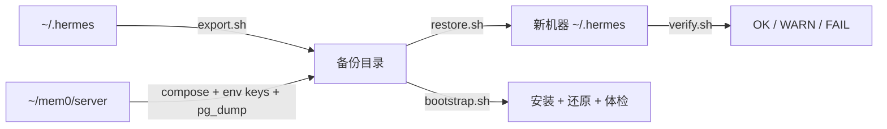

# ARCHITECTURE

## 组件

```
scripts/
├── export.sh      读 ~/.hermes（+ mem0 服务目录） → 写备份目录
├── restore.sh     读备份目录 → 写目标目录（含覆盖保护）
├── bootstrap.sh   编排：安装 → restore → verify → 待办清单
└── verify.sh      只读检查 → OK/WARN/FAIL
references/
├── inventory.md   目录分类（迁/不迁/为什么）
└── secrets.md     密钥四处 + 补齐 + 轮换
```

四个脚本彼此不 import，只通过**约定路径**交互：备份目录结构（`manifest.json` / `files/hermes/` / `mem0-service/`）。

## 数据流



## 分层模型

层级是**累积**的，不是三套独立逻辑：

```
config  ⊂  state  ⊂  full
```

- `config`：重建"行为"所需的最小集合（配置 + 技能 + 插件 + 键名）
- `state`：再加"历史"（记忆、会话、数据库）
- `full`：再加"代码与运行时"（源码、installs、tools、skins）

每一层都在同一个 `files/hermes/` 树下，还原逻辑不需要分支判断——这是选择"累积"而非"并列"的原因。

## 关键设计决策

| 决策 | 理由 | 代价 |
|---|---|---|
| 插件默认只记 `plugins.txt` | 单个插件可超 400 MB，且可按 sha 重建 | 需要网络重新 clone |
| mem0 插件始终整份复制 | 非 git 仓库，无 sha 可用；仅 292 KB | 可忽略 |
| SQLite 用 `backup()` 而非 `cp` | 运行中复制会拿到半写状态 | 需要 python3 |
| 排除 `.venv` / `tools/` | 平台绑定，重建优于复制 | `full` 层不保证"开箱即跑" |
| 密钥只留键名 | 备份目录常被同步/误提交 | 恢复后需人工补值 |

## 失败模式

| 失败点 | 表现 | 兜底 |
|---|---|---|
| 备份中断 | 目录存在但无 `manifest.json` | `restore.sh` 拒绝无 manifest 的目录 |
| 目标已存在 | 可能覆盖现有安装 | 默认拒绝；`--force` 先改名为 `.bak.<时间>` |
| 数据库被占用 | `verify.sh` 报 locked | 判为 WARN，不阻塞 |
| 插件缺失 | 配置启用但目录不存在 | `verify.sh` 明确列出名字 |
| 路径含 Windows 反斜杠 | `tar -C` 解析错乱 | 改为子 shell `cd` 再打包 |

## 非目标

- 不做增量/去重备份（每次全量，简单可靠）
- 不做云端同步（由用户决定备份放在哪）
- 不管理第三方插件的安装（只记录 sha，重装交给插件自己的流程）
