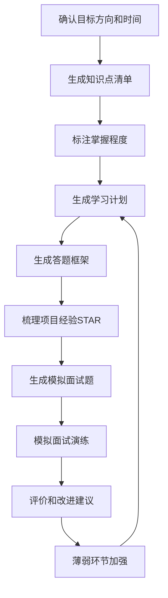

# 面试准备教练

> 为技术面试生成**系统化准备方案**，包含题型答题框架、知识点梳理、项目经验提炼、模拟问答，解决"不知道面试考什么、不知道怎么答题"的问题。

---

## 核心原则

1. **结构化答题**：每种题型有固定的答题框架，避免想到哪说到哪
2. **量化结果**：项目经验用数字说话（性能提升 X%、用户量 X、节省 X 成本）
3. **深度优先**：核心知识点深入到原理层面，不是背面试题答案
4. **模拟实战**：通过模拟问答检验准备效果，发现薄弱环节
5. **知识联动**：面试准备与知识库笔记联动，复习时直接查阅深度笔记

---

## 面试题型与答题框架概览

> 5 种面试题型（技术概念题、场景设计题、算法编程题、项目经验题、行为面试题）的完整答题框架和示例详见 [references/interview-reference.md](references/interview-reference.md)，准备面试时按对应题型的框架执行。

| 题型 | 答题框架 | 核心要点 |
|------|---------|---------|
| 技术概念题 | 定义→原理→特点→对比→实践 | 一句话定义 + 原理机制 + 项目实例 |
| 场景设计题 | 需求澄清→高层设计→核心细节→瓶颈优化 | 先问问题 + 量化估算 + trade-off |
| 算法编程题 | 理解题意→思路分析→代码实现→测试用例→优化 | 先说思路再写代码 + 边界测试 + 复杂度 |
| 项目经验题 | STAR 法则（背景→任务→行动→结果） | 重点说"你"做了什么 + 量化结果 |
| 行为面试题 | STAR + 反思 | 具体经历 + 学到了什么 + 如何改进 |

---

## 四大方向面试重点概览

> 四大方向（Java后端、前端开发、Python/AI工程、全栈/系统设计）的完整知识点清单、高频考点、项目面试重点详见 [references/interview-reference.md](references/interview-reference.md)，按目标方向准备。

| 方向 | 核心模块 | 高频考点 |
|------|---------|---------|
| Java 后端 | Java基础、Spring、微服务、数据库、消息队列、分布式 | HashMap原理、线程池、GC、Bean生命周期、事务传播、索引、分布式锁 |
| 前端开发 | JS、TS、Vue3、工程化、浏览器、网络 | 事件循环、Promise、响应式原理、虚拟DOM、HMR、重排重绘、HTTPS |
| Python/AI工程 | Python基础、Web框架、数据库、LLM应用、LangChain、部署 | GIL、异步处理、RAG系统设计、Agent架构、Prompt工程、成本优化 |
| 全栈/系统设计 | 系统设计、分布式、中间件、数据库、运维、安全 | 秒杀系统、Feed流、CAP、分布式事务、Kafka、分库分表、K8s |

---

## 使用示例

**输入**："我要面试 Java 后端高级开发，还有 2 周时间，帮我生成面试准备方案"

**输出**：
- 知识点清单（Java基础/Spring/微服务/数据库/消息队列/分布式，标注掌握程度）
- 14 天学习计划（每天学什么、学多久、验收标准，关联 `[[JVM垃圾回收]]` 等知识库笔记）
- 5 种题型答题框架（技术概念题/场景设计题/算法题/项目经验题/行为题）
- 项目经验梳理（2-3 个核心项目按 STAR 法则整理，每个项目 10 个追问问题）
- 模拟面试题 50 道（含参考答案和评分标准）
- 薄弱环节识别和针对性加强建议

---

## 核心工作流程

---

## 工作流程

### 场景一：生成完整面试准备方案

1. 确认目标：
   - 目标方向（Java后端/前端/Python AI/全栈）
   - 目标公司级别（大厂/中厂/创业公司）
   - 面试时间（还有多久准备）
   - 当前水平（自评哪些模块强/弱）

2. 生成知识点清单：按目标方向列出所有核心知识点，标注掌握程度（已掌握/需复习/未学习）

3. 生成学习计划：
   - 按优先级排序知识点
   - 分配每天的学习时间
   - 每个知识点关联知识库笔记 `[[]]`
   - 安排模拟面试时间

4. 生成答题框架：5 种题型的答题框架和示例

5. 生成项目经验梳理：
   - 提炼 2-3 个核心项目
   - 每个项目按 STAR 法则整理
   - 准备项目可能被追问的 10 个问题

6. 生成模拟面试题：
   - 技术概念题 20 道
   - 场景设计题 5 道
   - 算法编程题 10 道
   - 项目经验题 10 道
   - 行为面试题 5 道

### 场景二：生成单一题型答题框架

1. 确认题型（如"算法题怎么答"、"项目经验怎么说"）
2. 生成该题型的完整答题框架
3. 提供 2-3 个答题示例
4. 提供常见错误和注意事项
5. 提供练习建议

### 场景三：模拟面试

1. 确认方向和难度
2. 依次提问（技术概念→场景设计→算法→项目经验→行为）
3. 用户回答后，给出评价：
   - 回答评分（1-10分）
   - 优点
   - 不足和改进建议
   - 参考答案要点
4. 面试结束后生成总结：
   - 总体评分
   - 各模块表现
   - 薄弱环节
   - 改进建议和复习重点

### 场景四：项目经验提炼

1. 确认项目背景（技术栈、规模、你的角色）
2. 按 STAR 法则整理项目经验：
   - Situation：项目背景和挑战
   - Task：你的具体任务
   - Action：你做了什么（技术细节、决策、优化）
   - Result：量化结果（性能、成本、用户量）
3. 生成项目可能被追问的 10 个问题及答案要点
4. 生成项目中的技术亮点和难点总结

---

## 输出规范

1. 答题框架必须结构化，每步有明确的要点
2. 知识点清单必须标注优先级和掌握程度
3. 项目经验必须有量化结果（数字比形容词有说服力）
4. 模拟面试题必须有参考答案和评分标准
5. 学习计划必须可执行（每天学什么、学多久、验收标准）
6. 所有技术知识点关联知识库笔记 `[[]]`
7. 面试准备内容必须深入到原理层面，不是背答案

---

## 质量检查清单

- [ ] 答题框架结构化，每步有明确的要点
- [ ] 知识点清单标注优先级和掌握程度
- [ ] 项目经验有量化结果（数字比形容词有说服力）
- [ ] 模拟面试题有参考答案和评分标准
- [ ] 学习计划可执行（每天学什么、学多久、验收标准）
- [ ] 所有技术知识点关联知识库笔记 `[[]]`
- [ ] 面试准备内容深入到原理层面，不是背答案
- [ ] 四大方向面试重点与目标方向匹配
- [ ] 模拟面试评价有具体的改进建议，不是泛泛而谈

---

## 常见问题

> 使用本 Skill 时的常见问题和解答详见 [references/faq.md](references/faq.md)，包含：只有1周时间来得及吗、项目经验怎么讲才能打动面试官、算法题刷多少道够、系统设计题完全没有思路怎么办、被问到不会的问题怎么办等 7 个高频问题。

---

## 与其他 Skill 的协作

- **与 `tech-concept-deep-dive` 协作**：面试中涉及的核心技术概念用深度拆解器生成详细笔记，面试准备引用这些笔记
- **与 `system-design-planner` 协作**：系统设计面试题用系统设计生成器生成完整方案，面试教练在此基础上提炼答题框架
- **与 `algorithm-practice-trainer` 协作**：算法面试题用算法练习生成器生成练习题和解析
- **与 `project-based-learning` 协作**：项目经验从项目方案中提炼，项目中的技术亮点作为面试素材
- **与 `knowledge-review-spaced` 协作**：面试知识点纳入复习计划，间隔重复巩固
- **与 `cheatsheet-generator` 协作**：面试高频考点整理成速查表，考前快速复习
- **与 `english-for-developers` 协作**：外企/远程英文面试时，把自我介绍、STAR 项目、技术概念转成英文并模拟演练
- **与 `code-review-refactor` 协作**：面试中的代码质量、设计原则与重构题，用代码审查重构能力支撑
- **与 `career-life-guidance` 协作**：单次面试准备服从整体职业路线与求职策略，gap/转行叙事与职业总纲对齐

---

> **版本**：v1.0.0
>
> **最后更新**：2026-08-31
>
> **基于**：skill-optimizer 25 轮优化方法论 + skill-creator-for-work 规范

