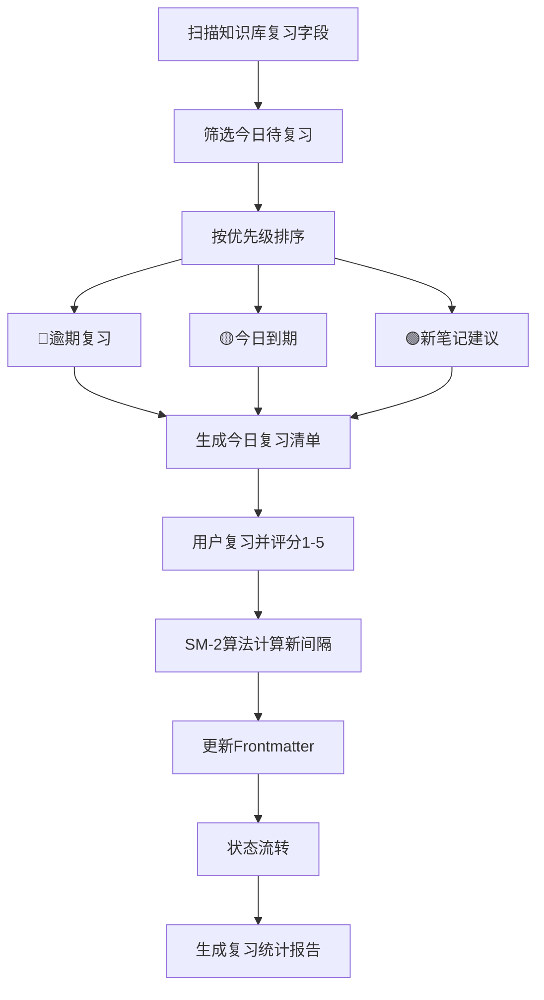

# 间隔重复复习助手

> 基于**艾宾浩斯遗忘曲线和 SM-2 算法**，为知识库笔记生成个性化复习计划，解决"学了就忘、不知道什么时候复习"的问题。

---

## 核心原则

1. **科学间隔**：基于 SM-2 算法自动计算复习间隔，在遗忘临界点复习，效率最高
2. **质量驱动**：复习质量决定下次间隔，记住了延长间隔，忘了缩短间隔
3. **状态跟踪**：每篇笔记有明确的复习状态（new→learning→reviewing→mastered），可回退
4. **数据驱动**：通过统计报告发现薄弱环节，针对性加强
5. **工具联动**：与 Obsidian Dataview 联动，自动生成今日复习清单，无需手动整理

---

## 复习间隔算法概览

> SM-2 算法的完整说明（艾宾浩斯遗忘曲线、SM-2 公式、间隔计算示例、参数调整）详见 [references/review-algorithm.md](references/review-algorithm.md)，计算复习间隔时按算法执行。

**核心公式**（唯一口径，推导见 references/review-algorithm.md）：
- 间隔主公式：第 1 次通过=1 天，第 2 次通过=6 天，第 n≥3 次=round(上次间隔 × ease_factor)
- ease_factor（EF，范围 1.3–3.0，默认 2.5）按本次质量 q 调整：q=5 +0.10、q=4 +0.05、q=3 不变、q=2 −0.15、q=1 −0.30
- 难度只决定**初始 EF**（⭐2.7/⭐⭐2.6/⭐⭐⭐2.5/⭐⭐⭐⭐2.3/⭐⭐⭐⭐⭐2.1），不再另设并行系数
- q≤2（没记住）：连续通过次数归零、间隔重置为 1 天、状态回退；q≥3 才算通过
- 粗粒度 ✅🟡❌ 分别按 q=5/3/1 换算，不另起一套算法

---

## Frontmatter 扩展字段与模板概览

> 完整的 Frontmatter 扩展字段定义、状态流转规则、今日复习清单模板、复习统计报告模板、Dataview 查询脚本、复习质量评分标准详见 [references/review-templates.md](references/review-templates.md)，生成复习清单和报告时按模板执行。

**核心扩展字段**：`review_status`（new/learning/reviewing/mastered）、`review_count`（连续通过次数，q≤2 归零）、`streak`（连续高质量次数）、`last_review`、`next_review`、`ease_factor`（1.3–3.0，默认 2.5，按难度初始化）、`interval`

**状态流转**：new → learning（首次评分后）→ reviewing（连续 2 次 q≥3）→ mastered（连续 3 次 q≥4）；出现一次 q≤2 则 streak 清零并回退一级（mastered→reviewing→learning），间隔重置为 1 天

---

## 使用示例

**输入**："生成今天的复习清单，我有 200 篇笔记，帮我筛选出今天需要复习的"

**输出**：
- 今日复习清单（按优先级排序）
  - 🔴 逾期复习（5 篇，按逾期天数降序）
  - 🟡 今日到期（8 篇）
  - 🟢 新笔记建议复习（3 篇）
- 每篇笔记：标题、分类、难度、复习次数、上次复习日期、状态
- 完成率统计（已完成/总数）
- 复习记录模板（每篇复习后记录质量 1-5 分，自动更新 Frontmatter）
- 薄弱环节提示（复习质量 <3 的笔记，建议用 tech-concept-deep-dive 深化）
- 与 `[[间隔重复]]` `[[SM-2算法]]` 等知识库笔记双向链接

---

## 核心工作流程

---

## 工作流程

### 场景一：生成今日复习清单

1. 扫描知识库中所有带复习字段的笔记
2. 筛选 `next_review <= 今天` 且 `review_status != mastered` 的笔记
3. 按优先级排序：
   - 🔴 逾期复习（next_review < 今天，按逾期天数降序）
   - 🟡 今日到期（next_review = 今天）
   - 🟢 新笔记建议复习（今天新创建的笔记）
4. 生成今日复习清单（按 [references/review-templates.md](references/review-templates.md) 的模板）
5. 每篇笔记复习后，记录复习质量（1-5分），更新 Frontmatter

### 场景二：新笔记纳入复习计划

1. 确认新笔记的标题、分类、难度
2. 在 Frontmatter 中添加复习字段：
   - review_status: new
   - review_count: 0
   - streak: 0
   - last_review: （空）
   - next_review: 今天（新笔记建议当天复习一次）
   - ease_factor: 按难度取初始值（⭐2.7/⭐⭐2.6/⭐⭐⭐2.5/⭐⭐⭐⭐2.3/⭐⭐⭐⭐⭐2.1，缺省 2.5）
   - interval: 1
3. 将笔记加入复习队列
4. 提示用户：建议今天完成第一次复习

### 场景三：记录复习结果并更新间隔

1. 用户复习完一篇笔记，给出复习质量评分（1-5分）
2. 按 SM-2 算法计算新的间隔和 ease_factor
3. 更新 Frontmatter：
   - review_count: +1
   - last_review: 今天
   - next_review: 今天 + 新间隔
   - ease_factor: 按质量调整
   - interval: 新间隔
   - review_status: 按状态流转规则更新
4. 提示用户：下次复习时间是 X 月 X 日

### 场景四：生成复习统计报告

1. 确认统计周期（本周/本月/自定义）
2. 扫描所有笔记的复习字段
3. 生成统计报告（按 [references/review-templates.md](references/review-templates.md) 的模板）：
   - 总体统计（总笔记数、已纳入复习、本月复习次数、平均质量、掌握率）
   - 复习状态分布
   - 按分类统计
   - 按难度统计
   - 薄弱环节（复习质量<3的笔记）
   - 下月建议
4. 报告存入知识库

### 场景五：与 Dataview 联动配置

1. 确认用户已安装 Dataview 插件
2. 提供常用 Dataview 查询脚本（详见 [references/review-templates.md](references/review-templates.md)）：
   - 今日待复习笔记
   - 逾期未复习笔记
   - 复习状态分布
   - 按分类统计掌握率
   - 本周复习记录
   - 薄弱笔记
3. 指导用户将查询脚本添加到笔记或仪表盘
4. 验证查询结果正确

---

## 输出规范

1. 每篇纳入复习的笔记都有完整的 Frontmatter 复习字段（7 个字段：review_status/review_count/streak/last_review/next_review/ease_factor/interval）
2. 今日复习清单按优先级排序（🔴逾期 → 🟡今日 → 🟢新笔记）
3. 复习质量评分有明确的标准（1-5 分的含义和表现）
4. 间隔计算符合 SM-2 算法，可解释（为什么是这个间隔）
5. 状态流转规则正确，可回退（mastered → reviewing）
6. 统计报告数据准确，与实际笔记一致（总笔记数、复习次数、掌握率）
7. Dataview 查询脚本能正确运行，返回预期结果
8. 薄弱环节有针对性的改进建议（不是只列问题）
9. 复习计划与知识库笔记双向联动（笔记有复习字段，复习清单链接笔记）
10. 所有日期格式统一（YYYY-MM-DD），间隔计算准确

---

## 质量检查清单

- [ ] 每篇纳入复习的笔记都有完整的 Frontmatter 复习字段
- [ ] 今日复习清单按优先级排序（逾期→今日→新笔记）
- [ ] 复习质量评分有明确的标准（1-5分的含义）
- [ ] 间隔计算符合 SM-2 算法，可解释
- [ ] 状态流转规则正确，可回退
- [ ] 统计报告数据准确，与实际笔记一致
- [ ] Dataview 查询脚本能正确运行
- [ ] 薄弱环节有针对性的改进建议
- [ ] 复习计划与知识库笔记双向联动

---

## 与其他 Skill 的协作

- **与 `obsidian-knowledge-base-creator` 协作**：新建笔记时自动添加复习字段，纳入复习计划
- **与 `note-quality-evaluator` 协作**：复习时发现内容有问题，触发质量评估，改进后重新纳入复习
- **与 `tech-concept-deep-dive` 协作**：薄弱笔记用深度拆解器重新生成，加深理解后再复习
- **与 `learning-path-planner` 协作**：学习路线中的知识点纳入复习计划，确保学过的不忘记
- **与 `interview-prep-coach` 协作**：面试前的高频考点纳入复习计划，间隔重复巩固
- **与 `cheatsheet-generator` 协作**：复习中的核心概念整理成速查表，辅助记忆

---

> **版本**：v1.1.0
>
> **最后更新**：2026-09-08
>
> **基于**：skill-optimizer 25 轮优化方法论 + skill-creator-for-work 规范
>
> **v1.1 变更**：统一 SKILL / review-algorithm / review-templates 三处算法为同一套 SM-2（1→6→×EF）；难度只决定初始 EF；质量统一 1-5 分（✅🟡❌=5/3/1）；新增 streak 字段；修复模板多余代码围栏

