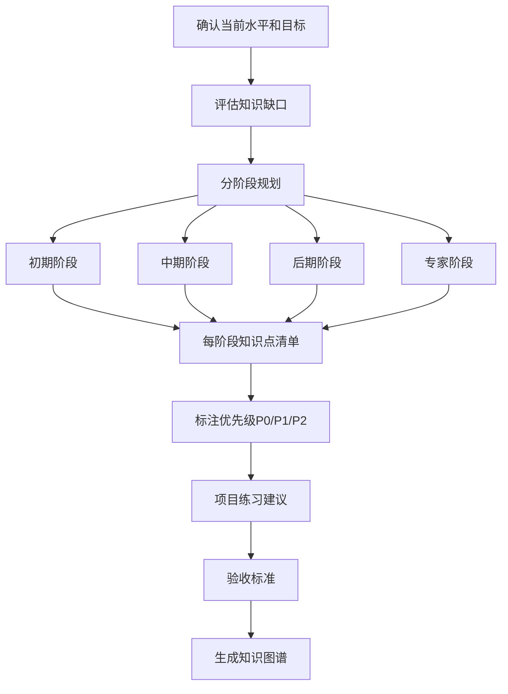

# 学习路径规划器

> 为全栈+AI工程化学习生成**有内容、可执行、可追踪**的分阶段学习路线，与 `obsidian-knowledge-base-creator` 联动，将路线中的知识点自动对应到知识库笔记。

---

## 核心原则

1. **由浅入深**：严格按「初期→中期→后期→专家」四阶段递进，不跳级
2. **可验收**：每阶段必须有明确的验收目标（能做什么、能答什么），不是模糊的"了解"
3. **项目驱动**：每阶段至少配 1 个实战项目，项目覆盖该阶段核心知识点
4. **优先级标注**：每个知识点标注 P0（必学）/ P1（重要）/ P2（选学）
5. **周期量化**：每阶段给出建议学习周期（周），每周给出学习量

---

## 使用示例

**输入**："我是 Java 后端初级开发，想在 6 个月内进阶到高级开发，帮我生成学习路线，当前水平：Spring Boot 会用但不懂原理，MySQL 基础，没接触过微服务"

**输出**：
- 6 个月分阶段学习路线（初期 2 个月 + 中期 2 个月 + 后期 2 个月）
- 每个阶段：学习目标、知识点清单（标注优先级 P0/P1/P2）、每周学习计划、验收标准
- 知识点详解：每个知识点的学习目标、核心概念、推荐资源、对应知识库笔记 `[[]]`
- 项目练习建议（每个阶段 1-2 个实战项目，用 project-based-learning 生成）
- 知识图谱（前置依赖关系，先学什么再学什么）
- 四大方向对比（Java/前端/Python/AI，确认方向选择）
- 学习技巧和时间管理建议
- 与 `[[Java进阶]]` `[[微服务]]` 等知识库笔记双向链接

---

## 核心工作流程



---

## 工作流程

### 步骤1：确认学习目标与约束

向用户确认（或从上下文中推断）：
- 目标技术栈/方向（如 Spring Boot 微服务、Vue3 源码、RAG 检索增强）
- 当前基础（零基础 / 有基础 / 资深）
- 每周可投入时间（小时）
- 学习目标（求职 / 进阶 / 项目落地 / 源码研究）

### 步骤2：生成四阶段学习路线

按以下模板生成，每阶段包含：

```markdown
## 第X阶段：阶段名称（建议 N 周）

**阶段目标**：一句话描述学完后能达到的水平

**核心知识点**：
| 序号 | 知识点 | 优先级 | 对应知识库笔记 | 建议学时 |
|------|--------|--------|--------------|---------|
| 1 | XXX | P0 | [[XXX笔记]] | 4h |

**验收目标**：
- [ ] 能独立完成 XXX
- [ ] 能解释 XXX 的底层原理
- [ ] 能排查 XXX 的常见问题

**项目练习**：
- 项目名称：XXX
- 项目描述：XXX
- 涉及知识点：XXX、XXX
- 验收标准：XXX

**学习技巧**：
- XXX
```

### 步骤3：生成学习总览表

在路线开头生成总览：

```markdown
## 学习总览

| 阶段 | 名称 | 周期 | 核心技能 | 项目 | 验收标准 |
|------|------|------|---------|------|---------|
```

### 步骤4：与知识库联动

- 每个知识点标注对应的知识库笔记链接（`[[]]` 格式）
- 如果知识库中没有对应笔记，标注 `📝待创建`，并建议使用 `obsidian-knowledge-base-creator` 的 `generate-note` 命令创建
- 生成的学习路线可直接保存为知识库中的 MOC 或独立笔记

---

## 四大方向知识图谱

> 各技术栈的详细知识点清单（初期/中期/后期/专家每阶段的具体知识点）请参考 [references/tech-stack-roadmaps.md](references/tech-stack-roadmaps.md)，生成路线时从中提取并按用户目标调整。

四大方向概览：
- **Java全栈**：Java基础→JVM→MySQL→Spring Boot→MyBatis→Redis→Spring Cloud→分布式→源码→云原生
- **Vue3+TypeScript**：TS基础→Vue3基础→组合式API→Router/Pinia→工程化→响应式原理→虚拟DOM→源码→跨端
- **Python全栈**：Python基础→高级特性→FastAPI/Django→ORM→异步→消息队列→部署→CPython源码→架构
- **AI应用开发**：LLM基础→Prompt工程→API调用→Embedding→RAG基础→LangChain→向量数据库→Agent→RAG进阶→微调→推理优化→部署

---

## 输出规范

1. 路线总字数控制在 3000-5000 字，确保信息密度
2. 知识点数量：初期 15-20 个，中期 20-25 个，后期 15-20 个，专家 10-15 个
3. 每个项目必须有明确的验收标准（可量化、可检查）
4. 优先级标注必须准确：P0 是不学就无法进入下一阶段的，P1 是重要但可延后的，P2 是拓展选学的
5. 生成的 Markdown 可直接保存到知识库，Frontmatter 遵循 `obsidian-knowledge-base-creator` 标准

---

## 质量检查清单

- [ ] 学习路线分阶段（初期/中期/后期/专家），每阶段有明确时间范围
- [ ] 每个知识点有明确的学习目标和验收标准（不是"学习XX"，而是"能独立完成XX"）
- [ ] 知识点按优先级排序（P0/P1/P2），先学核心再学扩展
- [ ] 每个阶段有项目练习建议（可验证学习成果）
- [ ] 学习资源具体（官方文档、推荐教程、经典书籍），不是"网上搜"
- [ ] 路线与用户当前水平匹配（入门不要求专家级内容）
- [ ] 四大技术栈路线覆盖核心知识点，无重大遗漏
- [ ] 知识图谱有明确的前置依赖关系（先学什么再学什么）
- [ ] 总学习时间估算合理（不超过用户可投入时间的 120%）
- [ ] 所有技术知识点关联知识库笔记 `[[]]`

---

## 与其他 Skill 的协作

- **与 `obsidian-knowledge-base-creator` 协作**：路线中的知识点对应到知识库笔记，缺失的笔记用 `generate-note` 创建；路线本身可保存为 MOC
- **与 `tech-concept-deep-dive` 协作**：路线中标注 P0 的核心概念，可用深度拆解器生成高质量笔记
- **与 `code-practice-generator` 协作**：路线中的项目练习，可用代码实践生成器生成可运行的项目模板
- **与 `project-based-learning` 协作**：复杂的综合项目，用项目驱动学习生成器生成完整项目方案
- **与 `career-life-guidance` 协作**：本 skill 管"技能学习路线"，职业人生总纲（方向选择/时间线/求职/长期发展）由人生指导手册统筹
- **与 `ai-assisted-coding` 协作**：路线各阶段标注"哪些环节用 AI 提效、哪些必须手写练基本功"

---

> **版本**：v1.0.0
>
> **最后更新**：2026-08-31
>
> **基于**：skill-optimizer 25 轮优化方法论 + skill-creator-for-work 规范

