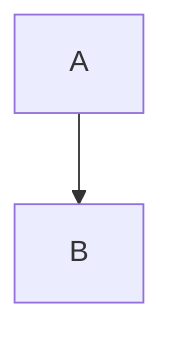

# Obsidian 知识库标准化生成器与质量保障体系

> 基于 **171 篇全栈+AI工程知识库文档**、**50+ 轮优化验证**、**4 类渲染问题修复实战** 提炼的完整知识库构建与维护标准。确保新建知识库在结构、内容、排版、元数据、导航体系、渲染兼容性等方面达到生产级水准。

---

## 📚 快速导航

### 核心文档

| 文档 | 用途 | 优先级 |
|------|------|--------|
| **本文档（SKILL.md）** | 完整功能规范、使用流程、质量保障体系 | ⭐⭐⭐⭐⭐ |
| [references/quality-assurance-and-repair.md](references/quality-assurance-and-repair.md) | **质量保障与修复指南**（4类问题诊断+修复+验证） | ⭐⭐⭐⭐⭐ |
| [references/obsidian-rendering-pitfalls.md](references/obsidian-rendering-pitfalls.md) | **Obsidian 渲染陷阱手册**（实战踩坑全记录） | ⭐⭐⭐⭐⭐ |
| [references/document-structure.md](references/document-structure.md) | 五段式文档结构详解 | ⭐⭐⭐⭐ |
| [references/frontmatter-standard.md](references/frontmatter-standard.md) | Frontmatter 字段标准与 YAML 陷阱 | ⭐⭐⭐⭐ |
| [references/formatting-guide.md](references/formatting-guide.md) | 排版规范（标题/表格/代码块/引用块） | ⭐⭐⭐⭐ |
| [references/advanced-visual-templates.md](references/advanced-visual-templates.md) | 高级视觉设计模板（动画卡片/Mermaid/精美表格） | ⭐⭐⭐⭐ |
| [references/multi-doc-integration-guide.md](references/multi-doc-integration-guide.md) | 多文档整合指南（10步整合法/三位一体解析） | ⭐⭐⭐ |
| [references/learning-path-planning.md](references/learning-path-planning.md) | **学习路径规划指南**（零基础到实战老手/三篇递进体系/知识点五要素） | ⭐⭐⭐⭐⭐ |
| [references/multi-round-review-guide.md](references/multi-round-review-guide.md) | **多轮复查优化指南**（内容深化→深度复查→优化补充→最终验证） | ⭐⭐⭐⭐⭐ |

### 工具脚本

| 脚本 | 功能 | 场景 |
|------|------|------|
| `scripts/init-kb.py` | 初始化知识库目录结构 | 新建知识库 |
| `scripts/generate-note.py` | 生成标准化笔记 | 单篇创建 |
| `scripts/generate-moc.py` | 生成 MOC 内容地图 | 板块导航 |
| `scripts/audit-kb.py` | 知识库健康检查 | 日常维护 |
| `scripts/validate-kb.py` | 严格质量校验 | 交付前检查 |
| **`scripts/repair-frontmatter.py`** | **修复 Frontmatter YAML 报错** | **开头报错** |
| **`scripts/repair-codeblocks.py`** | **修复代码块标记/内容被吞** | **流程图报错** |
| **`scripts/repair-headers.py`** | **修复标题级别混乱** | **标题混乱** |
| **`scripts/verify-kb.py`** | **综合验证（YAML+代码块+标题）** | **修复后验证** |
| `scripts/batch-generate-notes.py` | 从 JSON/YAML 列表批量生成多笔记 | 批量建笔记 |
| `scripts/fix-deadlinks.py` | 扫描双链、修复高频死链（建笔记/加别名） | 死链治理 |
| `scripts/fix-tags.py` | 合并重复标签、统一大小写、映射核心标签集 | 标签规范 |
| `scripts/progress.py` | 基于 Frontmatter 生成学习进度统计报告 | 进度跟踪 |
| `scripts/lint.py` / `scripts/config.py` | 脚本代码规范检查 / YAML 配置加载模块 | 工程化维护 |
| `scripts/kb.py`（根目录 `kb.bat` 为 Windows 启动器） | 统一 CLI 入口：`python scripts/kb.py init/note/audit/validate`（或根目录直接 `kb.bat ...`） | 一键操作 |

### 其他文档

| 文档 | 用途 |
|------|------|
| [README.md](README.md) | 项目首页，功能概览 |
| [QUICKSTART.md](QUICKSTART.md) | 5 分钟快速上手 |
| [docs/TEMPLATES-GUIDE.md](docs/TEMPLATES-GUIDE.md) | 模板使用与自定义指南 |
| [docs/OBSIDIAN-GUIDE.md](docs/OBSIDIAN-GUIDE.md) | Obsidian 配置与使用指南 |
| [docs/FAQ.md](docs/FAQ.md) | 常见问题解答 |
| [CHANGELOG.md](CHANGELOG.md) | 版本变更记录 |

**版本历史**：v1.0 → v2.0 → v2.1 → v2.2 → v2.3 → v2.4 → v2.5 → v2.6 → v3.0 → v3.1 → v3.2 → v3.3 → v3.4 → v3.5 → v4.0 → v4.1 → v5.0 → v5.1 → v6.0 → v6.1 → **v6.2（当前）**

v5.0 核心升级：基于 171 篇文档实战验证，新增完整质量保障与修复体系，解决 Obsidian 渲染四大类问题。
v5.1 核心升级：基于 14 篇标题级别严重混乱文档的深度修复实战，全面升级标题级别修复体系——两类根因分析（代码块标记损坏+子章节级别错误）、3步诊断法（H2数量阈值/代码模式匹配/代码块状态机）、5条修复铁律、14个实战案例验证。
v6.0 核心升级：基于"Python三文档从零基础到实战老手"大型重写实战（3篇文档从86KB扩充至752KB，内容量提升9倍），新增递进学习文档生成体系——知识点五要素标准（概念解释+原理说明+可运行代码+使用场景+常见坑点）、三篇递进体系（入门篇→进阶篇→实战篇）、学习路径规划规范、章节总结与梯度练习题规范；新增多轮复查优化流程（第一轮内容深化→深度内容复查→第二轮优化补充→第三轮最终验证），确保生成的知识库文档内容更基础、全面、细致，符合从零基础新手到实战老手的学习路程。

v6.2 核心升级：针对"代码类知识点懂了用法却看不懂底层"的痛点，在五要素"原理说明"之上新增**强制的『底层逻辑四步拆解』**——①运行链路（配 Mermaid 时序/流程图）②源码定位（贴 `包名.类名#方法` 与关键源码/字节码片段并逐行注释）③可自证（断点/日志/`javap -c`·`dis.dis()`/`timeit` 最小实验，结论可被读者复现）④设计权衡（为什么这样设计、代价与替代方案）；入门篇可只做第1步并标注"底层见进阶篇"，进阶/实战篇必须四步齐全。已同步到场景六编写铁律、验收清单、learning-path-planning.md、document-structure.md 与 multi-round-review-guide.md。

---

## 核心标准概览

| 维度 | 标准 | 参考文件 |
|------|------|---------|
| 目录结构 | 11 个顶级分类，编号前缀，层级清晰 | `references/directory-structure.md` |
| Frontmatter | 10 个标准字段，YAML 严格可解析，pre 字段流序列格式 | `references/frontmatter-standard.md` |
| 标签体系 | 核心标签 77 个，按技术领域分类 | `references/tag-taxonomy.md` |
| 文档结构 | 概述→原理→实操→问题→拓展 五段式 | `references/document-structure.md` |
| 排版规范 | 标题层级严格（1个H1）、代码块闭合规范、引用块统一 | `references/formatting-guide.md` |
| 高级视觉设计 | HTML/CSS动画卡片、Mermaid流程图、精美表格 | `references/advanced-visual-templates.md` |
| 多文档整合 | 10步整合法、篇→章→节四层结构、三位一体深度解析 | `references/multi-doc-integration-guide.md` |
| **质量保障** | **4类渲染问题诊断+修复+验证闭环** | **`references/quality-assurance-and-repair.md`** |
| **渲染兼容** | **Obsidian 渲染陷阱全记录与规避方案** | **`references/obsidian-rendering-pitfalls.md`** |
| MOC 结构 | mindmap总览+学习路线表+文档索引+快速导航 | `assets/moc-template.md` |
| 项目实战文档 | 项目概述+核心原理+分步实操+常见问题+进阶+验收标准 | `assets/project-template.md` |
| 8种文档类型 | 通用笔记/MOC/首页/学习路线/项目/面试题/资源/枢纽 | `assets/` 9个模板（通用笔记含标准+原子两个模板） |
| **学习路径规划（v6.0新增）** | **零基础到实战老手四阶段、三篇递进体系、知识点五要素、章节总结与梯度练习题** | **`references/learning-path-planning.md`** |
| **多轮质量复查（v6.0新增）** | **内容深化→深度复查→优化补充→最终验证 四轮闭环** | **`references/multi-round-review-guide.md`** |

---

## 使用流程

### 场景一：从零初始化新知识库

1. **确定主题**：明确知识库的核心领域
2. **（可选）准备配置文件**：复制 `assets/config-template.yaml`，或使用 `themes/` 主题预设
3. **生成目录结构**：运行 `scripts/init-kb.py`，自动生成分类目录骨架
4. **生成首页与导航**：基于 `assets/home-template.md` 生成 Home 首页、综合导航 MOC
5. **复制 Obsidian 配置**：自动将 `assets/obsidian-config/` 复制到 `.obsidian/` 目录
6. **生成各板块 MOC**：为每个顶级分类生成标准化 MOC
7. **批量生成核心笔记**：使用 `scripts/generate-note.py`，基于五段式模板
8. **建立双链网络**：在笔记间建立 `[[]]` 双链，确保无孤立文档
9. **质量校验**：运行 `scripts/verify-kb.py` 检查 Frontmatter、代码块、标题级别

### 场景二：对现有知识库进行内容深化与流程图补充

> 基于 171 篇文档实战验证的多轮迭代流程

1. **第一轮：内容深化**
   - 按五段式结构检查每篇文档的完整性
   - 补充缺失的概述/原理/实操/问题/拓展模块
   - 为核心知识点添加三位一体深度解析（作用/原理/用法要点）
   - 每章末尾添加 💡深度讲解 + 📝精简总结
   - 文档尾部添加关联笔记/前置知识/标签/返回首页

2. **第二轮：视觉增强**
   - 为原理模块添加 Mermaid 流程图/架构图
   - 为核心概念添加 HTML/CSS 动画卡片（4种模板×4套配色）
   - 优化表格样式，添加对比表格

3. **第三轮：质量检查**
   - 运行 `scripts/verify-kb.py` 全面验证
   - 检查 Frontmatter YAML 是否可解析
   - 检查代码块是否全部闭合
   - 检查标题级别是否规范（1个H1，无跳跃）
   - 对发现的问题运行对应修复脚本

4. **迭代循环**：每轮修复后重新验证，直到所有指标达标

### 场景三：修复 Obsidian 渲染问题

> 这是 v5.0 新增的核心能力，基于 4 类实战问题提炼

#### 问题A：文档开头报错（Frontmatter YAML 解析失败）

**症状**：Obsidian 打开文档后，顶部显示 YAML 错误或属性面板异常。

**常见根因**：
- Frontmatter 中混入了 ``` 代码块标记（批量处理时意外插入）
- `pre` 字段中 `[[wiki-link]]` 方括号与 YAML 流序列语法冲突
- 出现 `[[[[link]]]` 畸形多括号

**修复步骤**：
```bash
# 1. 诊断：扫描所有文件的 Frontmatter 问题
python scripts/verify-kb.py --check frontmatter

# 2. 修复：自动移除 Frontmatter 内的 ```，统一 pre 字段格式
python scripts/repair-frontmatter.py --path "知识库路径"

# 3. 验证：确认所有 YAML 可解析
python scripts/verify-kb.py --check frontmatter
```

**预防规则**：
- Frontmatter 内绝对不能出现 ``` 标记
- `pre` 字段必须使用 `pre: ["[[link1]]", "[[link2]]"]` 格式
- 双链必须用双引号包裹在流序列中

#### 问题B：流程图报错 + 内容被吞进代码块

**症状**：Mermaid 图无法渲染，后续正文显示为代码样式，文档内容"消失"。

**常见根因**：
- 代码块结束标记被损坏为 `` `$lang ``（一个反引号+$lang）
- 结束标记带语言名（```text/```python）——结束标记必须是纯 ```
- 出现 4+ 反引号的畸形标记
- 连续两个 ``` 导致代码块提前关闭
- Python 代码块内嵌 ``` 时未用 4 反引号外层包裹

**修复步骤**：
```bash
# 1. 诊断：扫描代码块平衡状态
python scripts/verify-kb.py --check codeblocks

# 2. 修复：修复畸形标记，恢复语言标识，确保闭合
python scripts/repair-codeblocks.py --path "知识库路径"

# 3. 验证：确认所有代码块正确闭合，Mermaid 标识正确
python scripts/verify-kb.py --check codeblocks
```

**预防规则**：
- 代码块开头标记可带语言名：```python、```mermaid、```bash
- 代码块结束标记必须是纯 ```，**绝对不能带语言名**
- 代码块内含 ``` 时，外层必须用 4 反引号 ```` 包裹
- Mermaid 图必须用 ```mermaid 开头，不能用纯 ```

#### 问题C：标题级别混乱（v5.1 深度升级）

> **关键洞察**：标题级别混乱并非单一问题，而是**两类根因交织**的结果。其中"代码块标记缺失/损坏导致代码内容暴露为标题"占 90% 以上，是最主要的原因。简单地将 H2 降级为 H3 只会掩盖问题，必须将代码内容正确包裹进代码块。

**症状识别**：
- 文档出现多个 H1 大标题，或 H2 直接跳到 H4，目录结构异常
- **H2 数量异常多**（正常技术文档约 8-15 个，超过 25 个几乎一定有代码暴露问题）
- **大纲面板出现大量代码行作为标题**：bash/Python 注释、命令行、配置文件名、参数行、ASCII 目录树等出现在标题列表中

**两类根因（交织出现）**：

**根因一：代码块标记缺失/损坏 → 代码内容暴露为标题（占90%以上）**

代码块的开始或结束标记被损坏后，后续代码内容暴露在正文中，其中以 `#` 开头的行被 Markdown 渲染为标题。具体有 6 种暴露模式：

| 暴露模式 | 示例 | 被渲染为 |
|---------|------|---------|
| **注释行** | `# 配置 Celery  worker` | H1 |
| **命令行** | `celery -A app worker -Q email` | H2（误加##） |
| **配置文件名** | `requirements.txt`、`Makefile`、`redis.conf` | H2（误加##） |
| **参数行** | `--max_batch_size：最大batch size` | H2（误加##） |
| **ASCII 目录树** | `├── config/`、`└── app.py` | H2（误加##） |
| **模板内容** | 模板中的标题行、占位符 | H1/H2 |

**根因二：子章节标题级别错误**

本应是 H3/H4 的描述性子标题被设为 H2，导致 H2 数量膨胀、层级混乱。这类问题通常与根因一同时出现。

**3步诊断方法**：

1. **H2 数量阈值法**：H2 数量 > 25 的文档几乎一定有代码暴露问题（正常文档 H2 约 8-15 个）
2. **标题文本模式匹配**：扫描 H2 标题文本，匹配以下代码模式：
   - 以 `#` 开头的注释行
   - 含 `.py`/`.conf`/`.txt`/`.yaml`/`.json`/`.md` 等文件名后缀
   - 以 `--` 开头的参数行
   - 以命令行工具名开头（pip/python/docker/git/npm/curl/apt/sudo/cd/ls 等）
   - ASCII 目录树特征（`├──`、`└──`、`│`）
3. **代码块状态机检查**：暴露的标题往往在未闭合的代码块之后，检查代码块开闭平衡

**5条修复铁律（极其重要）**：

> ⚠️ **铁律1：代码内容必须包裹进代码块，绝不能简单降级为 H3**
> 如果一行是 `# 注释`，它应该在代码块内，而不是变成 `### 注释`。降级只是掩盖问题，代码内容在正文中仍然是错误的。

> ⚠️ **铁律2：只有子章节标题才降级（H2→H3/H4/H5），保持层级连续**
> 判断标准：这行是真正的章节标题（描述性文字），还是代码内容？

> ⚠️ **铁律3：装饰性分隔线转为加粗普通文本**
> 如 `=== xxx ===`、`--- xxx ---` 转为 `**xxx**`，不应作为标题。

> ⚠️ **铁律4：只改格式不改内容**
> 修复标题级别时不修改任何文字内容，只调整 `#` 数量和代码块包裹。

> ⚠️ **铁律5：MOC/枢纽/系统梳理类文档除外（emoji开头H2或数字序号格式正常）**
> 它们用 emoji 开头 H2（如 `## 📚 核心文档`）或 `1. 概述` 格式是正常的，不应被误判为代码暴露。

**14个实战案例汇总**：

| 文档 | 修复前H2 | 修复后H2 | 主要问题 |
|------|---------|---------|---------|
| TensorRT-LLM推理加速 | 87 | 14 | 代码暴露严重 |
| Tasks-任务管理 | 75 | 14 | 代码暴露严重 |
| Python-类型注解与mypy | 73 | 14 | 代码暴露严重 |
| 主流开源模型架构对比 | 65 | 8 | 代码暴露+子标题错误 |
| Prompt版本管理 | 40 | 14 | 代码暴露 |
| Python-正则表达式与文本处理 | 31 | 11 | 代码暴露 |
| Obsidian-模板与快速输入 | 31 | 8 | 代码暴露 |
| Python-日志规范与结构化日志 | 30 | 8 | 代码暴露 |
| Celery-异步任务队列 | 30 | 8 | 代码暴露 |
| FastAPI-中间件与异常处理 | 27 | 8 | 代码暴露 |
| Python-性能测试与压测 | 27 | 11 | 代码暴露 |
| AI文档与PPT生成工作流 | 27 | 8 | 代码暴露 |
| Weaviate-向量数据库 | 26 | 13 | 代码暴露 |
| AI安全与对齐基础 | 26 | 13 | 代码暴露 |

**修复步骤**：
```bash
# 1. 诊断：扫描标题级别（v5.1增强：H2数量异常检测+代码模式标题检测）
python scripts/verify-kb.py --check headers

# 2. 修复：代码内容包裹进代码块 + 子章节标题降级 + 修复级别跳跃
#    注意：repair-headers.py 会自动识别代码模式标题，将其包裹进代码块而非简单降级
python scripts/repair-headers.py --path "知识库路径"

# 3. 验证：确认每篇文档恰好1个H1，H2数量在合理范围，无代码模式标题
python scripts/verify-kb.py --check headers
```

**预防规则**：
- 每篇文档**恰好 1 个 H1**（文档主标题）
- H2 数量在合理范围（标准技术文档 8-15 个，MOC/枢纽类除外）
- H2 为主要模块（一、概述/二、原理/...），H3 为模块内小节
- 禁止 H2 直接跳到 H4（必须经过 H3）
- **代码内容必须在代码块内**，不能暴露在正文——`# 注释` 是代码，不是标题
- **H2/H3 标题文本中禁止出现代码模式**（文件名后缀/命令行/参数行/注释符号/ASCII树）
- MOC/枢纽文档的 emoji 开头 H2 和数字序号格式是正常的，不适用上述限制

#### 问题D：综合问题排查

```bash
# 一键全面诊断
python scripts/verify-kb.py --path "知识库路径" --all

# 一键全面修复（按顺序执行 frontmatter → codeblocks → headers）
python scripts/repair-frontmatter.py --path "知识库路径"
python scripts/repair-codeblocks.py --path "知识库路径"
python scripts/repair-headers.py --path "知识库路径"

# 最终验证
python scripts/verify-kb.py --path "知识库路径" --all
```

**详细诊断与修复方案**：`references/quality-assurance-and-repair.md`
**渲染陷阱全记录**：`references/obsidian-rendering-pitfalls.md`

### 场景四：单篇标准化笔记生成

1. **确定主题**：明确笔记的核心概念和所属分类
2. **生成笔记**：运行 `scripts/generate-note.py --title "主题" --category "分类"`
3. **补充内容**：基于模板填充五段式结构
4. **建立关联**：添加相关笔记双链，更新对应 MOC
5. **设置元数据**：确认 Frontmatter 10 字段完整，YAML 可解析
6. **验证**：运行 `scripts/verify-kb.py` 检查单篇文档

### 场景五：多文档整合生成旗舰文档

1. **来源分析** → 2. **去重合并** → 3. **逻辑重排** → 4. **补充缺失** → 5. **统一格式**
6. **添加深度解析**（三位一体） → 7. **添加导言总结**（💡+📝） → 8. **视觉美化**
9. **知识关联** → 10. **质量检查**（含渲染兼容性验证）

**详细指南**：`references/multi-doc-integration-guide.md`

### 场景六：单文档深度重写 — 从零基础新手到实战老手的系统学习文档（v6.0 核心新增）

> 基于"Python三文档从86KB扩充至752KB（8.7倍）、21711行、727个代码示例"的大型重写实战提炼。**当用户要求"深度重写""全面完善""内容不够基础/全面/细致""写成学习文档"时，自动触发本场景**，而非普通格式优化。

#### ⚡ 触发条件（满足任一即触发深度重写）

当用户的需求包含以下关键词或意图时，**必须**触发本场景的深度重写流程，而非仅做格式修复：

| 触发关键词 | 示例 |
|-----------|------|
| "深度重写" / "全面重写" | "帮我深度重写这个文档" |
| "内容不够" / "太浅" / "不细致" | "这个文档内容不够基础、全面、细致" |
| "写成学习文档" / "学习路径" | "写成从零基础到实战的学习文档" |
| "完善内容" / "补充知识点" | "帮我完善这个文档的内容" |
| "像XX那样丰富" | "像Python那三个文档那样内容丰富" |
| 用户明确指定文档进行内容创作 | "帮我写一篇关于XX的完整文档" |

**与普通格式优化的区别**：
- 普通格式优化（场景二/三）：只修复Frontmatter/代码块/标题等格式问题，**不改变内容量**
- 单文档深度重写（本场景）：**内容量提升5-10倍**，每个知识点按五要素深度创作，达到"零基础能看懂、实战老手有收获"的标准

#### 📊 深度重写量化质量门槛（必须达标）

| 指标 | 最低标准 | 推荐标准 | 验证方法 |
|------|---------|---------|---------|
| **文档篇幅** | ≥100KB / ≥3000行 | ≥200KB / ≥6000行 | 文件大小统计 |
| **章节数量** | ≥8个H2章节 | ≥12个H2章节 | 标题统计 |
| **代码示例数** | ≥100个 | ≥200个 | 代码块计数 |
| **知识点五要素覆盖率** | ≥90% | 100% | 随机抽查10个知识点 |
| **每章代码示例** | ≥8个 | ≥15个 | 逐章统计 |
| **每章字数** | ≥3000字 | ≥5000字 | 字数统计 |
| **章节总结覆盖率** | 100% | 100% | 每章检查💡+📝+🎯 |
| **常见坑点数** | ≥30个 | ≥50个 | 坑点标记统计 |
| **面试高频考点标注** | ≥15个 | ≥30个 | 面试考点标记统计 |
| **Mermaid图/表格数** | ≥10个 | ≥20个 | 图表统计 |

**参考基准**：Python三文档重写后平均250KB/篇、7000行/篇、240个代码示例/篇，这是深度重写的标杆。

#### 🔄 深度重写四步执行流程

##### 第一步：学习路径规划与大纲设计（产出：详细大纲）

1. **领域知识盘点**：
   - 收集3-5本该领域经典教材的章节目录
   - 收集2-3个知名在线课程的大纲
   - 查阅官方文档的目录结构
   - 整理面试高频考点清单
   - 合并去重，形成完整知识点清单

2. **知识依赖关系分析**：
   - 为每个知识点标注前置知识
   - 绘制知识依赖图（Mermaid graph）
   - 识别基础知识点和高级知识点
   - 检查是否有循环依赖

3. **章节逻辑排序**：
   - 按"是什么→为什么→怎么用→怎么用好→怎么用精"递进
   - 前置知识章节在前，后续知识章节在后
   - 相关知识点聚集在同一章节
   - 每章明确标注学习目标和前置知识

4. **输出详细大纲**：
   - 每个H2章节包含：章节标题、学习目标、前置知识、包含的H3知识点清单、预计代码示例数
   - 大纲必须覆盖该领域95%以上的核心知识点
   - 大纲确认后再开始编写

##### 第二步：按知识点五要素标准逐章深度创作（产出：完整文档内容）

**每个知识点（H3/H4级别）必须包含以下五要素，缺一不可**：

| 要素 | 占比 | 详细要求 | 反面教材 |
|------|------|---------|---------|
| **概念解释（通俗）** | 20% | 1句正式定义 + 1个生活化比喻 + 1句核心价值；避免一上来就讲技术细节 | "列表是一种有序的可变序列"（太抽象，无比喻） |
| **原理说明（深入）** | 25% | 核心机制说明 + 为什么这样设计 + 至少1个技术对比 + 配Mermaid原理图；**代码/框架/JVM/语法糖/并发/IO 类知识点，还必须走完下方『底层逻辑四步拆解』** | 只列API参数，不讲原理；或只写"底层做了优化，所以更快"却不给链路/源码/可复现实验 |
| **代码示例（可运行）** | 30% | **至少3个示例**：基础用法→进阶用法→完整场景；每个示例完整可独立运行；注释详细，关键代码每行有说明 | 只有1个简单示例，或代码不完整无法运行 |
| **使用场景/最佳实践** | 15% | 适用场景 + 不适用场景（说明原因） + 至少3条最佳实践（做法+原因） + 性能建议（带量化数据） | 只讲"怎么用"，不讲"什么时候用" |
| **常见坑点** | 10% | **至少2个坑点**，每个包含：错误现象（可复现） + 根本原因 + 正确做法 + 预防措施 | 只讲正确用法，不讲新手会犯什么错 |

**编写铁律**：
- 代码示例必须**完整可运行**，不能用"省略部分代码"、"其余类似"等敷衍
- 从简单到复杂循序渐进，第一个示例必须是"复制就能跑"的Hello World级别
- 每个代码示例下方标注**预期运行结果**
- 关键代码旁用`# ⚠️ 新手注意：...`标注易错点
- 标注**面试高频考点**：`> 🎯 面试高频：...`
- 对比其他语言差异：适合有其他语言基础的学习者

**⚙️ 代码类知识点·底层逻辑四步拆解（v6.2 新增，强制）**：凡涉及代码运行、框架机制、JVM/解释器、语法糖、并发、IO、序列化、网络请求等"跑起来才发生"的知识点，"原理说明"不能只给一句抽象结论，必须走完以下四步（**入门篇可只做第1步并标注"底层实现见进阶篇"；进阶篇/实战篇必须四步齐全**）：

1. **运行链路（内部依次发生什么）**：从你写下的那行代码/那个调用出发，到结果产出，内部经过哪些函数调用、数据转换、状态变化；配一张 Mermaid 时序图/流程图（谁调用谁、数据怎么流、在哪一步分叉或返回）。
2. **源码定位（真实逻辑在哪）**：指出该机制在框架/JDK/解释器/库中的具体位置（`包名.类名#方法`），贴 5–20 行关键源码或字节码片段，并逐行注释"这一行在做什么"；**禁止只说"底层做了优化"却不贴出那段代码**。
3. **可自证（读者怎么亲眼看到）**：给一个最小可复现实验，让读者自己运行就能验证原理——断点打在哪看调用栈、加哪行 print/log 看中间值、用 `javap -c` / `dis.dis()` / 反编译看字节码、用 `timeit` / JMH 跑出对比数据。**原理结论必须可被读者复现，不能只凭作者断言**。
4. **设计权衡（为什么是这样）**：这个机制解决了什么问题、不这么设计会怎样、代价（性能/内存/复杂度）是什么、有什么替代方案。

> ❌ 反面写法："列表推导式底层做了优化，所以比 for 循环快。"（无链路、无源码、无可复现实验，读者仍不知道快在哪）
> ✅ 正面写法：说明 CPython 把推导式编译成 `LIST_APPEND` 字节码循环，贴 `dis.dis()` 的输出片段，给一段 `timeit` 对比让读者自己跑出 20–30% 差距，再解释为什么这样能避免 append 的动态扩容开销。

##### 第三步：每章末尾添加标准模块（产出：总结+练习题）

每章（H2级别）末尾**必须**包含以下三个模块：

**1. 💡 本章深度讲解（3-5句话）**
- 本章最重要的概念是什么
- 为什么这个概念重要
- 与前后章节的关系
- 在实战中的价值

**2. 📝 本章精简总结（要点列表）**
- 核心概念（3-5个）
- 关键原理（2-3个）
- 常用操作（3-5个）
- 最佳实践（2-3个）
- 常见坑点（2-3个）
- 面试高频（2-3个）

**3. 🎯 梯度练习题**
- **基础题（⭐）2-3道**：考察基本概念记忆和简单用法，给简要答案
- **进阶题（⭐⭐）2道**：考察原理理解和综合运用，给思考方向
- **实战题（⭐⭐⭐）1道**：真实项目场景，给背景/需求/要求/验收标准/提示

##### 第四步：多轮复查优化（产出：最终高质量文档）

**第一轮：内容深化编写**
- 按详细大纲逐章编写
- 每个知识点按五要素标准创作
- 每章末尾添加总结和练习题

**深度内容复查（五大维度）**
1. **学习路径合理性**：知识点顺序是否符合认知规律，前置知识是否先讲
2. **逻辑顺序**：章节内和章节间的逻辑是否连贯
3. **结构完整性**：五段式结构、五要素、章节总结是否完整
4. **内容深度**：原理讲解是否深入，最佳实践和坑点是否充足
5. **内容缺失**：对照领域知识清单，是否有重要知识点遗漏

**第二轮：优化补充**
- 按复查问题清单优先级修复（P0缺失>P1错误>P2浅薄>P3优化）
- 补充缺失的知识点和代码示例
- 深化薄弱知识点的原理讲解
- 补充常见坑点和面试考点

**第三轮：最终验证**
- **格式验证**：Frontmatter YAML可解析、代码块平衡、标题级别正确（用verify-kb.py）
- **内容抽查**：随机抽取10个知识点检查五要素完整性
- **量化指标验证**：对照"深度重写量化质量门槛"逐项检查
- **整体质量评估**：所有维度评分≥4分（满分5分）才能交付

#### ✅ 深度重写验收清单（交付前必须全部勾选）

**格式质量**
- [ ] Frontmatter YAML 100%可解析，10字段完整
- [ ] 代码块开始/结束标记100%平衡
- [ ] 每篇恰好1个H1，无标题级别跳跃
- [ ] 无代码行游离在代码块外
- [ ] 无连续多个---分隔符

**内容质量**
- [ ] 文档篇幅≥100KB（推荐≥200KB）
- [ ] 代码示例≥100个（推荐≥200个）
- [ ] 知识点五要素覆盖率≥90%（推荐100%）
- [ ] 代码/框架类进阶知识点已完成『底层逻辑四步拆解』（运行链路+源码定位+可自证实验+设计权衡），不是一句抽象结论
- [ ] 每章有💡深度讲解+📝精简总结+🎯梯度练习题
- [ ] 常见坑点≥30个（推荐≥50个）
- [ ] 面试高频考点标注≥15个（推荐≥30个）
- [ ] Mermaid图/表格≥10个（推荐≥20个）

**学习路径质量**
- [ ] 从零基础到实战老手递进，无知识断点
- [ ] 前置知识明确标注
- [ ] 章节顺序符合认知规律
- [ ] 有完整的学习路线图

**详细指南**：`references/learning-path-planning.md`、`references/multi-round-review-guide.md`

---

## 关键设计原则

### 1. 元数据优先 + YAML 严格可解析
每篇笔记必须有完整的 Frontmatter，且 YAML 必须能被严格解析。Frontmatter 内禁止出现任何 ``` 标记。`pre` 字段的双链必须用双引号包裹在流序列中。

### 2. 五段式内容结构
所有技术笔记遵循：概述→原理→实操→问题→拓展。

### 3. 标题级别严格性（v5.1 升级）
- **恰好 1 个 H1**：文档主标题
- **H2 数量合理范围**：标准技术文档 8-15 个（MOC/枢纽/系统梳理类文档除外）
- **约 15-25 个 H3**：模块内小节
- **少量 H4**：必要时使用
- **禁止级别跳跃**：H2 不能直接到 H4
- **H2/H3 标题文本禁止代码模式**：不得包含文件名后缀（.py/.conf/.txt 等）、命令行、参数行（--xxx）、注释符号（#）、ASCII 树字符（├──/└──）
- **MOC/枢纽文档例外**：emoji 开头 H2（如 `## 📚 核心文档`）或数字序号格式（如 `## 1. 概述`）是正常的，不适用上述数量和代码模式限制

### 4. 代码块闭合铁律
- 开头标记可带语言名：```python、```mermaid
- **结束标记必须是纯 ```**，不带任何语言名
- 代码块内含 ``` 时外层用 4 反引号 ````
- 所有代码块必须正确闭合，0 个未闭合

### 5. MOC 导航体系
每个顶级分类必须有 MOC，作为该板块的入口和索引。

### 6. 双链网络
笔记间通过 `[[]]` 建立关联，无孤立文档。

### 7. 多轮质量验证
内容深化后必须经过至少 3 轮质量检查：内容完整性 → 渲染兼容性 → 格式规范性。每轮修复后重新验证，直到全部达标。

### 8. 知识点五要素标准（v6.0 新增）
每个知识点必须包含五要素，缺一不可：
- **概念解释（通俗）**：生活化语言+类比，先定义后解释
- **原理说明（深入）**：底层机制+设计原因+技术对比
- **代码示例（可运行）**：完整可运行+详细注释+从简到繁
- **使用场景/最佳实践**：适用/不适用场景+推荐做法+性能建议
- **常见坑点**：新手易错+错误现象+原因分析+正确做法

### 9. 学习递进性原则（v6.0 新增）
- **从零基础到实战老手**：知识点按"是什么→怎么用→为什么→怎么用好→怎么用精"递进
- **三篇递进体系**：入门篇（会用）→进阶篇（懂原理）→实战篇（成专家），内容不重复，难度递增
- **每章有梯度练习题**：基础题（⭐）→进阶题（⭐⭐）→实战题（⭐⭐⭐），检验不同层次的掌握程度
- **前置知识明确标注**：每个知识点标注所需前置知识，确保学习路径无断点

---

## 质量保障体系（v5.0 核心）

### 四大质量维度

| 维度 | 检查项 | 达标标准 | 验证脚本 |
|------|--------|---------|---------|
| **Frontmatter** | YAML 可解析性、10字段完整性、pre字段格式 | 100% 文件 YAML 解析通过，0 个 ``` 混入 | `verify-kb.py --check frontmatter` |
| **代码块** | 开闭标记平衡、结束标记纯净、Mermaid标识、语言标注 | 0 个未闭合，结束标记100%纯``` | `verify-kb.py --check codeblocks` |
| **标题级别** | H1数量、级别跳跃、H2数量异常检测、H2/H3代码模式标题检测 | 每篇恰好1个H1，0处跳跃，H2数量8-15个（MOC除外），0个代码模式标题 | `verify-kb.py --check headers` |
| **内容完整性** | 五段式结构、深度解析、章节总结、关联笔记 | 核心模块覆盖率100% | `validate-kb.py --strict` |
| **内容深度复查（v6.0新增）** | 学习路径合理性、逻辑顺序、知识点五要素完整性、练习题质量、内容缺失点 | 知识点五要素覆盖率100%，每章有梯度练习题，学习路径无断点 | 人工/AI深度复查 + `references/multi-round-review-guide.md` |

### 修复工具链

| 修复脚本 | 解决问题 | 关键能力 |
|---------|---------|---------|
| `repair-frontmatter.py` | 开头报错 | 移除```混入、统一pre格式、修复畸形括号 |
| `repair-codeblocks.py` | 流程图报错/内容被吞 | 修复畸形标记、恢复语言标识、确保闭合 |
| `repair-headers.py` | 标题混乱 | H2数量异常检测、代码模式标题识别（注释/命令行/配置文件名/参数行/ASCII树）、代码内容自动包裹进代码块、子章节标题降级、MOC/枢纽文档例外处理 |

### 标准修复流程

```text
诊断（verify-kb.py --all）
    ↓
修复 Frontmatter（repair-frontmatter.py）
    ↓
修复代码块（repair-codeblocks.py）
    ↓
修复标题（repair-headers.py）
    ↓
验证（verify-kb.py --all）
    ↓
全部达标？→ 是 → 完成
    ↓ 否
返回诊断，迭代修复
```

---

## 脚本使用说明

### 核心生成脚本

```bash
# 初始化知识库
python scripts/init-kb.py --name "知识库名称" --path "输出路径" --theme "全栈+AI"

# 生成标准化笔记
python scripts/generate-note.py --title "Vue3 组合式 API" --category "前端开发" --difficulty 3

# 生成 MOC
python scripts/generate-moc.py --category "前端开发" --path "01-前端开发"

# 健康检查
python scripts/audit-kb.py --path "知识库路径"
```

### 质量修复脚本（v5.0 新增）

```bash
# === Frontmatter 修复 ===
# 诊断
python scripts/verify-kb.py --path "知识库路径" --check frontmatter
# 修复
python scripts/repair-frontmatter.py --path "知识库路径"

# === 代码块修复 ===
# 诊断
python scripts/verify-kb.py --path "知识库路径" --check codeblocks
# 修复
python scripts/repair-codeblocks.py --path "知识库路径"

# === 标题修复 ===
# 诊断
python scripts/verify-kb.py --path "知识库路径" --check headers
# 修复
python scripts/repair-headers.py --path "知识库路径"

# === 综合验证 ===
python scripts/verify-kb.py --path "知识库路径" --all
```

### 统一 CLI 入口（scripts/kb.py，Windows 可用根目录 kb.bat）

```bash
# 在 skill 根目录下运行（kb.py 已归入 scripts/）
python scripts/kb.py init --name "我的知识库" --path "./my-kb"
python scripts/kb.py note --title "Vue3 响应式原理" --category 前端开发 --kb-root "./my-kb"
python scripts/kb.py standardize --kb-root "./my-kb"
python scripts/kb.py audit --kb-root "./my-kb"
python scripts/kb.py validate --kb-root "./my-kb" --strict

# Windows 更简单：根目录的 kb.bat 启动器已自动指向 scripts/kb.py
kb.bat init --name "我的知识库" --path "./my-kb"
```

---

## 模板文件说明

| 模板 | 用途 |
|------|------|
| `assets/note-template.md` | 标准化笔记模板（五段式结构 + 完整 Frontmatter） |
| `assets/moc-template.md` | MOC 内容地图模板（学习路线 + 文档索引 + 知识关联） |
| `assets/home-template.md` | 知识库首页模板（总入口 + 快速导航 + 学习统计） |
| `assets/learning-path-template.md` | 学习路线模板（四阶段 + 核心技能 + 验收标准） |
| `assets/atomic-note-template.md` | 原子化笔记模板（单一概念 + 双链 + 标签） |
| `assets/project-template.md` | 项目实战文档模板（8大模块） |
| `assets/interview-template.md` | 面试题汇总模板 |
| `assets/resource-template.md` | 资源汇总模板 |
| `assets/hub-template.md` | 枢纽索引模板 |

---

## 参考文档索引

### 核心规范
- `references/document-structure.md` — 五段式文档结构详解
- `references/frontmatter-standard.md` — Frontmatter 字段标准与 YAML 陷阱
- `references/formatting-guide.md` — 排版规范（标题/表格/代码块/引用块）
- `references/tag-taxonomy.md` — 核心标签分类体系（77 个标签）
- `references/directory-structure.md` — 11 分类目录结构详解

### 视觉与整合
- `references/advanced-visual-templates.md` — 高级视觉设计模板
- `references/multi-doc-integration-guide.md` — 多文档整合指南
- `references/project-practice-guide.md` — 项目实战文档编写指南
- `references/doc-type-selection-guide.md` — 文档类型选择指南

### 质量保障（v5.0 新增）
- **`references/quality-assurance-and-repair.md`** — 质量保障与修复指南（4类问题完整方案）
- **`references/obsidian-rendering-pitfalls.md`** — Obsidian 渲染陷阱手册（实战踩坑全记录）

### 学习文档生成（v6.0 新增）
- **`references/learning-path-planning.md`** — 学习路径规划指南（零基础到实战老手/三篇递进体系/知识点五要素）
- **`references/multi-round-review-guide.md`** — 多轮复查优化指南（内容深化→深度复查→优化补充→最终验证）

---

## 质量检查清单

### 内容质量
- [ ] 所有技术笔记遵循五段式结构（概述/原理/实操/问题/拓展）
- [ ] 核心知识点有三位一体深度解析（作用/原理/用法要点）
- [ ] 每章末尾有 💡深度讲解 + 📝精简总结
- [ ] 文档尾部有关联笔记/前置知识/标签/返回首页
- [ ] 原理模块有 Mermaid 流程图或架构图
- [ ] 核心概念有 HTML/CSS 动画卡片

### 学习文档质量（v6.0 新增）
- [ ] 知识点五要素完整（概念解释/原理说明/可运行代码/使用场景/常见坑点）
- [ ] 学习路径从零基础到实战老手递进，无知识断点
- [ ] 三篇递进体系定位清晰（入门篇/进阶篇/实战篇），内容不重复
- [ ] 每章末尾有梯度练习题（基础题⭐/进阶题⭐⭐/实战题⭐⭐⭐）
- [ ] 代码示例从简单到复杂循序渐进，每个示例可独立运行
- [ ] 前置知识明确标注，学习路线连贯
- [ ] 包含面试高频考点标注
- [ ] 对比其他语言的差异（适合有其他语言基础的学习者）

### 渲染兼容性（v5.0 新增）
- [ ] **所有 Frontmatter YAML 可被严格解析**
- [ ] **Frontmatter 内无任何 ``` 标记**
- [ ] **pre 字段使用 `pre: ["[[link]]"]` 格式**
- [ ] **所有代码块正确闭合，0 个未闭合**
- [ ] **代码块结束标记是纯 ```，不带语言名**
- [ ] **Mermaid 图使用 ```mermaid 开头**
- [ ] **每篇文档恰好 1 个 H1**
- [ ] **无标题级别跳跃（H2→H4）**
- [ ] **H2 数量在合理范围（8-15个，MOC/枢纽类除外）**
- [ ] **H2/H3 标题文本中无代码模式（文件名/命令行/参数/注释）**
- [ ] **代码内容全部包裹在代码块内，无暴露为标题的情况**
- [ ] **代码注释在代码块内，不暴露为标题**

### 元数据与导航
- [ ] 所有笔记 Frontmatter 10 字段完整
- [ ] difficulty 使用星级制
- [ ] 标签来自核心标签集
- [ ] 无孤立文档（每篇至少 1 个双链）
- [ ] 每个顶级分类有标准化 MOC
- [ ] 无高频死链

---

## ⚡ 快速参考速查表

### Frontmatter 标准（YAML 严格可解析）

```yaml
---
title: 笔记标题
tags: [标签1, 标签2, 标签3]
category: 所属分类
created: 2026-09-09
updated: 2026-09-09
difficulty: ⭐⭐⭐
status: ✅ 内容已完善
priority: 核心
pre: ["[[前置知识1]]", "[[前置知识2]]"]
aliases: [别名1, 别名2]
---
```

**⚠️ 铁律**：
- Frontmatter 内**绝对不能**出现 ``` 标记
- `pre` 字段的双链**必须**用双引号包裹：`pre: ["[[link]]"]`
- 禁止 `[[[[link]]]` 畸形多括号

### 代码块铁律

````markdown
✅ 正确：
```python
print("Hello")
```



❌ 错误（结束标记带语言名）：
```python
print("Hello")
```python

❌ 错误（结束标记畸形）：
```python
print("Hello")
`python
```
````

### 标题级别标准（v5.1 升级）

| 级别 | 正常数量范围 | 用途 | 示例 |
|------|------------|------|------|
| `#` H1 | **恰好 1 个** | 文档主标题 | `# FastAPI 路由与依赖注入` |
| `##` H2 | **8-15 个**（MOC/枢纽类除外） | 主要模块 | `## 一、概述` |
| `###` H3 | 约 15-25 个 | 模块内小节 | `### 1.1 什么是路由` |
| `####` H4 | 少量 | 必要时使用 | `#### 特殊场景` |
| `#####`+ | **禁止** | - | - |

**禁止**：H2 直接跳到 H4（必须经过 H3）
**告警阈值**：H2 数量 > 25 几乎一定有代码暴露问题

### 标题文本代码模式检测（v5.1 新增）

扫描 H2/H3 标题文本，匹配以下模式即判定为"代码内容暴露为标题"：

| 检测模式 | 正则/特征 | 示例 |
|---------|----------|------|
| 注释行 | 以 `#` 开头 | `# 配置 Celery worker` |
| 文件名后缀 | 含 `.py`/`.conf`/`.txt`/`.yaml`/`.json`/`.md` | `requirements.txt`、`redis.conf` |
| 参数行 | 以 `--` 开头 | `--max_batch_size：最大batch size` |
| 命令行工具 | 以 pip/python/docker/git/npm/curl/apt/sudo/cd/ls 开头 | `pip install celery` |
| ASCII 目录树 | 含 `├──`/`└──`/`│` | `├── config/` |
| 模板内容 | 含 `{{`/`}}`/`<%`/`%>` | `{{title}}` |

**处理方式**：匹配到代码模式的标题，必须将其包裹进代码块，**绝不能简单降级为 H3**。

### 五段式结构占比

| 模块 | 占比 | 核心内容 |
|------|------|---------|
| 概述 | 15% | 定义/作用/概念/场景 |
| 原理 | 30% | 机制/架构/流程/对比（配Mermaid图） |
| 实操 | 30% | 安装/示例/最佳实践（可运行代码） |
| 问题 | 15% | 错误/性能/安全/踩坑 |
| 拓展 | 10% | 进阶/生态/资源 |

---

## 📝 完整使用示例

### 示例1：从零创建知识库 + 质量验证

```bash
# 1. 初始化
python scripts/init-kb.py --name "AI工程化知识库" --path "./ai-kb" --theme "AI工程化"

# 2. 生成核心笔记
python scripts/generate-note.py --title "LLM 服务架构" --category "AI与效率工具" --difficulty 3

# 3. 生成 MOC
python scripts/generate-moc.py --category "AI与效率工具" --path "./ai-kb/09-AI与效率工具"

# 4. 全面质量验证
python scripts/verify-kb.py --path "./ai-kb" --all
```

### 示例2：修复现有知识库的渲染问题

```bash
# 1. 诊断所有问题
python scripts/verify-kb.py --path "./existing-kb" --all

# 2. 按顺序修复
python scripts/repair-frontmatter.py --path "./existing-kb"
python scripts/repair-codeblocks.py --path "./existing-kb"
python scripts/repair-headers.py --path "./existing-kb"

# 3. 验证修复结果
python scripts/verify-kb.py --path "./existing-kb" --all
```

### 示例3：内容深化多轮迭代

```bash
# 第一轮：内容深化（人工/AI完成）
# - 补充五段式结构
# - 添加三位一体深度解析
# - 添加章节总结

# 第二轮：视觉增强
# - 添加 Mermaid 流程图
# - 添加 HTML/CSS 动画卡片

# 第三轮：质量验证
python scripts/verify-kb.py --path "./kb" --all

# 如有问题，修复后重新验证，直到全部达标
```

---

## 🚀 版本里程碑

- **v1.0**：初始版本，5 个核心脚本 + 5 个模板 + 5 个参考文档
- **v2.0**：统一 CLI 入口 + Frontmatter/死链自动修复
- **v2.1**：一键标准化 + 学习进度 + 标签统一
- **v3.2**：高级视觉设计模板 + 多文档整合指南
- **v3.3**：项目实战文档专用模板 + 编写指南
- **v3.4**：8种文档类型全覆盖 + 类型选择指南
- **v4.0**：模板全面升级 + 配置化支持 + 主题预设
- **v4.1**：开箱即用度优化 + demo模式 + Obsidian配置
- **v5.0**：**质量保障体系全面升级**——基于171篇文档实战验证，新增4类渲染问题诊断与修复工具链（Frontmatter YAML修复/代码块标记修复/标题级别修复/综合验证），新增质量保障与修复指南、Obsidian渲染陷阱手册，完善Frontmatter YAML严格可解析标准、代码块闭合铁律、标题级别严格性规范
- **v5.1**：**标题级别深度修复体系升级**——基于14篇标题级别严重混乱文档的深度修复实战（H2数量从最高87个降至正常范围），全面升级标题级别修复体系：两类根因分析（代码块标记损坏占90%+ + 子章节级别错误）、6种代码暴露模式、3步诊断法（H2数量阈值/代码模式匹配/代码块状态机）、5条修复铁律（代码内容必须包裹进代码块而非降级）、14个实战案例验证、MOC/枢纽文档例外处理；repair-headers.py 增强H2异常检测与代码模式自动识别，verify-kb.py 增强H2数量统计与代码模式标题检测
- **v6.0**：**递进学习文档生成体系 + 多轮复查优化流程**——基于"Python三文档从零基础到实战老手"大型重写实战（3篇文档从86KB扩充至752KB，内容量提升9倍，21711行，727个代码示例），新增递进学习文档生成体系：知识点五要素标准（概念解释通俗+原理说明深入+可运行代码+使用场景最佳实践+常见坑点）、三篇递进体系（入门篇零基础→进阶篇有基础→实战篇老手）、学习路径四阶段规划（入门筑基→进阶提升→高级精通→专家架构）、每章总结与梯度练习题（基础⭐/进阶⭐⭐/实战⭐⭐⭐）、面试高频考点标注、跨语言差异对比；新增多轮复查优化流程（第一轮内容深化→深度内容复查→第二轮优化补充→第三轮最终验证），确保生成的知识库文档内容更基础、全面、细致，符合从零基础新手到实战老手的学习路程规划和逻辑顺序
- **v6.1**：**单文档深度重写能力增强 + pre字段bug修复**——基于"612文档批量优化实战"中发现的问题，全面增强单文档深度重写能力：场景六新增明确触发条件（9类关键词自动触发深度重写而非普通格式优化）、量化质量门槛（11项指标，最低≥100KB/≥100代码示例，推荐≥200KB/≥200代码示例）、四步执行流程增强（每步明确产出物，第一步产出详细大纲、第二步产出完整内容、第三步产出总结练习题、第四步产出最终文档）、深度重写验收清单（17项检查，格式质量5项+内容质量8项+学习路径质量4项）；修复repair-frontmatter.py的pre字段回归bug（原正则`\[([^\]]+)\]`将`pre: ["link"]`错误转为`pre: ["[["link"]]"]`，影响252个文件，改用三层提取逻辑+畸形格式自动修复+原始值比较，8测试用例全部通过）
- **v6.2**：**代码类知识点『底层逻辑四步拆解』强制化**——针对"会用代码却看不懂底层"的痛点，在五要素"原理说明"之上新增强制四步：①运行链路（Mermaid 时序/流程图，讲清从那行代码到结果内部依次发生什么）②源码定位（`包名.类名#方法` + 5–20行关键源码/字节码片段逐行注释，禁止只写"底层做了优化"）③可自证（断点/日志/`javap -c`·`dis.dis()`/`timeit`·JMH 最小实验，结论必须可被读者复现）④设计权衡（解决什么问题/代价/替代方案）；入门篇可只做第1步并标注"底层见进阶篇"，进阶/实战篇四步齐全；同步更新场景六编写铁律、验收清单，以及 learning-path-planning.md、document-structure.md、multi-round-review-guide.md

---

> **本 Skill 经过 171 篇全栈+AI工程知识库文档、50+ 轮优化验证、4 类渲染问题修复实战的全面检验。所有规范均来自真实踩坑与修复经验，确保知识库在 Obsidian 中完美渲染。**
