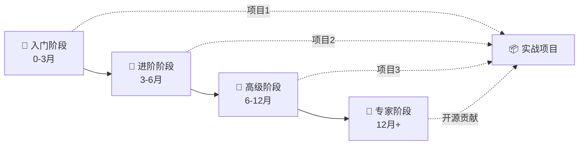

# 🗺️ {{领域名称}}学习路线

> 从零基础到资深专家的完整学习路径，涵盖 {{核心领域1}}、{{核心领域2}}、{{核心领域3}} 三大核心板块。
>
> **总学习周期**：{{总时长，如12-18个月}} · **核心笔记**：{{数量}} 篇 · **项目实战**：{{数量}} 个 · **验收标准**：{{数量}} 项

<!-- 填充指引：学习路线是"从0到1"的完整路径图。描述包含3个核心板块。总周期要现实（不能写"3个月成为专家"）。核心笔记和项目数要与实际知识库对应。 -->

---

## 📋 路线总览

**阶段目标速查**：

| 阶段 | 周期 | 核心目标 | 关键产出 |
|------|------|---------|---------|
| 🌱 入门筑基 | 0-3月 | 掌握基础语法和工具 | 1个完整项目 |
| 🌿 进阶提升 | 3-6月 | 深入原理和工程化 | 1个中大型项目 |
| 🌳 高级精通 | 6-12月 | 架构设计和复杂问题 | 1个分布式项目 |
| 🌲 专家架构 | 12月+ | 技术引领和知识输出 | 开源贡献/技术博客 |

---

## 🌱 第一阶段：入门筑基（0-3 个月）

### 🎯 阶段目标
- 掌握 {{主攻语言}} 基础语法
- 熟悉开发工具和环境
- 能独立完成简单 CRUD 项目
- 理解计算机基础概念

### 📚 核心知识点

| 序号 | 知识点 | 难度 | 预计时长 | 笔记 |
|------|--------|------|---------|------|
| 1 | 计算机基础（网络/操作系统） | ⭐ | 2 周 | [[计算机基础入门]] |
| 2 | Git 版本控制 | ⭐ | 1 周 | [[Git 快速上手]] |
| 3 | {{主攻语言}} 基础语法 | ⭐ | 4 周 | [[{{语言}}基础]] |
| 4 | {{主攻框架}} 入门 | ⭐⭐ | 3 周 | [[{{框架}}入门]] |
| 5 | 数据库基础（MySQL） | ⭐ | 2 周 | [[MySQL 基础]] |

### 🚀 项目实战

#### 项目1：{{项目名称，如"个人博客系统"}}
- **难度**：⭐
- **时长**：2 周
- **技术栈**：{{技术栈，如"Vue3 + SpringBoot + MySQL"}}
- **目标**：{{项目目标，如"实现用户注册登录、文章CRUD、评论功能"}}
- **验收标准**：
  - [ ] 完成用户注册登录
  - [ ] 实现基础 CRUD
  - [ ] 数据持久化到数据库
  - [ ] 代码托管到 GitHub
  - [ ] 编写 README 文档

### ✅ 验收标准
- [ ] 能独立搭建开发环境
- [ ] 能使用 Git 进行版本控制
- [ ] 能编写基础的 CRUD 接口
- [ ] 能完成一个简单的全栈项目
- [ ] 理解 HTTP 协议和 RESTful API

### 💡 学习技巧
- **边学边练**：每个知识点配合代码练习，不要只看视频
- **费曼学习法**：用自己的话解释概念，写学习笔记
- **间隔重复**：每周复习已学内容，使用 Anki 等工具
- **不要钻牛角尖**：入门阶段先会用，原理后面深入
- **找学习伙伴**：加入技术社区，与他人交流学习

---

## 🌿 第二阶段：进阶提升（3-6 个月）

### 🎯 阶段目标
- 深入理解核心框架原理
- 掌握数据库优化和缓存
- 熟悉工程化实践
- 理解分布式基础概念

### 📚 核心知识点

| 序号 | 知识点 | 难度 | 预计时长 | 笔记 |
|------|--------|------|---------|------|
| 1 | {{主攻语言}} 进阶特性 | ⭐⭐ | 3 周 | [[{{语言}}进阶]] |
| 2 | 设计模式 | ⭐⭐⭐ | 2 周 | [[设计模式实战]] |
| 3 | 数据库优化（索引/事务/SQL） | ⭐⭐⭐ | 3 周 | [[MySQL 优化实战]] |
| 4 | Redis 缓存实战 | ⭐⭐ | 2 周 | [[Redis 深度实战]] |
| 5 | 工程化（构建/测试/部署） | ⭐⭐ | 2 周 | [[工程化实践]] |
| 6 | 消息队列基础 | ⭐⭐⭐ | 2 周 | [[消息队列入门]] |

### 🚀 项目实战

#### 项目2：{{项目名称，如"电商后台管理系统"}}
- **难度**：⭐⭐
- **时长**：4 周
- **技术栈**：{{技术栈}}
- **目标**：{{项目目标}}
- **核心功能**：
  - [ ] 用户权限管理（RBAC）
  - [ ] 缓存优化（Redis）
  - [ ] 异步任务（消息队列）
  - [ ] 单元测试和集成测试
  - [ ] CI/CD 自动化部署

### ✅ 验收标准
- [ ] 理解核心框架的底层原理
- [ ] 能进行数据库性能优化（索引、SQL）
- [ ] 能使用 Redis 进行缓存设计
- [ ] 能搭建 CI/CD 流水线
- [ ] 能设计简单的分布式系统
- [ ] 能编写单元测试和集成测试

### 💡 学习技巧
- **源码阅读**：开始阅读核心框架的源码，从入口函数开始
- **性能思维**：关注每个操作的性能影响，学会用压测工具验证
- **工程化意识**：代码规范、测试、文档并重，不要只追求功能实现
- **技术对比**：对比不同技术方案的优缺点，培养选型能力

---

## 🌳 第三阶段：高级精通（6-12 个月）

### 🎯 阶段目标
- 掌握系统架构设计
- 能解决分布式复杂问题
- 熟悉云原生技术栈
- 能进行全链路性能调优

### 📚 核心知识点

| 序号 | 知识点 | 难度 | 预计时长 | 笔记 |
|------|--------|------|---------|------|
| 1 | 系统架构设计 | ⭐⭐⭐⭐ | 4 周 | [[架构设计实战]] |
| 2 | 分布式事务与一致性 | ⭐⭐⭐⭐ | 3 周 | [[分布式事务实战]] |
| 3 | 分布式锁与限流熔断 | ⭐⭐⭐ | 2 周 | [[分布式锁实战]] |
| 4 | Kubernetes 容器编排 | ⭐⭐⭐ | 3 周 | [[Kubernetes 实战]] |
| 5 | 可观测性（监控/日志/链路） | ⭐⭐⭐ | 2 周 | [[可观测性实战]] |
| 6 | 性能调优（JVM/DB/网络） | ⭐⭐⭐⭐ | 3 周 | [[性能调优实战]] |
| 7 | 安全实战（认证/加密/防护） | ⭐⭐⭐ | 2 周 | [[安全实战]] |

### 🚀 项目实战

#### 项目3：{{项目名称，如"高并发秒杀系统"}}
- **难度**：⭐⭐⭐
- **时长**：8 周
- **技术栈**：{{技术栈}}
- **目标**：{{项目目标}}
- **核心功能**：
  - [ ] 微服务架构拆分
  - [ ] 分布式事务保证数据一致性
  - [ ] 限流熔断和服务降级
  - [ ] K8s 容器化部署
  - [ ] 全链路监控和日志
  - [ ] 性能压测和优化

### ✅ 验收标准
- [ ] 能独立设计中大型系统架构
- [ ] 能解决分布式系统的复杂问题（事务、一致性、容灾）
- [ ] 能使用 K8s 进行容器编排
- [ ] 能搭建完整的可观测性体系
- [ ] 能进行全链路性能调优
- [ ] 能设计安全的认证授权体系

### 💡 学习技巧
- **架构思维**：从全局视角思考系统设计，关注可扩展性、可维护性
- **权衡意识**：没有完美方案，只有合适的权衡，学会在CAP之间做选择
- **故障演练**：主动制造故障，验证系统韧性，积累排障经验
- **技术深度**：选择 1-2 个领域深入到源码级别，成为该领域专家

---

## 🌲 第四阶段：专家架构（12 个月+）

### 🎯 阶段目标
- 深入理解核心技术源码
- 能预判技术趋势并做选型
- 具备技术管理和团队领导能力
- 有公开的技术输出和影响力

### 📚 核心知识点

| 序号 | 知识点 | 难度 | 预计时长 | 笔记 |
|------|--------|------|---------|------|
| 1 | 核心框架源码精读 | ⭐⭐⭐⭐⭐ | 持续 | [[源码分析]] |
| 2 | AI 工程化（LLM/RAG/Agent） | ⭐⭐⭐⭐ | 4 周 | [[AI 工程化实战]] |
| 3 | 云原生新特性（服务网格/Serverless） | ⭐⭐⭐⭐ | 3 周 | [[云原生进阶]] |
| 4 | 技术管理（团队/流程/决策） | ⭐⭐⭐ | 持续 | [[技术管理]] |
| 5 | 开源贡献 | ⭐⭐⭐⭐ | 持续 | [[开源贡献指南]] |

### 🚀 项目实战

#### 项目4：开源项目贡献
- **难度**：⭐⭐⭐⭐
- **时长**：持续
- **目标**：参与知名开源项目，提交有价值的 PR
- **验收标准**：
  - [ ] 至少 1 个 PR 被合并到知名项目
  - [ ] 理解项目的架构设计和代码规范
  - [ ] 能与社区有效沟通协作

#### 项目5：技术输出
- **难度**：⭐⭐⭐
- **时长**：持续
- **目标**：建立个人技术品牌
- **验收标准**：
  - [ ] 技术博客累计 20+ 篇
  - [ ] 至少 1 次技术分享（线上/线下）
  - [ ] 有自己的开源项目或工具

### ✅ 验收标准
- [ ] 能深入理解核心技术的源码实现
- [ ] 能预判技术趋势并做出技术选型
- [ ] 能带领团队完成复杂项目
- [ ] 有公开的技术输出和影响力
- [ ] 能在开源社区有效贡献

### 💡 学习技巧
- **深度优先**：选择 1-2 个领域成为专家，不要什么都懂一点
- **输出驱动**：通过写作和分享深化理解，教是最好的学
- **社区参与**：参与技术社区，拓展视野，建立人脉
- **持续学习**：技术日新月异，保持学习习惯，关注前沿动态

---

## 📊 技能矩阵

| 技能领域 | 入门 | 进阶 | 高级 | 专家 |
|---------|------|------|------|------|
| {{主攻语言}} | 基础语法 | 高级特性 | 性能调优 | 源码级 |
| {{主攻框架}} | 基础使用 | 原理理解 | 扩展开发 | 贡献源码 |
| 数据库 | CRUD | 索引优化 | 分库分表 | 内核级 |
| 分布式 | 概念理解 | 微服务 | 一致性 | 架构设计 |
| 云原生 | Docker | K8s 基础 | 服务网格 | 平台建设 |
| AI | API 调用 | RAG 应用 | Agent 开发 | 模型优化 |

---

## 📚 推荐学习资源

### 书籍
- 《{{书籍1}}》— {{说明，如"适合入门，通俗易懂"}}
- 《{{书籍2}}》— {{说明，如"深入原理，必读经典"}}
- 《{{书籍3}}》— {{说明，如"实战导向，项目驱动"}}

### 在线课程
- [{{课程1}}]({{URL}}) — {{说明}}
- [{{课程2}}]({{URL}}) — {{说明}}

### 官方文档
- [{{技术1}} 官方文档]({{URL}})
- [{{技术2}} 官方文档]({{URL}})

### 技术社区
- [{{社区1}}]({{URL}}) — {{说明}}
- [{{社区2}}]({{URL}}) — {{说明}}

---

## ⚠️ 常见误区

1. **只看不练**：编程是实践技能，必须动手写代码，看10遍不如写1遍
2. **追求完美**：先完成再完美，不要在入门阶段纠结细节
3. **频繁切换**：选定一个方向深入，不要什么都学一点，最后什么都不精
4. **忽视基础**：计算机基础决定了技术上限，不要跳过基础直接学框架
5. **不做项目**：项目是检验学习成果的最好方式，每个阶段必须配合项目
6. **不输出**：教是最好的学，通过写作和分享深化理解
7. **盲目追新**：技术更新快，但核心基础变化慢，先打好基础再学新技术
8. **单打独斗**：加入技术社区，与他人交流，避免走弯路

---

## 🎯 下一步行动

1. **评估当前水平**：根据技能矩阵判断自己所处阶段
2. **制定学习计划**：选择下一阶段的核心知识点，制定每周学习计划
3. **开始项目实战**：每个阶段配合对应的项目，在实践中学习
4. **定期复盘**：每月回顾学习进度，调整计划，总结经验
5. **加入社区**：参与技术讨论，拓展人脉，获取反馈
6. **开始输出**：写学习笔记，做技术分享，建立个人品牌

---

## 🔗 关联路线

- [[全栈开发学习路线]] — 全栈方向完整路径
- [[AI 工程化学习路线]] — AI 方向完整路径
- [[云原生学习路线]] — 云原生方向完整路径
- [[后端开发学习路线]] — 后端方向完整路径
- [[前端开发学习路线]] — 前端方向完整路径

## 🏷️ 相关标签

`#学习路线` `#{{领域标签}}` `#知识管理` `#学习方法` `#职业发展`

---

[[Home|🏠 返回首页]] · [[MOC-综合导航|📚 综合导航]] · [[学习路线总览|🗺️ 总览]]

---

> 📝 **路线版本**：v2.0 · **最后更新**：{{更新日期}}
>
> 💡 **提示**：学习路线是参考，不是教条。根据自己的实际情况调整节奏，重要的是持续学习和实践。
