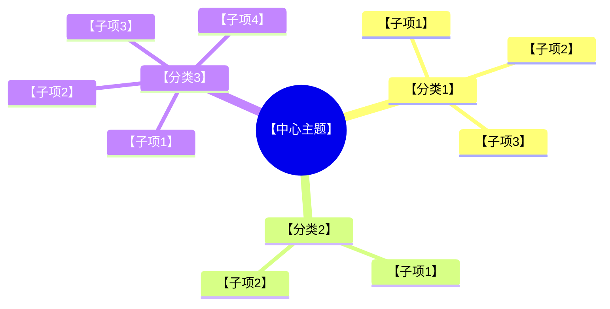
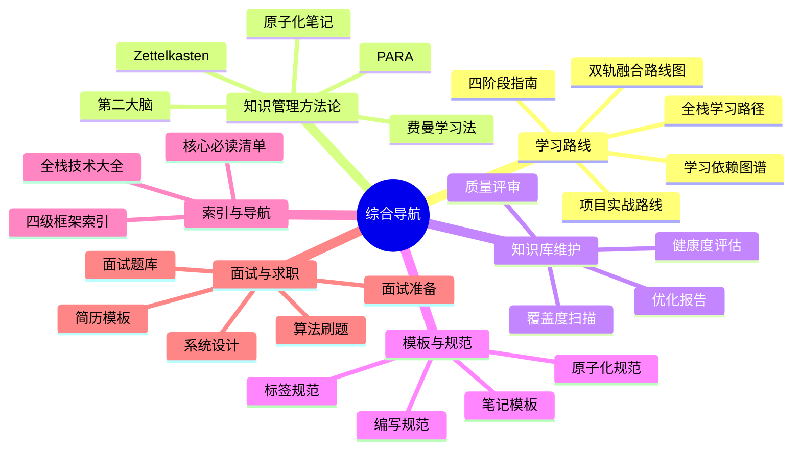

# 高级视觉设计模板体系

> 基于《Java知识点完整整合大全_优化版》和《MOC-综合导航》的视觉设计逆向提炼，包含 HTML/CSS 动画卡片、Mermaid 思维导图、ASCII 架构图、精美表格、章节总结结构等可直接复用的模板。

---

## 一、HTML/CSS 动画卡片模板

### 模板1：层级包含关系卡片（如 JDK⊃JRE⊃JVM）

**适用场景**：展示包含关系、层级结构、嵌套关系、架构分层

```html
<div style="background:linear-gradient(135deg,#667eea,#764ba2);border-radius:16px;padding:20px;margin:16px 0;font-family:-apple-system,'Segoe UI','PingFang SC','Microsoft YaHei',sans-serif;color:#fff;overflow:hidden;box-shadow:0 8px 28px rgba(0,0,0,.14),0 3px 10px rgba(0,0,0,.08)">
<style>@keyframes pulse{0%,100%{transform:scale(1);opacity:.9}50%{transform:scale(1.03);opacity:1}}@keyframes glow{0%,100%{box-shadow:0 0 8px rgba(255,255,255,.3)}50%{box-shadow:0 0 20px rgba(255,255,255,.6)}}.dk-layer{border-radius:8px;padding:12px 16px;margin:6px auto;text-align:center;font-weight:600;animation:pulse 3s ease-in-out infinite}.dk-outer{background:rgba(255,255,255,.15);border:2px solid rgba(255,255,255,.5);max-width:320px;animation-delay:0s}.dk-middle{background:rgba(255,255,255,.2);border:2px solid rgba(255,255,255,.6);max-width:260px;animation-delay:.5s}.dk-inner{background:rgba(255,255,255,.25);border:2px solid rgba(255,255,255,.7);max-width:200px;animation-delay:1s}.dk-arrow{text-align:center;font-size:18px;animation:glow 2s ease-in-out infinite;margin:2px 0}.dk-label{font-size:12px;opacity:.85;font-weight:400;margin-top:4px}</style>
<div style="text-align:center;font-size:15px;font-weight:700;margin-bottom:14px;padding-bottom:10px;border-bottom:1.5px solid rgba(255,255,255,.22);letter-spacing:1px;text-shadow:0 1px 3px rgba(0,0,0,.12)">【标题：如 JDK ⊃ JRE ⊃ JVM 三层包含关系】</div>
<div class="dk-layer dk-outer">【外层名称】<div class="dk-label">【外层说明】</div></div>
<div class="dk-arrow">▼ 包含</div>
<div class="dk-layer dk-middle">【中层名称】<div class="dk-label">【中层说明】</div></div>
<div class="dk-arrow">▼ 包含</div>
<div class="dk-layer dk-inner">【内层名称】<div class="dk-label">【内层说明】</div></div>
</div>
```

**可配置项**：
- 渐变色：`#667eea,#764ba2`（紫蓝）→ 可替换
- 层数：3层（outer/middle/inner）→ 可增减
- 每层宽度：320px/260px/200px → 按内容调整

---

### 模板2：流程步骤动画卡片（如 Java 程序执行流程）

**适用场景**：展示执行流程、调用链、步骤顺序、生命周期

```html
<div style="background:linear-gradient(135deg,#f093fb,#f5576c);border-radius:16px;padding:20px;margin:16px 0;font-family:-apple-system,'Segoe UI','PingFang SC','Microsoft YaHei',sans-serif;color:#fff;overflow:hidden;box-shadow:0 8px 28px rgba(0,0,0,.14),0 3px 10px rgba(0,0,0,.08)">
<style>@keyframes flow{0%{transform:translateX(-10px);opacity:0}15%{transform:translateX(0);opacity:1}85%{transform:translateX(0);opacity:1}100%{transform:translateX(10px);opacity:0}}.flow-step{display:inline-block;background:rgba(255,255,255,.2);border:2px solid rgba(255,255,255,.5);border-radius:8px;padding:10px 14px;margin:4px;text-align:center;font-weight:600;font-size:13px;animation:flow 4s ease-in-out infinite;min-width:90px}.flow-step:nth-child(2){animation-delay:.5s}.flow-step:nth-child(4){animation-delay:1s}.flow-step:nth-child(6){animation-delay:1.5s}.flow-step:nth-child(8){animation-delay:2s}.flow-arrow{display:inline-block;font-size:20px;animation:flow 4s ease-in-out infinite;vertical-align:middle}.flow-code{background:rgba(0,0,0,.2);border-radius:6px;box-shadow:0 2px 8px rgba(0,0,0,.06);padding:8px 12px;margin-top:10px;font-family:monospace;font-size:12px;text-align:center}</style>
<div style="text-align:center;font-size:15px;font-weight:700;margin-bottom:14px;padding-bottom:10px;border-bottom:1.5px solid rgba(255,255,255,.22);letter-spacing:1px;text-shadow:0 1px 3px rgba(0,0,0,.12)">【标题】</div>
<div style="text-align:center;white-space:nowrap;overflow-x:auto">
<span class="flow-step">【步骤1】</span><span class="flow-arrow">→</span><span class="flow-step">【步骤2】</span><span class="flow-arrow">→</span><span class="flow-step">【步骤3】</span><span class="flow-arrow">→</span><span class="flow-step">【步骤4】</span>
</div>
<div class="flow-code">【底部关键路径说明】</div>
<div style="text-align:center;font-size:12px;opacity:.85;margin-top:8px">【核心原理说明】</div>
</div>
```

---

### 模板3：对比展示卡片（如 编译型 vs 解释型）

**适用场景**：两个概念对比、优缺点对比、方案对比、技术选型

```html
<div style="background:linear-gradient(135deg,#4facfe,#00f2fe);border-radius:16px;padding:20px;margin:16px 0;font-family:-apple-system,'Segoe UI','PingFang SC','Microsoft YaHei',sans-serif;color:#fff;overflow:hidden;box-shadow:0 8px 28px rgba(0,0,0,.14),0 3px 10px rgba(0,0,0,.08)">
<style>@keyframes fadeIn{from{opacity:0;transform:translateY(10px)}to{opacity:1;transform:translateY(0)}}.cmp-col{display:inline-block;width:45%;vertical-align:top;padding:12px;margin:0 2%;background:rgba(255,255,255,.15);border-radius:10px;animation:fadeIn .8s ease-out}.cmp-col h4{margin:0 0 8px 0;text-align:center;border-bottom:1px solid rgba(255,255,255,.3);padding-bottom:6px}.cmp-col ul{margin:0;padding-left:18px;font-size:13px;line-height:1.8}.cmp-vs{display:inline-block;width:4%;text-align:center;font-size:24px;font-weight:700;vertical-align:middle;animation:fadeIn 1s ease-out}</style>
<div style="text-align:center;font-size:15px;font-weight:700;margin-bottom:14px;padding-bottom:10px;border-bottom:1.5px solid rgba(255,255,255,.22);letter-spacing:1px;text-shadow:0 1px 3px rgba(0,0,0,.12)">【对比标题】</div>
<div style="text-align:center">
<div class="cmp-col"><h4>【方案A】</h4><ul><li>优点1</li><li>优点2</li><li>缺点1</li><li>适用场景</li></ul></div>
<div class="cmp-vs">VS</div>
<div class="cmp-col"><h4>【方案B】</h4><ul><li>优点1</li><li>优点2</li><li>缺点1</li><li>适用场景</li></ul></div>
</div>
<div style="text-align:center;font-size:12px;opacity:.85;margin-top:10px">【选择建议/总结】</div>
</div>
```

---

### 模板4：核心概念高亮卡片

**适用场景**：突出核心定义、关键公式、重要结论、记忆要点

```html
<div style="background:linear-gradient(135deg,#fa709a,#fee140);border-radius:16px;padding:20px;margin:16px 0;font-family:-apple-system,'Segoe UI','PingFang SC','Microsoft YaHei',sans-serif;color:#fff;overflow:hidden;box-shadow:0 8px 28px rgba(0,0,0,.14),0 3px 10px rgba(0,0,0,.08)">
<style>@keyframes highlight{0%,100%{box-shadow:0 0 0 rgba(255,255,255,0)}50%{box-shadow:0 0 20px rgba(255,255,255,.4)}}.hl-box{background:rgba(255,255,255,.2);border-radius:10px;padding:14px 18px;margin:10px 0;animation:highlight 3s ease-in-out infinite;border-left:4px solid rgba(255,255,255,.6)}.hl-formula{font-family:monospace;font-size:16px;text-align:center;background:rgba(0,0,0,.15);border-radius:8px;padding:12px;margin:10px 0}</style>
<div style="text-align:center;font-size:15px;font-weight:700;margin-bottom:14px;padding-bottom:10px;border-bottom:1.5px solid rgba(255,255,255,.22);letter-spacing:1px;text-shadow:0 1px 3px rgba(0,0,0,.12)">📌 【核心概念名称】</div>
<div class="hl-box">【定义/核心说明，1-3句话】</div>
<div class="hl-formula">【关键公式/代码/表达式】</div>
<div style="font-size:13px;opacity:.9;margin-top:8px">💡 【记忆技巧/理解要点】</div>
</div>
```

---

## 二、渐变配色方案速查

| 场景 | 渐变色1 | 渐变色2 | 色值 |
|------|---------|---------|------|
| 技术架构 | 紫 | 蓝紫 | `#667eea → #764ba2` |
| 流程步骤 | 粉 | 橙红 | `#f093fb → #f5576c` |
| 数据结构 | 青 | 蓝 | `#4facfe → #00f2fe` |
| 并发编程 | 橙 | 黄 | `#fa709a → #fee140` |
| JVM/底层 | 青 | 深蓝 | `#30cfd0 → #330867` |
| 对比分析 | 浅青 | 浅粉 | `#a8edea → #fed6e3` |
| 算法/逻辑 | 绿 | 青 | `#11998e → #38ef7d` |
| 网络/IO | 蓝 | 紫 | `#667eea → #764ba2` |
| MOC/导航 | 深蓝 | 青 | `#0f2027 → #203a43 → #2c5364` |
| 学习路线 | 橙 | 红 | `#ff512f → #dd2476` |

---

## 三、Mermaid 思维导图模板（mindmap）

**适用场景**：MOC 导航体系总览、知识体系全景、学习路线概览



**MOC 综合导航 mindmap 示例**：



---

## 四、ASCII 艺术架构图模板

**适用场景**：知识库 MOC 体系总览、系统架构分层、导航层级结构

```
                        【顶层：Home 首页】
                            │
            ┌───────────────┼───────────────┐
            │               │               │
       【MOC-综合导航】  【学习路线总览】  【MOC内容地图】
            │
    ┌───────┼───────┬───────┬───────┬───────┐
    │       │       │       │       │       │
  【领域1】【领域2】【领域3】【领域4】【领域5】【领域6】
    │       │       │       │       │       │
    └───────┴───────┴───────┴───────┴───────┘
                            │
    ┌───────┬───────┬───────┼───────┬───────┐
    │       │       │       │       │       │
  【领域7】【领域8】【领域9】【项目】【知识管理】【学习方法】
```

---

## 五、精美表格模板

### 模板1：标准对比表

| 区别维度 | 概念A | 概念B |
|---------|-------|-------|
| 定义 | ... | ... |
| 原理 | ... | ... |
| 优点 | ... | ... |
| 缺点 | ... | ... |
| 适用场景 | ... | ... |
| 性能 | ... | ... |
| 发生阶段 | 编译时/运行时 | ... |

### 模板2：MOC 文档索引表

| 文档 | 说明 | 难度 |
|------|------|------|
| `[[文档1]]` | 文档核心内容的简短描述 | 🟢入门 / 🟡进阶 / 🔴高级 |
| `[[文档2]]` | 文档核心内容的简短描述 | 🟡进阶 |

### 模板3：领域 MOC 导航表

| 领域 | MOC入口 | 文档数 | 核心内容 |
|------|---------|--------|---------|
| 🎨 前端开发 | `[[MOC-前端开发]]` | 112 | Vue3、TypeScript、JavaScript、CSS、工程化 |
| ☕ 后端开发 | `[[MOC-后端开发]]` | 99 | Java、Spring Boot、微服务、中间件 |

### 模板4：分阶段学习路线表

| 阶段 | 指南 | 周期 | 核心目标 |
|------|------|------|---------|
| 🌱 入门筑基 | `[[第一阶段-入门筑基学习指南]]` | 0-4月 | 编程基础+前后端入门+AI概念 |
| ⚡ 进阶实战 | `[[第二阶段-进阶实战学习指南]]` | 4-9月 | 框架精通+全栈项目+AI应用 |
| 🏗️ 高级架构 | `[[第三阶段-高级架构学习指南]]` | 9-15月 | 微服务+AI工程化+RAG/Agent |
| 👑 专家精通 | `[[第四阶段-专家精通学习指南]]` | 15-24月 | 源码深度+架构设计+技术领导力 |

### 难度标识规范

| 标识 | 难度 | 说明 |
|------|------|------|
| 🟢 | 入门 | 零基础可学，基础概念和基本用法 |
| 🟡 | 进阶 | 需要一定基础，深入原理和最佳实践 |
| 🔴 | 高级 | 需要扎实基础，源码级分析和架构设计 |

---

## 六、章节末尾结构模板

### 💡 深度讲解 + 📝 精简总结

```markdown
---

> 💡 **深度讲解**：【200-500字，深入展开本章核心概念，关联其他知识点，说明为什么这样设计，业界最佳实践，常见误区】
>
> **📝 精简总结**：【3-5句话，概括本章核心要点，便于快速复习和记忆】

---
```

### 知识点三位一体深度解析块

```markdown
> 🔍 **知识点深度解析**
>
> **作用**：【一句话定义 + 解决什么问题 + 适用场景】
>
> **原理**：【底层机制 + 核心逻辑 + 关键步骤】
>
> **用法要点**：① 【要点1】 ② 【要点2】 ③ 【要点3】 ④ 【常见坑/最佳实践】
```

---

## 七、MOC 页面底部导航模板

```markdown
---

## 🏷️ 标签体系

`#标签1` `#标签2` `#标签3` `#标签4`

---

[[Home|🏠 返回首页]] · [[MOC-综合导航|📚 综合导航]] · [[学习路线总览|🗺️ 学习路线]]
```

---

> **最后更新**：2026-09-01
>
> **基于**：《Java知识点完整整合大全_优化版》+《MOC-综合导航》视觉设计逆向分析
