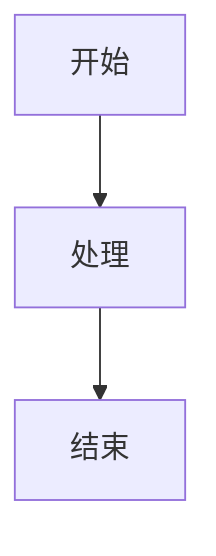

# Obsidian 渲染陷阱手册

> 基于 171 篇全栈+AI工程知识库文档实战踩坑全记录。每一条陷阱都来自真实问题，包含症状、根因、错误示例、正确示例和预防措施。

---

## 陷阱分类总览

| 类别 | 陷阱数量 | 严重程度 | 影响范围 |
|------|---------|---------|---------|
| Frontmatter YAML | 3 种 | 🔴 高 | 文档开头报错，属性面板异常 |
| 代码块标记 | 6 种 | 🔴 高 | 内容被吞，流程图不渲染 |
| 标题级别 | 9 种 | 🔴 高 | 大纲混乱，代码内容暴露为大标题，H2数量异常膨胀 |
| 内容结构 | 2 种 | 🟡 中 | 重复章节，结构异常 |

---

## 一、Frontmatter YAML 陷阱

### 陷阱1：``` 标记混入 YAML（最严重）

**严重程度**：🔴 🔴 🔴 🔴 🔴
**影响范围**：可导致 100+ 文件同时报错
**实战案例**：170/171 个文件受影响

#### 症状
- Obsidian 打开文档后顶部显示 YAML 错误
- 属性面板不显示或显示异常
- 文档开头出现代码块样式

#### 根因
批量处理脚本在写入 Frontmatter 时，意外将 ``` 代码块标记插入到 YAML 字段之间。通常每 2-3 个字段就有一个 ```。

#### 错误示例
```markdown
---
```
title: FastAPI 路由与依赖注入
tags: [Python, FastAPI]
category: Python全栈
created: 2026-08-13
```
difficulty: ⭐⭐⭐
status: ✅ 内容已完善
```
priority: 核心
pre: ["[[Python-异步编程asyncio]]"]
---
```

#### 正确示例
```markdown
---
title: FastAPI 路由与依赖注入
tags: [Python, FastAPI]
category: Python全栈
created: 2026-08-13
updated: 2026-09-08
difficulty: ⭐⭐⭐
status: ✅ 内容已完善
priority: 核心
pre: ["[[Python-异步编程asyncio]]", "[[Python-类型注解与mypy]]"]
aliases: [FastAPI路由, FastAPI DI]
---
```

#### 预防措施
- 批量写入 Frontmatter 时，使用 YAML 库（如 PyYAML）序列化，不要手动拼接字符串
- 写入后立即用 `yaml.safe_load()` 验证
- Frontmatter 模板中不要包含任何 ``` 标记

---

### 陷阱2：pre 字段双链未加引号

**严重程度**：🔴 🔴 🔴
**影响范围**：含前置知识的文档

#### 症状
- YAML 解析错误
- pre 字段不显示

#### 根因
`[[` 在 YAML 中是嵌套序列的开始符号，与 wiki-link 的 `[[` 语法冲突。

#### 错误示例
```yaml
pre: [[Vue3基础]], [[TypeScript基础]]
```

#### 正确示例
```yaml
pre: ["[[Vue3基础]]", "[[TypeScript基础]]"]
```

#### 预防措施
- pre 字段始终使用流序列格式，双链用双引号包裹
- 无前置知识时用 `pre: []`

---

### 陷阱3：畸形多括号

**严重程度**：🔴 🔴
**影响范围**：批量替换后的文档

#### 症状
- YAML 解析错误
- 出现 `[[[[link]]]` 这样的畸形格式

#### 根因
批量替换时重复添加 `[` 或 `]`，导致括号数量不对。

#### 错误示例
```yaml
pre: ["[[[[Python基础]]]"]
```

#### 正确示例
```yaml
pre: ["[[Python基础]]"]
```

#### 预防措施
- 批量替换后检查括号配对
- 使用正则 `\[\[([^\]]+)\]\]` 匹配标准双链

---

## 二、代码块标记陷阱

### 陷阱4：结束标记带语言名（最常见）

**严重程度**：🔴 🔴 🔴 🔴 🔴
**影响范围**：可导致 100+ 文件内容被吞
**实战案例**：3229 处结束标记带语言名

#### 症状
- 文档内容"消失"，显示为代码样式
- Mermaid 图之后的所有内容都变成代码
- 大纲面板缺少后续章节

#### 根因
代码块结束标记被错误地添加了语言名（```python、```text），Obsidian 将其视为新代码块的开始，而非当前代码块的结束。导致当前代码块永远不闭合，吞掉后续所有内容。

#### 错误示例
```markdown
```python
print("Hello World")
```python

## 二、原理
这部分内容会被吞进代码块！
```

#### 正确示例
```markdown
```python
print("Hello World")
```

## 二、原理
这部分内容正常显示。
```

#### 预防措施
- **铁律**：结束标记必须是纯 ```，绝对不能带语言名
- 批量处理时，只修改开头标记的语言名，不碰结束标记
- 处理后运行代码块平衡验证

---

### 陷阱5：畸形结束标记 `` `$lang ``

**严重程度**：🔴 🔴 🔴 🔴
**影响范围**：批量脚本处理后的文档
**实战案例**：209 处畸形标记

#### 症状
- 代码块不闭合
- 内容被吞

#### 根因
批量脚本的正则替换错误，将结束标记 ``` 替换为 `` `$lang ``（一个反引号+语言名变量）。

#### 错误示例
```markdown
```python
print("Hello")
`python
```

#### 正确示例
```markdown
```python
print("Hello")
```
```

#### 预防措施
- 批量替换时使用精确匹配，避免变量未展开
- 替换后检查所有 ``` 标记的格式

---

### 陷阱6：Mermaid 语言标识丢失

**严重程度**：🔴 🔴 🔴
**影响范围**：含 Mermaid 图的文档
**实战案例**：476 个 Mermaid 图需恢复标识

#### 症状
- Mermaid 图不渲染，显示为纯代码
- 流程图显示为文本

#### 根因
修复代码块时，误将开头标记的语言名也去掉了（```mermaid → ```），导致 Obsidian 无法识别为 Mermaid。

#### 错误示例
```markdown
```
graph TD
    A[开始] --> B[处理]
    B --> C[结束]
```
```

#### 正确示例
```markdown

```

#### 预防措施
- 修复代码块时，只清理结束标记的语言名，保留开头标记的语言名
- 根据代码块内容自动识别语言（含 graph/flowchart/sequenceDiagram 的是 mermaid）

---

### 陷阱7：4+ 反引号畸形标记

**严重程度**：🔴 🔴 🔴
**影响范围**：含嵌套代码块的文档

#### 症状
- 代码块结构混乱
- 内容被吞或提前显示

#### 根因
在不需要 4 反引号的地方使用了 4 反引号，或开头/结束的反引号数量不一致。

#### 错误示例
```markdown
````python
print("Hello")
```
```

#### 正确示例（普通代码块用 3 反引号）
```markdown
```python
print("Hello")
```
```

#### 正确示例（代码内含 ``` 时用 4 反引号外层）
```markdown
````python
template = """
```markdown
# 标题
内容
```
"""
````
```

#### 预防措施
- 普通代码块始终用 3 反引号
- 仅当代码块内容包含 ``` 时，外层才用 4 反引号
- 开头和结束的反引号数量必须一致

---

### 陷阱8：连续两个 ```

**严重程度**：🔴 🔴
**影响范围**：手动编辑或合并后的文档

#### 症状
- 出现空代码块
- 后续内容被吞

#### 根因
代码块结束后多写了一个 ```，第二个 ``` 开启了新的空代码块。

#### 错误示例
```markdown
```python
print("Hello")
```
```

## 二、原理
```

#### 正确示例
```markdown
```python
print("Hello")
```

## 二、原理
```

#### 预防措施
- 代码块结束后只需一个 ```
- 合并文档时检查相邻代码块之间的标记

---

### 陷阱9：Python 代码块内嵌 Prompt 模板

**严重程度**：🔴 🔴 🔴
**影响范围**：AI 相关文档

#### 症状
- Python 代码块内的 Markdown 模板破坏代码块结构
- 模板中的 ``` 被误认为代码块结束

#### 根因
Python 代码中包含 Markdown 模板字符串，模板内有 ``` 标记，与外层代码块标记冲突。

#### 错误示例
```markdown
```python
prompt = """
```markdown
# 分析报告
## 结论
内容
```
"""
print(prompt)
```
```

#### 正确示例（外层用 4 反引号）
```markdown
````python
prompt = """
```markdown
# 分析报告
## 结论
内容
```
"""
print(prompt)
````
```

#### 预防措施
- AI 相关文档中，Python 代码块内含 Markdown 模板时，外层必须用 4 反引号
- 写入前检查代码块内是否含 ```

---

## 三、标题级别陷阱

### 陷阱10：代码注释暴露为 H1（最隐蔽）

**严重程度**：🔴 🔴 🔴 🔴
**影响范围**：代码块标记损坏后的文档
**实战案例**：649 个多余 H1 需降级

#### 症状
- 文档出现几十个大标题（H1）
- 大纲面板混乱
- 某些"标题"实际是代码注释

#### 根因
代码块标记损坏后，bash/Python 注释（`# 注释内容`）暴露在正文中，被 Obsidian 渲染为 H1。

#### 错误示例
```markdown
## 三、实操

# 安装依赖
pip install fastapi uvicorn

# 启动服务
uvicorn main:app --reload

### 3.2 核心用法
```

#### 正确示例
```markdown
## 三、实操

```bash
# 安装依赖
pip install fastapi uvicorn
# 启动服务
uvicorn main:app --reload
```

### 3.2 核心用法
```

#### 识别方法
- H1 行紧跟代码行（函数调用、赋值、命令）→ 是代码注释
- H1 行包含代码符号（括号、等号、管道符）→ 是代码注释
- H1 行以数字编号开头（`# 1. 步骤`）→ 可能是代码注释

#### 预防措施
- 代码注释必须在代码块内
- 修复代码块后检查标题级别
- 每篇文档应恰好 1 个 H1

---

### 陷阱11：章节标题误设为 H1

**严重程度**：🔴 🔴
**影响范围**：批量生成或手动编写的文档

#### 症状
- 文档有多个 H1 大标题
- 每个主要模块都是 H1

#### 根因
将主要模块（概述、原理、实操等）设为 H1，而非标准的 H2。

#### 错误示例
```markdown
# 文档标题

# 一、概述
内容...

# 二、原理
内容...
```

#### 正确示例
```markdown
# 文档标题

## 一、概述
内容...

## 二、原理
内容...
```

#### 预防措施
- 文档主标题用 H1（#）
- 主要模块用 H2（##）
- 小节用 H3（###）

---

### 陷阱12：标题级别跳跃 H2→H4

**严重程度**：🔴 🔴
**影响范围**：结构不规范的文档

#### 症状
- 大纲面板出现断层
- H2 下直接是 H4，缺少 H3

#### 根因
子标题级别设置错误，跳过了中间层级。

#### 错误示例
```markdown
## 二、原理

#### 2.1.1 特殊细节
内容...
```

#### 正确示例
```markdown
## 二、原理

### 2.1 核心机制

#### 2.1.1 特殊细节
内容...
```

#### 预防措施
- 标题级别必须逐级递进，禁止跳跃
- H2 下必须先有 H3，才能有 H4
- 批量处理后检查级别连续性

---

### 陷阱13：H2数量异常膨胀（代码暴露的首要信号）

**严重程度**：🔴 🔴 🔴 🔴
**影响范围**：代码块标记损坏后的文档
**实战案例**：TensorRT-LLM推理加速 87个H2 → 修复后14个；14篇文档平均减少32个H2

#### 症状
- 文档 H2 数量超过 25 个，大纲面板超长
- 滚动大纲面板时看到大量"看起来像代码"的标题
- 文档结构看起来"扁平"，缺少 H3/H4 子层级

#### 根因
代码块标记损坏后，大量代码行（注释、命令、文件名、参数等）被渲染为 H2。这是标题混乱最主要的信号——H2 膨胀本身不是问题，而是代码暴露的表象。

#### 诊断阈值
- H2 > 25：告警，需排查代码暴露
- H2 > 40：几乎确定是代码块标记大面积损坏
- H2 在 8-15：正常范围
- H2 在 15-25：可接受（内容较丰富），但需抽查标题文本

#### 错误示例
````markdown
## 三、实操

# 安装依赖          ← 被渲染为H1
pip install fastapi

# 配置参数          ← 被渲染为H1
--workers: 4

requirements.txt    ← 被渲染为H2
fastapi==0.104.1

## 四、部署          ← 这才是真正的H2
````

#### 正确示例
先修复代码块标记，再将暴露的代码内容包裹进代码块：
````markdown
## 三、实操

```bash
# 安装依赖
pip install fastapi
# 配置参数
--workers: 4
```

`requirements.txt`：
```text
fastapi==0.104.1
```

## 四、部署
````

#### 识别方法
- 统计每篇文档 H2 数量，>25 即标记
- 检查 H2 标题文本是否包含代码模式特征
- 查看异常 H2 是否集中在某个代码块之后

#### 预防措施
- **H2 数量是代码暴露的首要信号**，每次质检必须统计
- 修复标题前必须先修复代码块标记
- MOC/枢纽文档（emoji 开头 H2）不受此阈值限制

---

### 陷阱14：配置文件名被渲染为标题

**严重程度**：🔴 🔴 🔴
**影响范围**：含配置文件示例的文档
**实战案例**：Tasks-任务管理、Python-日志规范、Weaviate-向量数据库等 6 篇文档受影响

#### 症状
- `requirements.txt`、`Makefile`、`redis.conf`、`docker-compose.yml` 等文件名显示为 H2 大标题
- 大纲面板中出现文件名作为章节名
- 文件内容紧跟在"标题"之后，没有代码块样式

#### 根因
代码块标记损坏，文件名单独成行时暴露在正文中。某些情况下文件名前有 `#` 注释或被 setext 标题语法影响，被 Markdown 解析器误判为标题。

#### 错误示例
````markdown
## 五、配置

requirements.txt

fastapi==0.104.1
uvicorn==0.24.0

redis.conf

bind 0.0.0.0
port 6379
````

#### 正确示例
````markdown
## 五、配置

`requirements.txt`：

```text
fastapi==0.104.1
uvicorn==0.24.0
```

`redis.conf`：

```text
bind 0.0.0.0
port 6379
```
````

#### 识别方法
H2 标题文本匹配常见文件名模式：
- 含 `.txt`、`.conf`、`.yml`、`.yaml`、`.json`、`.toml`、`.ini`、`.cfg`、`.env` 后缀
- 文本为 `Makefile`、`Dockerfile`、`docker-compose.yml` 等
- 标题文本短（通常 <30 字符）且紧跟文件内容

#### 预防措施
- 配置文件示例必须用代码块包裹
- 文件名作为正文引用时使用行内代码 `` `requirements.txt` ``
- 批量处理后检查 H2 标题中是否含文件名后缀

---

### 陷阱15：命令行被渲染为标题

**严重程度**：🔴 🔴 🔴
**影响范围**：含命令行示例的文档
**实战案例**：Celery-异步任务队列、Python-性能测试、TensorRT-LLM等 7 篇文档受影响

#### 症状
- `pip install fastapi`、`celery -A app worker -Q email`、`docker-compose up -d` 等命令行显示为 H2
- 大纲面板中出现完整命令作为章节名
- 命令行没有代码块样式和语法高亮

#### 根因
代码块标记损坏，命令行暴露在正文中。当命令行单独成行且前后有空行时，可能被解析器误判。

#### 错误示例
````markdown
## 四、部署

celery -A app worker -Q email --loglevel=info

docker-compose up -d

### 4.2 监控
````

#### 正确示例
````markdown
## 四、部署

```bash
celery -A app worker -Q email --loglevel=info
docker-compose up -d
```

### 4.2 监控
````

#### 识别方法
H2 标题以命令行工具名开头：
- `pip`、`python`、`docker`、`git`、`npm`、`curl`、`apt`、`celery`、`uvicorn`、`pytest`、`make`、`kubectl`
- 标题文本含命令行参数（`-`、`--`、`|`、`>`）
- 标题文本为可执行的完整命令

#### 预防措施
- 所有命令行示例必须包裹在 ```bash 代码块中
- 正文中引用命令时使用行内代码
- 批量处理后检查 H2 标题是否以命令行工具名开头

---

### 陷阱16：参数说明行被渲染为标题

**严重程度**：🔴 🔴
**影响范围**：含参数说明的文档
**实战案例**：TensorRT-LLM、Celery、Python-性能测试等 5 篇文档受影响

#### 症状
- `--max_batch_size：最大batch size`、`--workers: 工作进程数` 等参数行显示为 H2/H3
- 大纲面板中出现参数名作为章节名
- 参数说明没有表格或代码块样式

#### 根因
代码块标记损坏，配置参数说明暴露。参数行以 `--` 开头，在某些 Markdown 解析器中可能被误判。

#### 错误示例
````markdown
## 六、参数说明

--max_batch_size：最大batch size
--workers: 工作进程数
--timeout: 超时时间（秒）
````

#### 正确示例（推荐用表格）
````markdown
## 六、参数说明

| 参数 | 说明 |
|------|------|
| `--max_batch_size` | 最大batch size |
| `--workers` | 工作进程数 |
| `--timeout` | 超时时间（秒） |
````

#### 正确示例（代码块方式）
````markdown
## 六、参数说明

```text
--max_batch_size：最大batch size
--workers: 工作进程数
--timeout: 超时时间（秒）
```
````

#### 识别方法
- 标题以 `--` 开头
- 标题文本含参数名+中文/英文说明的组合
- 标题文本含 `：`或`:`分隔符

#### 预防措施
- 参数说明优先使用表格形式
- 如必须用代码块，确保正确闭合
- 批量处理后检查标题是否以 `--` 开头

---

### 陷阱17：ASCII目录树被渲染为多级标题

**严重程度**：🔴 🔴 🔴
**影响范围**：含项目结构说明的文档
**实战案例**：主流开源模型架构对比等 3 篇文档受影响

#### 症状
- 含 `├──`、`└──`、`│` 的目录结构被渲染为混乱的标题层级
- 大纲面板中出现树形字符作为标题
- 目录结构没有代码块等宽字体样式

#### 根因
代码块标记损坏，ASCII 艺术暴露。树形字符中的某些组合可能被 Markdown 解析器误判为标题或列表。

#### 错误示例
````markdown
## 七、项目结构

├── src/
│   ├── main.py
│   └── utils.py
├── tests/
│   └── test_main.py
└── README.md
````

#### 正确示例
````markdown
## 七、项目结构

```text
├── src/
│   ├── main.py
│   └── utils.py
├── tests/
│   └── test_main.py
└── README.md
```
````

#### 识别方法
- 标题文本含 ASCII 树字符：`├`、`└`、`│`、`─`
- 连续多行含树形字符
- 上下文为"项目结构""目录结构""文件组织"等关键词

#### 预防措施
- ASCII 目录树必须包裹在 ```text 代码块中
- 项目结构说明优先使用代码块而非纯文本
- 批量处理后检查是否有树形字符暴露在代码块外

---

### 陷阱18：模板内容暴露为标题

**严重程度**：🔴 🔴 🔴
**影响范围**：含 Markdown/Prompt 模板示例的文档
**实战案例**：Python-类型注解与mypy、Prompt版本管理、AI文档与PPT生成工作流等 4 篇文档受影响

#### 症状
- Markdown 模板示例中的 `# 模板标题`、`## 模板章节` 被渲染为真实标题
- 含 `{{变量}}`、`<%= 占位符 %>` 的模板内容被渲染为标题或异常格式
- 大纲面板中出现"模板标题""模板章节"等不属于文档结构的标题
- 模板内容没有代码块样式

#### 根因
代码块标记损坏，Markdown 模板示例或 Prompt 模板内容暴露在正文中。模板内的 `#`、`##` 被解析器误判为真实标题标记；`{{}}`、`<% %>` 等占位符也可能导致解析异常。

#### 错误示例
````markdown
## 八、模板示例

# 分析报告模板
## 一、结论
根据数据分析，...

## 二、建议
建议采取以下措施...
````

#### 正确示例
````markdown
## 八、模板示例

````markdown
# 分析报告模板
## 一、结论
根据数据分析，...

## 二、建议
建议采取以下措施...
````
````

#### 含占位符的模板示例

**错误**：
````markdown
## 九、Prompt模板

你是一个{{角色}}，请完成{{任务}}。

## 输出格式
- 结论
- 分析
````

**正确**：
````markdown
## 九、Prompt模板

```text
你是一个{{角色}}，请完成{{任务}}。
```

## 输出格式
- 结论
- 分析
````

#### 识别方法
- 标题文本为"模板标题""模板章节""分析报告"等模板常用名
- 上下文含"模板""示例""template""prompt"等关键词
- 标题附近含 `{{}}`、`<% %>`、`${}` 等占位符
- 标题内容与文档实际结构不符（如文档是技术教程，却出现"分析报告"标题）

#### 预防措施
- Markdown 模板示例必须用 4 反引号外层包裹（内含 3 反引号）
- Prompt 模板含占位符时用 ```text 代码块包裹
- 模板内容与文档正文之间必须有代码块分隔
- 批量处理后检查大纲面板是否含"模板"类标题

---

## 四、内容结构陷阱

### 陷阱19：重复章节

**严重程度**：🔴 🔴
**影响范围**：批量脚本处理后的文档

#### 症状
- 文档中出现两套完全相同的章节
- 内容重复，篇幅异常增大

#### 根因
批量脚本在追加内容时，未检查是否已存在该章节，导致重复写入。

#### 错误示例
```markdown
## 三、实操
内容...

## 三、实操  ← 重复！
内容...
```

#### 正确示例
```markdown
## 三、实操
内容...
```

#### 预防措施
- 批量追加内容前，检查章节是否已存在
- 使用章节标题作为去重键

---

### 陷阱20：代码块内的 Markdown 模板被误判为重复章节

**严重程度**：🟡
**影响范围**：含代码模板的文档

#### 症状
- 质检脚本报告"重复章节"，但实际没有重复
- 代码块内的模板示例被误判

#### 根因
质检脚本不区分代码块内外，将代码块内的 Markdown 模板标题误判为文档章节。

#### 示例
````markdown
```markdown
# 模板标题
## 模板章节
内容
```
````
上面代码块内的 `# 模板标题` 和 `## 模板章节` 是模板示例，不是文档真实章节。

#### 预防措施
- 质检脚本必须区分代码块内外
- 手动检查时注意代码块内的模板内容

---

## 五、陷阱速查表

| 编号 | 陷阱 | 严重程度 | 快速修复 |
|------|------|---------|---------|
| 1 | ``` 混入 Frontmatter | 🔴🔴🔴🔴🔴 | 移除 YAML 内的 ``` |
| 2 | pre 字段未加引号 | 🔴🔴🔴 | 改为 `pre: ["[[link]]"]` |
| 3 | 畸形多括号 | 🔴🔴 | 修正为 `[[link]]` |
| 4 | 结束标记带语言名 | 🔴🔴🔴🔴🔴 | 结束标记改为纯 ``` |
| 5 | 畸形结束标记 `` `$lang `` | 🔴🔴🔴🔴 | 改为纯 ``` |
| 6 | Mermaid 标识丢失 | 🔴🔴🔴 | 开头改为 ```mermaid |
| 7 | 4+ 反引号畸形 | 🔴🔴🔴 | 普通用3反引号，嵌套用4反引号 |
| 8 | 连续两个 ``` | 🔴🔴 | 删除多余的 ``` |
| 9 | Python内嵌模板冲突 | 🔴🔴🔴 | 外层用4反引号 |
| 10 | 代码注释暴露为H1 | 🔴🔴🔴🔴 | 包裹进代码块 |
| 11 | 章节标题误设为H1 | 🔴🔴 | 降级为H2 |
| 12 | H2→H4跳跃 | 🔴🔴 | 插入H3或降级H4为H3 |
| 13 | H2数量异常膨胀 | 🔴🔴🔴🔴 | 先修复代码块，再包裹暴露代码内容 |
| 14 | 配置文件名被渲染为标题 | 🔴🔴🔴 | 文件名用行内代码，内容包裹进代码块 |
| 15 | 命令行被渲染为标题 | 🔴🔴🔴 | 包裹进 ```bash 代码块 |
| 16 | 参数说明行被渲染为标题 | 🔴🔴 | 转为参数表格或包裹进代码块 |
| 17 | ASCII目录树被渲染为标题 | 🔴🔴🔴 | 包裹进 ```text 代码块 |
| 18 | 模板内容暴露为标题 | 🔴🔴🔴 | 模板用4反引号或```text包裹 |
| 19 | 重复章节 | 🔴🔴 | 删除重复部分 |
| 20 | 代码块内模板误判 | 🟡 | 质检脚本区分代码块内外 |

---

## 六、批量处理安全准则

基于以上陷阱，批量处理 Markdown 文档时必须遵守：

1. **处理前备份**：批量修改前必须备份原文件
2. **Frontmatter 用 YAML 库**：不要手动拼接 YAML 字符串
3. **只改开头标记的语言名**：结束标记永远是纯 ```
4. **区分代码块内外**：所有检测和替换必须跳过代码块内内容
5. **修复标题前必须先修复代码块**：代码块标记损坏是标题混乱的根因，顺序不可颠倒——先 repair-codeblocks，再 repair-headers
6. **H2数量异常是代码暴露的首要信号**：H2 >25 必须排查代码暴露，H2 >40 几乎确定是代码块标记大面积损坏，不要急于降级标题
7. **处理后立即验证**：
   - YAML 解析验证
   - 代码块平衡验证
   - 标题级别验证（含 H2 数量统计和标题文本代码模式检测）
8. **小批量测试**：先在少量文件上测试，确认无误后再全量执行
9. **记录变更**：记录修改了哪些文件、哪些位置，便于回滚

---

> **本手册持续更新。遇到新的渲染陷阱，请补充到对应分类中，并记录症状、根因和修复方案。**
