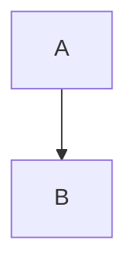

# 质量保障与修复指南

> 基于 171 篇全栈+AI工程知识库文档、50+ 轮优化验证、4 类渲染问题修复实战提炼的完整质量保障体系。涵盖诊断→修复→验证的完整闭环。

---

## 一、质量保障体系总览

### 四大质量维度

| 维度 | 对应问题 | 达标标准 | 诊断脚本 | 修复脚本 |
|------|---------|---------|---------|---------|
| Frontmatter | 文档开头报错 | YAML 100%可解析，0个```混入 | `verify-kb.py --check frontmatter` | `repair-frontmatter.py` |
| 代码块 | 流程图报错/内容被吞 | 0个未闭合，结束标记100%纯``` | `verify-kb.py --check codeblocks` | `repair-codeblocks.py` |
| 标题级别 | 标题混乱 | 每篇恰好1个H1，0处跳跃，H2数量8-15个（MOC除外），0个代码模式标题 | `verify-kb.py --check headers` | `repair-headers.py` |
| 内容完整性 | 内容缺失/浅薄 | 五段式覆盖率100% | `validate-kb.py --strict` | 人工/AI深化 |

### 标准修复流程

```text
┌─────────────────┐
│  诊断 verify-kb  │  扫描全部4个维度
└────────┬────────┘
         │ 发现问题
         ▼
┌─────────────────┐
│ 修复 Frontmatter │  必须最先修复（影响全文解析）
└────────┬────────┘
         ▼
┌─────────────────┐
│  修复代码块      │  其次修复（影响内容可见性）
└────────┬────────┘
         ▼
┌─────────────────┐
│  修复标题级别    │  最后修复（依赖前两步完成）
└────────┬────────┘
         ▼
┌─────────────────┐
│  验证 verify-kb  │  确认全部达标
└────────┬────────┘
         │
    ┌────┴────┐
    │ 全部达标？│
    └────┬────┘
     是 │    │ 否
        ▼    ▼
      完成  返回诊断
```

**为什么必须按此顺序？**
- Frontmatter 修复会改变文件开头结构，可能影响代码块和标题的行号
- 代码块修复会暴露/隐藏内容，可能影响标题检测
- 标题修复依赖前两步完成后的准确状态

---

## 二、Frontmatter YAML 问题修复

### 2.1 症状识别

| 症状 | 可能原因 |
|------|---------|
| Obsidian 属性面板显示异常 | YAML 解析失败 |
| 文档顶部显示红色错误提示 | YAML 语法错误 |
| tags/category 等字段不显示 | Frontmatter 未被识别 |
| 文档开头出现 ``` 代码块 | ``` 标记混入 YAML |

### 2.2 常见根因

#### 根因A：``` 标记混入 Frontmatter（最常见，影响面最大）

**错误示例**：
```yaml
---
```
title: 笔记标题
tags: [标签1, 标签2]
category: 分类
created: 2026-09-09
```
difficulty: ⭐⭐⭐
status: ✅ 内容已完善
```
priority: 核心
pre: ["[[链接]]"]
---
```

**问题分析**：批量处理脚本在写入 Frontmatter 时，意外将 ``` 代码块标记插入到 YAML 字段之间。每 2-3 个字段就有一个 ```，导致 YAML 被分割成多个代码块，Obsidian 无法解析。

**正确格式**：
```yaml
---
title: 笔记标题
tags: [标签1, 标签2]
category: 分类
created: 2026-09-09
updated: 2026-09-09
difficulty: ⭐⭐⭐
status: ✅ 内容已完善
priority: 核心
pre: ["[[链接1]]", "[[链接2]]"]
aliases: [别名1, 别名2]
---
```

#### 根因B：pre 字段格式错误

**错误示例**：
```yaml
pre: [[链接1]], [[链接2]]
```

**问题分析**：`[[` 在 YAML 中是嵌套序列的开始符号，与 wiki-link 的 `[[` 语法冲突，导致解析错误。

**正确格式**：
```yaml
pre: ["[[链接1]]", "[[链接2]]"]
```

双链必须用双引号包裹，放在流序列中。

#### 根因C：畸形多括号

**错误示例**：
```yaml
pre: ["[[[[链接]]]"]
```

**问题分析**：出现 4 个左括号 `[[[[`，通常是批量替换时重复添加导致。

**正确格式**：
```yaml
pre: ["[[链接]]"]
```

### 2.3 修复步骤

```bash
# 1. 诊断
python scripts/verify-kb.py --path "知识库路径" --check frontmatter

# 2. 修复（自动执行以下操作）
#    - 移除 Frontmatter 内所有 ``` 标记
#    - 统一 pre 字段为 ["[[link]]"] 格式
#    - 修复畸形多括号
python scripts/repair-frontmatter.py --path "知识库路径"

# 3. 验证
python scripts/verify-kb.py --path "知识库路径" --check frontmatter
```

### 2.4 手动修复方法

如果自动修复失败，按以下步骤手动修复：

1. 找到文件开头的 `---`（第一个）和第二个 `---`
2. 两个 `---` 之间的内容就是 Frontmatter
3. 删除其中所有单独成行的 ``` 标记
4. 确保 pre 字段格式为 `pre: ["[[link1]]", "[[link2]]"]`
5. 确保 10 个标准字段都存在
6. 用 YAML 解析器验证（如 `python -c "import yaml; yaml.safe_load(open('file.md').read().split('---')[1])"`）

### 2.5 预防规则

- [ ] Frontmatter 内**绝对不能**出现 ``` 标记
- [ ] `pre` 字段必须使用 `pre: ["[[link]]"]` 格式
- [ ] 双链必须用双引号包裹
- [ ] 禁止 `[[[[link]]]` 畸形多括号
- [ ] 每次批量处理后，必须运行 YAML 解析验证

---

## 三、代码块标记问题修复

### 3.1 症状识别

| 症状 | 可能原因 |
|------|---------|
| Mermaid 图不渲染，显示为代码 | 开头标记缺少 mermaid 语言名 |
| 文档内容"消失"，显示为代码样式 | 代码块未正确闭合，吞掉了后续内容 |
| 流程图报语法错误 | 代码块标记损坏，Mermaid 内容不完整 |
| 代码块语言高亮异常 | 语言标识丢失或错误 |

### 3.2 常见根因

#### 根因A：结束标记带语言名（最常见）

**错误示例**：
```markdown
```python
print("Hello")
```python
```

**问题分析**：结束标记 ```python 被 Obsidian 视为新代码块的开始（带语言名），而不是当前代码块的结束。导致当前代码块永远不闭合，吞掉后续所有内容。

**正确格式**：
```markdown
```python
print("Hello")
```
```

**铁律**：结束标记必须是纯 ```，**绝对不能带语言名**。

#### 根因B：畸形结束标记

**错误示例**：
```markdown
```python
print("Hello")
`python
```

**问题分析**：结束标记只有一个反引号 `` ` `` 加上语言名，不是有效的代码块结束标记。

**正确格式**：纯三个反引号 ```

#### 根因C：4+ 反引号畸形标记

**错误示例**：
```markdown
````python
print("Hello")
````
```

**问题分析**：使用了 4 个反引号，但开头和结束不匹配，或在不需要的地方使用了 4 反引号。

**正确做法**：
- 普通代码块用 3 反引号
- 仅当代码块内容包含 ``` 时，外层才用 4 反引号 ````
- 开头和结束的反引号数量必须一致

#### 根因D：连续两个 ```

**错误示例**：
```markdown
```python
print("Hello")
```
```
```

**问题分析**：连续两个 ``` 导致第一个关闭代码块，第二个开启新的空代码块，吞掉后续内容。

**正确做法**：代码块结束后只需一个 ```，不需要连续两个。

#### 根因E：Mermaid 语言标识丢失

**错误示例**：
```markdown
```
graph TD
    A-->B
```
```

**问题分析**：Mermaid 图用纯 ``` 开头，Obsidian 无法识别为 Mermaid，不渲染图表。

**正确格式**：
```markdown

```

#### 根因F：Python 代码块内嵌 ``` 未用 4 反引号

**错误示例**：
```markdown
```python
template = """
```markdown
# 标题
内容
```
"""
```
```

**问题分析**：Python 代码内的 ``` 会被误认为代码块结束，导致结构混乱。

**正确做法**：外层用 4 反引号包裹：
```markdown
````python
template = """
```markdown
# 标题
内容
```
"""
````
```

### 3.3 修复步骤

```bash
# 1. 诊断
python scripts/verify-kb.py --path "知识库路径" --check codeblocks
# 输出：代码块总数、Mermaid图总数、未闭合代码块列表

# 2. 修复（自动执行以下操作）
#    - 修复畸形标记（`$lang → ```）
#    - 移除结束标记上的语言名
#    - 修复 4+ 反引号畸形
#    - 根据代码内容自动恢复语言标识（python/mermaid/bash等）
#    - 确保所有代码块正确闭合
python scripts/repair-codeblocks.py --path "知识库路径"

# 3. 验证
python scripts/verify-kb.py --path "知识库路径" --check codeblocks
# 确认：0个未闭合，Mermaid标识正确
```

### 3.4 手动修复方法

1. 用文本编辑器打开文件
2. 搜索所有 ``` 标记
3. 逐个检查：
   - 开头标记：可带语言名（```python、```mermaid）
   - 结束标记：必须是纯 ```
4. 找到未闭合的代码块，在合适位置添加结束标记
5. 检查 Mermaid 图是否都用 ```mermaid 开头
6. 检查代码块内是否含 ```，如有则外层用 4 反引号

### 3.5 预防规则

- [ ] 代码块开头标记可带语言名
- [ ] **代码块结束标记必须是纯 ```，不带语言名**
- [ ] Mermaid 图必须用 ```mermaid 开头
- [ ] 代码块内含 ``` 时外层用 4 反引号 ````
- [ ] 禁止连续两个 ```
- [ ] 每次批量处理后，必须运行代码块平衡验证

---

## 四、标题级别问题修复

> 基于 14 篇文档、500+ 个异常 H2 的深度修复实战总结。标题混乱的根因 90% 以上来自代码块标记损坏，而非标题级别设置错误。

### 4.1 症状识别

| 症状 | 可能原因 | 严重程度 |
|------|---------|---------|
| 文档出现多个大标题（H1） | 代码注释暴露为 H1，或章节标题误设为 H1 | 🔴🔴🔴 |
| 大纲面板结构混乱 | 标题级别跳跃 | 🟡 |
| 某些"标题"实际是代码注释 | 代码块标记损坏导致注释暴露 | 🔴🔴🔴 |
| H2 直接跳到 H4 | 缺少 H3 中间层级 | 🟡 |
| **H2数量异常多（>25）** | **代码块标记损坏，大量代码行被渲染为H2** | 🔴🔴🔴🔴 |
| **大纲面板出现代码行作为标题** | **命令行/参数行/配置文件名暴露为标题** | 🔴🔴🔴 |
| **配置文件名/命令行显示为大标题** | **代码块标记损坏，代码内容暴露** | 🔴🔴🔴 |
| **ASCII目录树被渲染为多级标题** | **代码块标记损坏，ASCII艺术暴露** | 🔴🔴 |

### 4.2 常见根因

标题级别问题分为两大类，**根因A占90%以上**，且两类经常交织出现。

#### 根因A：代码块标记损坏导致代码内容暴露为标题（最主要原因）

代码块标记损坏（结束标记带语言名、畸形标记、未闭合等）后，原本应在代码块内的内容暴露在正文中，被 Markdown 解析器误判为标题。具体有 6 种暴露模式：

**模式1：注释行暴露**

bash/Python 注释 `# 注释内容` 暴露后，`#` 被解析为 H1 标记。这是最普遍的暴露模式，出现在 12/14 篇修复文档中。

错误示例：
````markdown
## 三、实操

# 安装依赖
pip install fastapi uvicorn

# 启动服务
uvicorn main:app --reload

### 3.2 核心用法
````

正确示例：
````markdown
## 三、实操

```bash
# 安装依赖
pip install fastapi uvicorn
# 启动服务
uvicorn main:app --reload
```

### 3.2 核心用法
````

**模式2：命令行暴露**

命令行单独成行时暴露在正文中，被渲染为标题。

错误示例：
````markdown
## 四、部署

celery -A app worker -Q email --loglevel=info

docker-compose up -d

### 4.2 监控
````

正确示例：
````markdown
## 四、部署

```bash
celery -A app worker -Q email --loglevel=info
docker-compose up -d
```

### 4.2 监控
````

**模式3：配置文件名暴露**

`requirements.txt`、`Makefile`、`redis.conf`、`docker-compose.yml` 等文件名在代码块外单独成行时被误判为标题。

错误示例：
````markdown
## 五、配置

requirements.txt

fastapi==0.104.1
uvicorn==0.24.0

redis.conf

bind 0.0.0.0
port 6379
````

正确示例：
````markdown
## 五、配置

`requirements.txt`：

```text
fastapi==0.104.1
uvicorn==0.24.0
```

`redis.conf`：

```text
bind 0.0.0.0
port 6379
```
````

**模式4：参数行暴露**

`--max_batch_size：最大batch size` 等参数说明行暴露为 H2/H3。

错误示例：
````markdown
## 六、参数说明

--max_batch_size：最大batch size
--workers: 工作进程数
--timeout: 超时时间（秒）
````

正确示例：
````markdown
## 六、参数说明

| 参数 | 说明 |
|------|------|
| `--max_batch_size` | 最大batch size |
| `--workers` | 工作进程数 |
| `--timeout` | 超时时间（秒） |
````

**模式5：ASCII目录树暴露**

含 `├──`、`└──`、`│` 字符的目录结构被渲染为混乱的标题层级。

错误示例：
````markdown
## 七、项目结构

├── src/
│   ├── main.py
│   └── utils.py
├── tests/
│   └── test_main.py
└── README.md
````

正确示例：
````markdown
## 七、项目结构

```text
├── src/
│   ├── main.py
│   └── utils.py
├── tests/
│   └── test_main.py
└── README.md
```
````

**模式6：模板内容暴露**

Markdown 模板示例中的标题行暴露为真实标题。

错误示例：
````markdown
## 八、模板示例

# 模板标题
## 模板章节
内容...
````

正确示例：
````markdown
## 八、模板示例

````markdown
# 模板标题
## 模板章节
内容...
````
````

#### 根因B：子章节标题级别错误

本应设为 H3/H4 的描述性子标题被错误地设为 H2，导致 H2 数量膨胀、层级扁平。此类问题通常与根因A交织出现——代码块修复后暴露的子标题也需要降级。

错误示例：
````markdown
## 三、实操

### 3.1 环境搭建

## 安装依赖        ← 应为 H4
内容...

## 配置文件        ← 应为 H4
内容...

### 3.2 核心用法
````

正确示例：
````markdown
## 三、实操

### 3.1 环境搭建

#### 安装依赖
内容...

#### 配置文件
内容...

### 3.2 核心用法
````

### 4.3 诊断方法

采用 3 步诊断法，从粗到细定位问题。

#### 第一步：H2数量阈值法

**规则**：H2 > 25 几乎一定有代码暴露问题。

**阈值依据**：
- 标准五段式文档 H2 数量为 8-15 个（概述/原理/实操/问题/拓展 + 尾部模块）
- H2 在 15-25 之间属于可接受范围（内容较丰富）
- H2 > 25 意味着至少 10 个以上"假 H2"
- H2 > 40 几乎可以确定是代码块标记大面积损坏

**例外说明**：
- MOC（Map of Content）/枢纽文档：emoji 开头的 H2 是正常的，不受数量限制
- 系统梳理类文档：`1. 概述`、`2. 原理` 格式的 H2 可能较多，需结合内容判断
- 超长文档（>500行）：H2 可能达到 15-20，但不应超过 25

#### 第二步：标题文本模式匹配

对所有 H2/H3 标题文本进行模式匹配，识别代码暴露：

| 模式 | 匹配特征 | 正则/关键词 |
|------|---------|------------|
| 注释行 | 标题文本含命令注释常用词，且紧跟代码行 | 含"安装""配置""启动""注意""TODO"等词，且下一行是代码 |
| 命令行 | 以命令行工具名开头 | `^(pip\|python\|docker\|git\|npm\|curl\|apt\|celery\|uvicorn\|pytest)\b` |
| 配置文件名 | 含常见文件后缀的短文本 | `\.(txt\|conf\|yml\|yaml\|json\|toml\|ini\|cfg\|env)$` 或 `makefile`（不区分大小写） |
| 参数行 | 以 `--` 开头 | `^--\w+` |
| ASCII目录树 | 含树形字符 | `[├└│─]` |
| 模板内容 | 上下文含模板关键词 | 标题文本为"模板标题""模板章节"，附近含"模板""示例""template" |

#### 第三步：代码块状态机检查

暴露标题往往出现在未闭合代码块之后。逐行追踪代码块开闭状态：

1. 初始化 `in_codeblock = False`
2. 遇到 ``` 开头标记 → `in_codeblock = True`
3. 遇到纯 ``` 结束标记 → `in_codeblock = False`
4. 遇到带语言名的 ``` → 判定为新代码块开始（标记损坏），记录位置
5. 在 `in_codeblock = False` 状态下出现的代码模式行 → 标记为"暴露内容"

**关键发现**：代码暴露问题通常集中在某个未闭合代码块之后的连续区域，找到第一个损坏的代码块标记即可定位大片暴露区域。

### 4.4 修复原则（5条铁律）

#### 铁律1：代码内容必须包裹进代码块，绝不能降级为任何级别标题

**错误做法**：将 `# 安装依赖` 从 H1 降级为 H3，它仍然是一个"假标题"。

**正确做法**：将 `# 安装依赖` 和后续的 `pip install ...` 一起包裹进 ```bash 代码块。

#### 铁律2：子章节标题才降级，保持层级连续

- 确认是子章节标题后，H2→H3、H3→H4，逐级降级
- 禁止跳跃降级（H2 直接到 H4）
- 降级后检查前后标题的层级连续性

#### 铁律3：装饰性分隔线转为加粗普通文本

`=== 核心配置 ===` 这类装饰性分隔线不是标题，应转为 `**=== 核心配置 ===**` 或直接删除。

#### 铁律4：只改格式不改内容

- 修复过程中不修改任何文字内容
- 代码内容原样包裹进代码块，不做语法修正
- 仅调整标题级别和代码块标记

#### 铁律5：MOC/枢纽/系统梳理类文档除外

- emoji 开头的 H2（如 `## 📚 Python 基础`）是 MOC 文档的正常格式
- `1. 概述`、`2. 原理` 格式的 H2 在系统梳理文档中正常
- 这类文档不适用 H2 数量阈值法

### 4.5 标准标题层级

| 级别 | 数量 | 用途 | 命名格式 | 示例 |
|------|------|------|---------|------|
| `#` H1 | **恰好 1 个** | 文档主标题 | `# {标题}` | `# FastAPI 路由与依赖注入` |
| `##` H2 | **8-15 个**（>25需排查） | 主要模块 | `## {序号}、{模块名}` | `## 一、概述` |
| `###` H3 | 约 15-25 个 | 模块内小节 | `### {序号}.{子序号} {名称}` | `### 1.1 什么是路由` |
| `####` H4 | 少量 | 必要时使用 | `#### {名称}` | `#### 特殊场景` |
| `#####`+ | **禁止** | - | - | - |

> **H2 数量说明**：标准五段式文档 H2 为 8-15 个。15-25 属于可接受范围（内容较丰富），超过 25 必须排查代码暴露问题，超过 40 几乎确定是代码块标记大面积损坏。

### 4.6 实战案例

以下 14 篇文档的修复数据展示了代码暴露问题的严重程度：

| 文档 | 修复前H2 | 修复后H2 | 减少量 | 主要问题类型 |
|------|---------|---------|--------|------------|
| TensorRT-LLM推理加速 | 87 | 14 | 73 | 代码注释+命令行+参数行暴露 |
| Tasks-任务管理 | 75 | 14 | 61 | 代码注释+配置文件名暴露 |
| Python-类型注解与mypy | 73 | 14 | 59 | 代码注释+模板内容暴露 |
| 主流开源模型架构对比 | 65 | 8 | 57 | 代码注释+ASCII树暴露 |
| Prompt版本管理 | 40 | 14 | 26 | 模板内容+参数行暴露 |
| Python-正则表达式与文本处理 | 31 | 11 | 20 | 代码注释+命令行暴露 |
| Obsidian-模板与快速输入 | 31 | 8 | 23 | 模板内容+装饰性分隔线 |
| Python-日志规范与结构化日志 | 30 | 8 | 22 | 代码注释+配置文件名暴露 |
| Celery-异步任务队列 | 30 | 8 | 22 | 命令行+参数行暴露 |
| FastAPI-中间件与异常处理 | 27 | 8 | 19 | 代码注释+子章节级别错误 |
| Python-性能测试与压测 | 27 | 11 | 16 | 命令行+参数行暴露 |
| AI文档与PPT生成工作流 | 27 | 8 | 19 | 模板内容+代码注释暴露 |
| Weaviate-向量数据库 | 26 | 13 | 13 | 代码注释+配置文件名暴露 |
| AI安全与对齐基础 | 26 | 13 | 13 | 子章节级别错误+代码注释 |

**关键发现**：
- 修复前 H2 > 40 的文档，减少量均超过 25，说明代码暴露是主因
- 修复后所有文档 H2 均落在 8-15 的合理范围内
- 代码注释暴露是最普遍的问题类型，出现在 12/14 篇文档中

### 4.7 修复步骤

```bash
# 1. 诊断（含新增检测能力）
python scripts/verify-kb.py --path "知识库路径" --check headers
# 输出：
#   - 有问题的文件列表
#   - 每篇H1/H2/H3/H4数量统计
#   - H2>25的文件告警
#   - 标题文本代码模式匹配结果
#   - 级别跳跃位置

# 2. 先修复代码块（标题修复的前提！）
python scripts/repair-codeblocks.py --path "知识库路径"

# 3. 修复标题（自动执行以下操作）
#    - H2数量阈值检测，标记异常文档
#    - 标题文本模式匹配，识别6种代码暴露模式
#    - 将暴露的代码内容包裹进代码块（不降级）
#    - 子章节标题逐级降级（H2→H3→H4）
#    - 装饰性分隔线转为加粗文本
#    - 修复级别跳跃
python scripts/repair-headers.py --path "知识库路径"

# 4. 验证
python scripts/verify-kb.py --path "知识库路径" --check headers
# 确认：0个文件有问题，H2均在合理范围，无代码模式标题
```

### 4.8 手动修复方法

当自动修复无法覆盖特殊情况时，按以下步骤手动修复。本流程为**手动执行步骤（4步）**，用于实际操作；诊断阶段的**5步决策流程**（判断问题类型）见 `references/formatting-guide.md` 第一节「标题修复决策流程」。

**第一步：判断问题类型**

```text
异常标题出现
    │
    ├─ H2数量 >25？
    │   ├─ 是 → 大概率是代码暴露，进入第二步
    │   └─ 否 → 可能是子章节级别错误，进入第三步
    │
    ├─ 标题文本是代码内容？
    │   （注释/命令/文件名/参数/ASCII树/模板）
    │   ├─ 是 → 代码暴露，包裹进代码块
    │   └─ 否 → 子章节标题，降级处理
    │
    └─ 标题是装饰性分隔线？
        （=== xxx === 格式）
        ├─ 是 → 转为加粗普通文本
        └─ 否 → 按子章节标题处理
```

**第二步：代码暴露修复**

1. 找到损坏的代码块标记位置（通常在暴露内容之前）
2. 修复代码块开闭标记
3. 将暴露的代码内容整体包裹进对应语言的代码块
4. 检查包裹后代码块是否正确闭合

**第三步：子章节标题降级**

1. 确认该标题是描述性子标题（非主要模块）
2. 根据上下文判断应降级到 H3 还是 H4
3. 逐级降级，禁止跳跃
4. 检查降级后前后标题层级连续

**第四步：验证**

1. 用 Obsidian 大纲视图检查结构
2. 确认 H2 数量在 8-15 范围内
3. 确认无代码模式标题
4. 确认无级别跳跃

### 4.9 预防规则

- [ ] 每篇文档**恰好 1 个 H1**
- [ ] H2 数量控制在 **8-15 个**，超过 25 必须排查
- [ ] H2/H3 标题文本中**禁止出现代码模式**（文件名/命令行/参数/注释）
- [ ] **禁止 H2 直接跳到 H4**
- [ ] 代码内容必须包裹进代码块，**绝不能降级为标题**
- [ ] 装饰性分隔线 `=== xxx ===` 必须转为加粗文本，不能用标题标记
- [ ] **修复标题前必须先修复代码块**
- [ ] MOC/枢纽文档不受 H2 数量限制，但需确认是 emoji 开头 H2
- [ ] 批量处理后必须检查：H1数量 + H2数量 + 标题文本模式 + 级别跳跃

---

## 五、综合验证标准

### 5.1 验证指标

| 指标 | 达标标准 | 验证方法 |
|------|---------|---------|
| Frontmatter YAML 解析 | 100% 通过 | `yaml.safe_load()` 无异常 |
| Frontmatter ``` 混入 | 0 个文件 | 扫描两个 --- 之间无 ``` |
| 代码块未闭合 | 0 个 | 开闭标记计数平衡 |
| 代码块结束标记纯净 | 100% 纯 ``` | 结束标记无语言名 |
| Mermaid 标识正确 | 100% ```mermaid | Mermaid 内容块开头带语言名 |
| H1 数量 | 每篇恰好 1 个 | 扫描非代码块内的 # 标题 |
| **H2 数量合理范围** | **每篇 8-15 个（>25需排查）** | **统计非代码块内的 ## 标题数量** |
| **标题文本无代码模式** | **0 处** | **标题文本匹配6种代码模式（注释/命令/文件名/参数/ASCII树/模板）检测** |
| 标题级别跳跃 | 0 处 | 检查 H(n) 后是否直接出现 H(n+2) |
| 五段式结构 | 核心模块覆盖率 100% | 检查概述/原理/实操/问题/拓展 |

### 5.2 一键验证

```bash
# 全面验证
python scripts/verify-kb.py --path "知识库路径" --all

# 单项验证
python scripts/verify-kb.py --path "知识库路径" --check frontmatter
python scripts/verify-kb.py --path "知识库路径" --check codeblocks
python scripts/verify-kb.py --path "知识库路径" --check headers
```

### 5.3 验证输出解读

```text
=== Frontmatter 检查 ===
总文件数: 171
YAML解析错误: 0 ✅
Frontmatter含```: 0 ✅

=== 代码块检查 ===
总文件数: 171
代码块总数: 3100
Mermaid图总数: 474
未闭合代码块: 0 ✅

=== 标题检查 ===
总文件数: 171
有标题问题的文件: 0 ✅
平均标题数: H1=1.0, H2=11.3, H3=18.7, H4=2.1
H2>25的文件: 0 ✅
标题文本代码模式匹配: 0处 ✅
级别跳跃: 0处 ✅

✅ 全部达标！
```

> **标题统计解读**：H2 平均值应在 8-15 之间。注意区分两类阈值：**单文档告警阈值为 H2>25**（单篇异常），**H2>40 为严重**（几乎确定代码块大面积损坏）；而**整体平均值告警阈值为 >15**（知识库整体偏高，说明部分文档可能存在代码暴露），**平均值 >20 几乎可以确定存在大面积代码暴露问题**。H3 平均值通常为 H2 的 1.5-2 倍，H4 应为少量。

---

## 六、内容深化与质量迭代流程

### 6.1 多轮迭代模型

```text
第一轮：内容深化
├── 五段式结构补全
├── 三位一体深度解析
├── 章节总结（💡+📝）
└── 关联笔记/前置知识
         ↓
第二轮：视觉增强
├── Mermaid 流程图/架构图
├── HTML/CSS 动画卡片
└── 精美表格优化
         ↓
第三轮：质量验证
├── Frontmatter YAML 验证
├── 代码块平衡验证
├── 标题级别验证
└── 内容完整性检查
         ↓
    全部达标？
    ├── 是 → 完成
    └── 否 → 修复后返回第三轮
```

### 6.2 内容深化检查清单

- [ ] 概述模块有一句话定义和适用场景
- [ ] 原理模块有架构图或流程图（Mermaid）
- [ ] 实操模块有可运行的代码示例
- [ ] 问题模块有"问题→原因→方案"结构
- [ ] 拓展模块有学习资源推荐
- [ ] 核心知识点有三位一体深度解析
- [ ] 每章末尾有 💡深度讲解 + 📝精简总结
- [ ] 文档尾部有关联笔记/前置知识/标签/返回首页

---

## 七、常见问题 FAQ

### Q1：修复 Frontmatter 后，文档内容变少了？
A：修复脚本只移除 Frontmatter 内的 ``` 标记，不影响正文。如果内容变少，可能是之前的 ``` 标记吞掉了内容，修复后内容恢复正常显示。

### Q2：修复代码块后，Mermaid 图不显示了？
A：检查修复脚本是否误将 ```mermaid 的语言名去掉了。运行 `verify-kb.py --check codeblocks` 确认 Mermaid 标识正确。如有问题，手动将 Mermaid 代码块开头改为 ```mermaid。

### Q3：修复标题后，代码注释变成了 H2？
A：这是因为修复脚本将无法识别为代码注释的 H1 降级为了 H2。如果这些是代码注释，需要手动将它们包裹进代码块。建议先修复代码块，再修复标题。

### Q4：为什么必须按 frontmatter → codeblocks → headers 顺序修复？
A：因为前一步的修复会改变文件结构，影响后一步的检测。如果顺序错误，可能导致修复不完整或引入新问题。

### Q5：自动修复后仍有问题怎么办？
A：自动修复覆盖了 95% 以上的常见问题。剩余问题通常是特殊情况（如代码块内嵌套复杂结构），需要手动修复。参考本文档的"手动修复方法"部分。

---

## 八、质量检查清单（交付前必过）

### Frontmatter
- [ ] 所有文件 YAML 可解析
- [ ] Frontmatter 内无 ``` 标记
- [ ] pre 字段格式正确
- [ ] 10 个标准字段完整

### 代码块
- [ ] 0 个未闭合代码块
- [ ] 结束标记全部为纯 ```
- [ ] Mermaid 图全部用 ```mermaid 开头
- [ ] 代码块语言标注正确

### 标题
- [ ] 每篇恰好 1 个 H1
- [ ] **H2 数量在 8-15 合理范围（>25 已排查代码暴露）**
- [ ] **标题文本无代码模式（无文件名/命令行/参数/注释/ASCII树作为标题）**
- [ ] 无 H2→H4 级别跳跃
- [ ] 代码注释在代码块内
- [ ] 装饰性分隔线已转为加粗文本
- [ ] 标题命名规范

### 内容
- [ ] 五段式结构完整
- [ ] 核心知识点有深度解析
- [ ] 有 Mermaid 流程图
- [ ] 有关联笔记和前置知识

---

> **本指南基于 171 篇文档实战验证，所有修复方案均经过实际测试。遇到本文档未覆盖的问题，请记录症状并补充到 `references/obsidian-rendering-pitfalls.md`。**


---

## 五、内容深度复查体系（v6.0 新增）

> 基于"Python三文档从零基础到实战老手"大型重写实战提炼。格式验证（Frontmatter/代码块/标题）只能确保"能正常渲染"，内容深度复查才能确保"内容质量高、符合学习路径、知识点完整"。

### 5.1 内容深度复查的五大维度

| 维度 | 检查项 | 达标标准 | 复查方法 |
|------|--------|---------|---------|
| **学习路径合理性** | 知识点顺序是否符合从零基础到实战的学习规律 | 前置知识先于后续知识，简单概念先于复杂概念 | 逐章检查依赖关系，绘制知识依赖图 |
| **逻辑顺序** | 章节内部和章节之间的逻辑是否连贯 | 每章有明确的"是什么→为什么→怎么用→怎么用好"递进 | 抽查3-5章的逻辑链条 |
| **结构完整性** | 五段式结构、知识点五要素、章节总结练习题是否完整 | 五段式覆盖率100%，知识点五要素覆盖率100%，每章有总结和练习题 | 逐章检查清单 |
| **内容深度** | 知识点是否讲解深入，是否有原理说明和最佳实践 | 每个知识点有原理说明+使用场景+常见坑点，不只是API罗列 | 抽查核心知识点的深度 |
| **内容缺失** | 是否有重要知识点遗漏，是否有需要补充的内容 | 对照领域知识图谱，覆盖率≥95% | 与权威教材/官方文档对比 |

### 5.2 知识点五要素复查清单

每个知识点（H3/H4级别）必须通过以下检查：

- [ ] **概念解释（通俗）**：有1句正式定义+1个生活化比喻+1句核心价值
- [ ] **原理说明（深入）**：有核心机制说明+设计原因+至少1个技术对比
- [ ] **代码示例（可运行）**：至少3个示例（基础→进阶→完整场景），每个可独立运行，注释详细
- [ ] **使用场景/最佳实践**：有适用场景+不适用场景+至少3条最佳实践
- [ ] **常见坑点**：至少2个坑点，每个包含错误现象+原因+正确做法

**复查方法**：随机抽取10个知识点，逐一检查五要素完整性。如果超过2个知识点缺要素，需要全面补充。

### 5.3 学习路径复查方法

#### 步骤1：绘制知识依赖图

将所有知识点列出，标注每个知识点的前置知识：

```text
知识点A（无前置）→ 知识点B（依赖A）→ 知识点C（依赖B）
```

#### 步骤2：检查顺序合理性

- 前置知识是否在后续知识之前讲解？
- 是否有"循环依赖"（A依赖B，B依赖A）？
- 是否有"跳跃"（直接从基础跳到高级，缺少中间过渡）？

#### 步骤3：检查难度递进

- 入门篇是否只讲基础概念和简单用法？
- 进阶篇是否深入原理和高级特性？
- 实战篇是否整合为最佳实践和架构设计？
- 三篇之间是否有内容重复？

### 5.4 内容缺失复查方法

#### 方法1：权威来源对比

将文档的知识点清单与以下来源对比：
- 官方文档的目录结构
- 经典教材的章节目录
- 知名在线课程的大纲
- 面试高频考点清单

#### 方法2：知识图谱覆盖检查

绘制该领域的完整知识图谱，检查文档覆盖了哪些节点，遗漏了哪些节点。

#### 方法3：用户视角检查

模拟不同水平的学习者阅读：
- 零基础学习者：能否看懂？是否有未解释的术语？
- 有基础学习者：能否学到新东西？是否有深度？
- 实战开发者：能否解决实际问题？是否有最佳实践？

### 5.5 多轮复查工作流程

```text
第一轮：内容深化编写
    ↓
深度复查（五大维度+五要素+学习路径+内容缺失）
    ↓
生成问题清单（按优先级排序：缺失>错误>浅薄>优化）
    ↓
第二轮：优化补充（按问题清单逐一修复）
    ↓
第三轮：最终验证（格式验证+内容抽查）
    ↓
全部达标？→ 是 → 完成
    ↓ 否
返回深度复查
```

### 5.6 复查报告模板

每次深度复查后，生成结构化的复查报告：

```markdown
## 内容深度复查报告

### 基本信息
- 文档名称：{{名称}}
- 复查日期：{{日期}}
- 复查人：{{复查人}}
- 文档篇幅：{{字数/行数}}

### 五大维度评分

| 维度 | 评分(1-5) | 主要问题 |
|------|----------|---------|
| 学习路径合理性 | {{评分}} | {{问题}} |
| 逻辑顺序 | {{评分}} | {{问题}} |
| 结构完整性 | {{评分}} | {{问题}} |
| 内容深度 | {{评分}} | {{问题}} |
| 内容缺失 | {{评分}} | {{问题}} |

### 知识点五要素覆盖率
- 概念解释：{{覆盖率}}%
- 原理说明：{{覆盖率}}%
- 代码示例：{{覆盖率}}%
- 使用场景：{{覆盖率}}%
- 常见坑点：{{覆盖率}}%

### 问题清单（按优先级排序）

#### P0 - 内容缺失（必须补充）
1. {{缺失的知识点}}
2. ...

#### P1 - 内容错误（必须修正）
1. {{错误描述}}
2. ...

#### P2 - 内容浅薄（需要深化）
1. {{浅薄的知识点及深化建议}}
2. ...

#### P3 - 优化建议（可选）
1. {{优化建议}}
2. ...

### 总结与建议
{{总体评价和下一步行动建议}}
```

### 5.7 常见复查发现的问题及解决方案

| 常见问题 | 表现 | 解决方案 |
|---------|------|---------|
| **API罗列式内容** | 只列函数签名和参数，没有原理和场景 | 补充"为什么用这个API"、"什么场景用"、"与其他API的对比" |
| **代码示例过少** | 每个知识点只有1个简单示例 | 补充至少3个示例：基础→进阶→完整场景 |
| **缺少常见坑点** | 只讲正确用法，不讲错误做法 | 补充至少2个新手常见坑点，包含错误现象+原因+正确做法 |
| **章节无总结** | 章节结束后直接进入下一章 | 每章末尾添加💡深度讲解+📝精简总结+🎯梯度练习题 |
| **学习路径跳跃** | 从基础直接跳到高级，缺少过渡 | 补充中间过渡知识点，或在高级知识点前增加"前置知识复习" |
| **三篇内容重复** | 入门篇和进阶篇讲了相同的内容 | 明确三篇定位：入门篇讲"是什么怎么用"，进阶篇讲"为什么怎么用好"，实战篇讲"怎么用精" |
| **缺少面试考点** | 内容全面但没有标注面试高频 | 在核心知识点旁标注"面试高频"，并在实战篇增加面试题精讲 |
