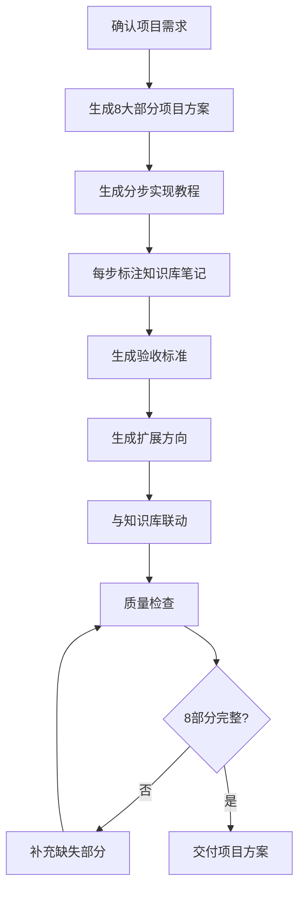

# 项目驱动学习生成器

> 生成**从需求到部署**的完整项目学习方案，将碎片化知识点整合为可交付的实战项目，解决"知识点都会但做不出完整项目"的问题。

---

## 核心原则

1. **完整闭环**：项目方案覆盖需求→设计→实现→测试→部署→优化的完整流程
2. **知识联动**：每一步实现标注对应的知识库笔记，项目完成后知识点也复习完毕
3. **可交付**：项目有明确的验收标准和可演示的最终产物，不是半成品
4. **梯度递进**：项目分阶段实现，每阶段有独立可运行的产物和验收点
5. **生产规范**：代码结构、命名、注释、错误处理符合生产环境标准，不是玩具代码

---

## 项目方案 8 大部分概览

> 每部分的详细结构模板（含完整内容要点和示例）详见 [references/project-templates.md](references/project-templates.md)，生成项目方案时按对应部分的模板执行。

| 部分 | 核心内容 | 关键产出 |
|------|---------|---------|
| 一、项目概述 | 项目名称、类型、难度、技术栈、学习目标 | 项目定义 |
| 二、需求文档 | 功能需求表、非功能需求、用户故事 | 需求规格 |
| 三、技术选型 | 技术栈总览、选型对比、对应知识库笔记 | 选型决策 |
| 四、架构设计 | 系统架构图、目录结构、数据库设计、API 设计 | 架构文档 |
| 五、分步实现教程 | 分阶段实现，每步标注对应知识库笔记 | 实现指南 |
| 六、验收标准 | 功能/性能/代码质量/部署验收清单 | 验收清单 |
| 七、扩展方向 | 功能扩展、技术升级、进阶学习 | 扩展路线 |
| 八、学习资源 | 官方文档、推荐教程、常见问题 | 资源清单 |

---

## 常见项目类型参考

> 8 种项目类型的详细需求模板、技术栈、知识点覆盖矩阵、验收标准详见 [references/project-types-and-templates.md](references/project-types-and-templates.md)，生成项目方案时按对应类型的模板执行。

| 类型 | 难度 | 周期 | 代表项目 |
|------|------|------|---------|
| 全栈 CRUD 应用 | ⭐⭐ | 2-3周 | 博客系统、任务管理 |
| 全栈业务系统 | ⭐⭐⭐ | 4-6周 | 电商平台、在线教育 |
| 微服务系统 | ⭐⭐⭐⭐ | 6-8周 | 微服务电商、支付平台 |
| AI RAG 应用 | ⭐⭐⭐ | 3-4周 | 知识库问答、文档助手 |
| AI Agent 应用 | ⭐⭐⭐⭐ | 4-6周 | 智能研究助手、多Agent协作 |
| 前端工程化项目 | ⭐⭐⭐ | 3-4周 | UI组件库、脚手架工具 |
| 高并发系统 | ⭐⭐⭐⭐ | 6-8周 | 秒杀系统、弹幕系统 |
| 全栈+AI融合 | ⭐⭐⭐⭐ | 6-8周 | AI驱动的全栈应用 |

---

## 使用示例

**输入**："我想做一个 RAG 知识库问答系统来练手，技术栈用 Python + FastAPI + LangChain + Chroma，周期 4 周"

**输出**：
- 项目概述（类型、难度、技术栈、学习目标）
- 需求文档（功能需求表、非功能需求、用户故事）
- 技术选型（每层技术选型及理由、与相关概念对比）
- 架构设计（系统架构图、目录结构、数据库设计、API 设计）
- 分步实现教程（4 个阶段，每步标注 `[[文档切分]]` `[[向量检索]]` 等知识库笔记）
- 验收标准（功能/性能/代码质量/部署验收清单）
- 扩展方向（功能扩展、技术升级、进阶学习）

---

## 核心工作流程

---

## 工作流程

### 场景一：生成完整项目方案

1. **确认需求**：
   - 项目类型和主题（如"做一个电商平台"、"练一下 RAG 技术"）
   - 技术栈偏好（Java/Vue3/Python/AI 或混合）
   - 难度级别（入门/进阶/高级/专家）
   - 预计周期（2周/4周/8周）
   - 是否需要与现有知识库笔记联动

2. **生成项目方案**：按 8 大部分生成完整方案，每部分按 references/project-templates.md 的模板执行

3. **生成分步实现教程**：
   - 按阶段拆分（初始化→核心功能→进阶功能→测试部署）
   - 每步包含：目标、具体步骤、代码片段、对应知识库笔记 `[[]]`、本阶段验收点
   - 每阶段结束有独立可运行的产物

4. **生成验收标准**：功能验收、性能验收、代码质量验收、部署验收，每项可量化可检查

5. **与知识库联动**：
   - 项目方案中所有技术概念添加 `[[]]` 双链
   - 在对应知识库笔记中添加项目引用
   - 项目完成后可生成项目总结笔记

### 场景二：生成项目某一部分的详细方案

1. 确认需要哪一部分（如"只生成需求文档"、"只生成分步实现教程"、"只生成架构设计"）
2. 按对应部分的模板生成详细内容
3. 确保该部分与项目整体上下文一致
4. 标注与其他部分的衔接关系

### 场景三：基于现有项目扩展

1. 确认现有项目的技术栈、已实现功能、代码结构
2. 确认要扩展的功能或技术点
3. 生成扩展方案：
   - 扩展需求说明
   - 对现有架构的影响分析
   - 具体实现步骤（标注修改哪些文件、新增哪些文件）
   - 兼容性和迁移说明
   - 扩展后的验收标准
4. 标注扩展涉及的知识库笔记

---

## 输出规范

1. 项目方案必须包含 8 大部分，每部分有实质内容，不是占位符
2. 分步实现教程每步必须标注对应知识库笔记的 `[[]]` 双链
3. 验收标准必须可量化、可检查（如"接口响应 <500ms"，不是"性能好"）
4. 技术选型必须有对比和理由（为什么选 A 不选 B），不是只列技术名
5. 代码示例必须可运行，包含完整的导入和配置
6. 项目分阶段实现，每阶段有独立可运行的产物和验收点
7. 扩展方向必须具体（如"引入 Redis 缓存热点数据"，不是"可以优化性能"）
8. 所有技术概念添加 `[[]]` 双链，与知识库笔记联动

---

## 质量检查清单

- [ ] 项目方案包含 8 大部分，每部分有实质内容，不是占位符
- [ ] 分步实现教程每步标注对应知识库笔记的 `[[]]` 双链
- [ ] 验收标准可量化、可检查（如"接口响应 <500ms"，不是"性能好"）
- [ ] 技术选型有对比和理由（为什么选 A 不选 B），不是只列技术名
- [ ] 代码示例可运行，包含完整的导入和配置
- [ ] 项目分阶段实现，每阶段有独立可运行的产物和验收点
- [ ] 扩展方向具体（如"引入 Redis 缓存热点数据"，不是"可以优化性能"）
- [ ] 所有技术概念添加 `[[]]` 双链，与知识库联动
- [ ] 项目类型与难度匹配（入门项目不要求微服务）
- [ ] 学习目标明确，项目完成后能达到什么水平

---

## 常见问题

> 使用本 Skill 时的常见问题和解答详见 [references/faq.md](references/faq.md)，包含：需要自己写代码吗、项目需要多长时间、技术选型可以改吗、做到一半发现方案有问题怎么办、项目完成后怎么检验学习效果等 7 个高频问题。

---

## 与其他 Skill 的协作

- **与 `code-practice-generator` 协作**：项目中的单个技术点用代码实践生成器生成可运行的练习项目，项目方案引用这些练习项目
- **与 `system-design-planner` 协作**：项目中的架构设计部分（尤其是高并发/分布式项目）用系统设计生成器生成深度方案，包含容量估算和 trade-off 分析
- **与 `tech-concept-deep-dive` 协作**：项目中涉及的核心技术概念用深度拆解器生成详细笔记，项目方案引用这些笔记
- **与 `obsidian-knowledge-base-creator` 协作**：项目方案写入知识库，与笔记双向链接；项目完成后生成项目总结笔记
- **与 `learning-path-planner` 协作**：项目纳入学习路线的实践阶段，学习路线中推荐对应难度的项目
- **与 `devops-deployment-guide` 协作**：项目的部署部分用部署运维指南生成具体的 Docker/K8s 部署方案
- **与 `ai-assisted-coding` 协作**：按 AI 辅助工作流搭骨架、垂直切片开发，但架构判断在你、代码逐行看懂
- **与 `code-review-refactor` 协作**：每个里程碑做一次自评审与安全重构，工程质量直接决定简历项目说服力
- **与 `career-life-guidance` 协作**：项目选型、组合与求职包装服从职业总路线，项目是普通背景者的第一硬通货

---

> **版本**：v1.0.0
>
> **最后更新**：2026-08-31
>
> **基于**：skill-optimizer 25 轮优化方法论 + skill-creator-for-work 规范

