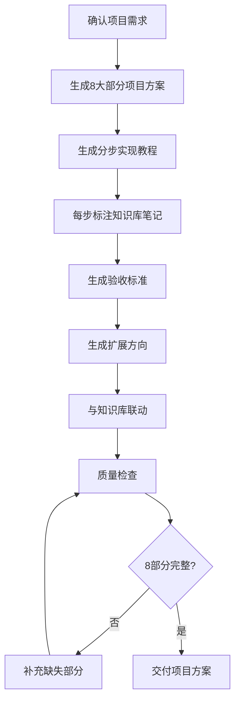

# 项目驱动学习生成器

> 生成**从需求到部署**的完整项目学习方案，将碎片化知识点整合为可交付的实战项目，解决"知识点都会但做不出完整项目"的问题。

---

## 核心原则

1. **完整闭环**：项目方案覆盖需求→设计→实现→测试→部署→优化的完整流程
2. **知识联动**：每一步实现标注对应的知识库笔记，项目完成后知识点也复习完毕
3. **可交付**：项目有明确的验收标准和可演示的最终产物，不是半成品
4. **梯度递进**：项目分阶段实现，每阶段有独立可运行的产物和验收点
5. **生产规范**：代码结构、命名、注释、错误处理符合生产环境标准，不是玩具代码
6. **分工显式**：每个阶段标注"AI 可代劳 / 你必须亲手"；方案只给方法与关键片段，不越界交付完整项目
7. **零基础可读**：术语首次出现给"定义 + 比喻"；命令标工作目录与预期输出；关键阶段给日志/结果解读；每阶段末尾一张动手卡片

---

## 项目方案 8 大部分概览

> 每部分的详细结构模板（含完整内容要点和示例）详见 [references/project-templates.md](references/project-templates.md)，生成项目方案时按对应部分的模板执行。

| 部分 | 核心内容 | 关键产出 |
|------|---------|---------|
| 一、项目概述 | 项目名称、类型、难度、技术栈、学习目标 | 项目定义 |
| 二、需求文档 | 功能需求表、非功能需求、用户故事 | 需求规格 |
| 三、技术选型 | 技术栈总览、选型对比、对应知识库笔记 | 选型决策 |
| 四、架构设计 | 系统架构图、目录结构、数据库设计、API 设计 | 架构文档 |
| 五、分步实现教程 | 分阶段实现，每步标注对应知识库笔记 | 实现指南 |
| 六、验收标准 | 功能/性能/代码质量/部署验收清单 | 验收清单 |
| 七、扩展方向 | 功能扩展、技术升级、进阶学习 | 扩展路线 |
| 八、学习资源 | 官方文档、推荐教程、常见问题 | 资源清单 |

> [!important] 每个部分的横切要求（不额外增加第 9 部分）
> - **分工**：标"AI 可代劳 / 你必须亲手"，别让学习者以为读完方案就等于会了；
> - **验收**：按「工程实践基线」第 1 条写成"命令 + 期望输出"，数字取自机器可读产物；
> - **估计值**：周期、难度、性能目标是估计值，写清依据（每周投入、参照项目）与变量，不冒充实测；
> - **卡片**：每个阶段末尾一张动手卡片（目标 / 命令 / 验收清单 / 卡住了）。

---

## 常见项目类型参考

> **选型三问**：① 你要练"单个技术点"还是"完整交付"？② 每周能稳定投入多少小时？③ 产出是练习还是简历项目？
> 入门 / 时间少 → CRUD；练 AI → RAG；练架构 → 微服务或高并发；求职 → 全栈 + AI 融合。
> 表中的周期按**每周 15-20 小时**估算，是估计值，不是承诺。

> 8 种项目类型的详细需求模板、技术栈、知识点覆盖矩阵、验收标准详见 [references/project-types-and-templates.md](references/project-types-and-templates.md)，生成项目方案时按对应类型的模板执行。

| 类型 | 难度 | 周期 | 代表项目 |
|------|------|------|---------|
| 全栈 CRUD 应用 | ⭐⭐ | 2-3周 | 博客系统、任务管理 |
| 全栈业务系统 | ⭐⭐⭐ | 4-6周 | 电商平台、在线教育 |
| 微服务系统 | ⭐⭐⭐⭐ | 6-8周 | 微服务电商、支付平台 |
| AI RAG 应用 | ⭐⭐⭐ | 3-4周 | 知识库问答、文档助手 |
| AI Agent 应用 | ⭐⭐⭐⭐ | 4-6周 | 智能研究助手、多Agent协作 |
| 前端工程化项目 | ⭐⭐⭐ | 3-4周 | UI组件库、脚手架工具 |
| 高并发系统 | ⭐⭐⭐⭐ | 6-8周 | 秒杀系统、弹幕系统 |
| 全栈+AI融合 | ⭐⭐⭐⭐ | 6-8周 | AI驱动的全栈应用 |

---

## 使用示例

> 一份 8 部分各取一段的骨架（标定"写多细才算够"）见 [examples/plan-skeleton-rag.md](examples/plan-skeleton-rag.md)；常见措辞的"差 / 好"对照见 [examples/bad-vs-good.md](examples/bad-vs-good.md)。

**输入**："我想做一个 RAG 知识库问答系统来练手，技术栈用 Python + FastAPI + LangChain + Chroma，周期 4 周"

**输出**：
- 项目概述（类型、难度、技术栈、学习目标）
- 需求文档（功能需求表、非功能需求、用户故事）
- 技术选型（每层技术选型及理由、与相关概念对比）
- 架构设计（系统架构图、目录结构、数据库设计、API 设计）
- 分步实现教程（4 个阶段，每步标注 `[[文档切分]]` `[[向量检索]]` 等知识库笔记）
- 验收标准（功能/性能/代码质量/部署验收清单）
- 扩展方向（功能扩展、技术升级、进阶学习）

---

## 核心工作流程

---

## 工作流程

### 场景一：生成完整项目方案

1. **确认需求**：
   - 项目类型和主题（如"做一个电商平台"、"练一下 RAG 技术"）
   - 技术栈偏好（Java/Vue3/Python/AI 或混合）
   - 难度级别（入门/进阶/高级/专家）
   - 预计周期（2周/4周/8周）
   - 是否需要与现有知识库笔记联动

2. **生成项目方案**：按 8 大部分生成完整方案，每部分按 references/project-templates.md 的模板执行

3. **生成分步实现教程**：
   - 按阶段拆分（初始化→核心功能→进阶功能→测试部署）
   - 每步包含：目标、具体步骤、命令 + 期望输出、代码片段、对应知识库笔记 `[[]]`、本阶段验收点
   - 每阶段结束有独立可运行的产物，并附一张动手卡片（目标 / 命令 / 验收 / 卡住了）

4. **生成验收标准**：功能验收、性能验收、代码质量验收、部署验收，每项写成"命令 + 期望输出"，数字取自机器可读产物

5. **标注人机分工**：每个阶段标"AI 可代劳 / 你必须亲手"；必须亲手的是跑通、改一行看变化、能讲清数据流

6. **与知识库联动**：
   - 项目方案中所有技术概念添加 `[[]]` 双链；没有对应笔记的，链接到该主题并标「待建」（如 `[[向量检索]]（待建）`），不臆造笔记名
   - 在对应知识库笔记中添加项目引用
   - 项目完成后可生成项目总结笔记

### 场景二：生成项目某一部分的详细方案

1. 确认需要哪一部分（如"只生成需求文档"、"只生成分步实现教程"、"只生成架构设计"）
2. 按对应部分的模板生成详细内容
3. 确保该部分与项目整体上下文一致
4. 标注与其他部分的衔接关系

### 场景三：基于现有项目扩展

1. 确认现有项目的技术栈、已实现功能、代码结构
2. 确认要扩展的功能或技术点
3. 生成扩展方案：
   - 扩展需求说明
   - 对现有架构的影响分析
   - 具体实现步骤（标注修改哪些文件、新增哪些文件）
   - 兼容性和迁移说明
   - 扩展后的验收标准
4. 标注扩展涉及的知识库笔记

---

## 输出规范

1. 项目方案必须包含 8 大部分，每部分有实质内容，不是占位符
2. 分步实现教程每步必须标注对应知识库笔记的 `[[]]` 双链
3. 验收标准必须可量化、可检查（如"接口响应 <500ms"，不是"性能好"）
4. 技术选型必须有对比和理由（为什么选 A 不选 B），不是只列技术名
5. 代码片段必须可运行（含导入与配置），但只给关键片段，不交付完整项目代码——要能跑起来的工程用 `project-scaffolder`
6. 项目分阶段实现，每阶段有独立可运行的产物和验收点
7. 扩展方向必须具体（如"引入 Redis 缓存热点数据"，不是"可以优化性能"）
8. 所有技术概念添加 `[[]]` 双链，与知识库笔记联动；没有对应笔记的，链接到该主题并标「待建」，不臆造
9. 周期/难度/性能目标是估计值，写清依据（每周投入、参照项目）与变量，不冒充实测
10. 命令标工作目录与预期输出；禁止无条件覆盖式命令（如 `cp .env.example .env`），危险命令标"危险"
11. 每个阶段末尾一张动手卡片；卡片命令可复制、验收项可勾选
12. 每个阶段标注"AI 可代劳 / 你必须亲手"，并给出必须亲手项的判断标准

---

## 工程实践基线（写进方案，不靠学习者自觉）

学习项目最常见的失败不是"不会写"，而是"看着跑起来了，其实没接上"。以下四条要写成方案的硬性要求，而不是建议。

### 1. 验收 = 命令 + 期望输出

| 差 | 好 |
|---|---|
| "接口正常返回" | `curl -s localhost:8000/api/health \| jq -e '.status=="ok"'` |
| "性能不错" | `wrk -t4 -c50 -d30s <url>`，P95 < 200ms |
| "测试通过" | `pytest -q --junitxml=.pytest/junit.xml`，取 `tests=` `failures=` `errors=` |

数字一律取自**机器可读产物**（junit xml、`--json` 输出），不抄终端摘要行：摘要会被终端插件截断，退出码会被包装脚本重写。

### 2. "装了要通电"：四类静默失败

配置写了不等于生效，四类各配一条验收：

1. **配置旁路**：业务代码绕过工厂直接 `import` 单例 → 换 provider 后仍跑老实现。验收：改配置重启，确认走的是新实现。
2. **绝对阈值**：分数尺度随数据量变化，阈值却写死 → 小数据全灭、大数据形同虚设。验收：用 1 条与 500 条数据各跑一次。
3. **校验没同步快速开始**：加了必填项但 QUICKSTART 没更新 → 新人照文档跑必失败。验收：照文档原样跑一遍。
4. **取消异常未捕获**：客户端断连的 `CancelledError` 逃过 `except Exception` → 日志刷栈。验收：请求中途断开，看日志。

> 这四类与 `project-scaffolder/references/engineering-baseline.md` 3.8 同源。方案里只写**验收动作**，不重抄根因分析——两处各写一套，必然漂移。

### 3. 提交纪律：commit 是批准，push 是传输

- `git add -A` 是"私有文件/临时文件进仓库"的头号入口——**按路径 add**，提交前 `git status --short` 扫一眼；
- 一个模块一条提交（`feat(retrieval): …`），不要攒成一条 `init`：历史要能读懂、能单独 revert；
- 装提交通道闸门（`secret-gate` 的 `pre-commit`，若该技能已安装）：`.env`、私钥、内嵌凭据在 `git commit` 那一刻被拒，而不是推上去再补救。

### 4. 环境一致性：确认"跑的是你改的那份"

源码与运行副本不同步，是"改了没生效"最常见的原因：`pip install` 未加 `-e`、Docker 镜像没重建、挂载的是另一份目录。方案里给一条验收：**改一行可见输出 → 重启 → 确认变化生效**。

---

## 质量检查清单

- [ ] 项目方案包含 8 大部分，每部分有实质内容，不是占位符
- [ ] 分步实现教程每步标注对应知识库笔记的 `[[]]` 双链
- [ ] 验收标准可量化、可检查（如"接口响应 <500ms"，不是"性能好"）
- [ ] 技术选型有对比和理由（为什么选 A 不选 B），不是只列技术名
- [ ] 代码片段可运行（含导入与配置），且只给关键片段、不越界交付完整项目代码
- [ ] 项目分阶段实现，每阶段有独立可运行的产物和验收点
- [ ] 扩展方向具体（如"引入 Redis 缓存热点数据"，不是"可以优化性能"）
- [ ] 所有技术概念添加 `[[]]` 双链，与知识库联动
- [ ] 项目类型与难度匹配（入门项目不要求微服务）
- [ ] 学习目标明确，项目完成后能达到什么水平
- [ ] 每条验收都能复制执行并给出可判定结果（命令 + 期望输出），数字取自机器可读产物
- [ ] 验收覆盖四类静默失败（配置旁路 / 绝对阈值 / 校验未同步 / 取消异常）各一条
- [ ] 方案含提交纪律（按模块提交、按路径 add）与提交通道闸门（secret-gate pre-commit）
- [ ] 有一致性验收：改一行 → 重启 → 确认生效（防"跑的是旧副本"）
- [ ] 每个阶段末尾有动手卡片，命令可复制、验收项可勾选
- [ ] 每个阶段标注"AI 可代劳 / 你必须亲手"，没有把核心练习外包给 AI
- [ ] 周期/难度/性能目标标了"估计"，并写清依据与变量
- [ ] 命令标了工作目录与预期输出；没有无条件 `cp .env` 之类的覆盖命令
- [ ] `[[]]` 双链指向真实笔记，或明确标「待建」
- [ ] 方案没有越界交付完整项目代码（要可运行工程转 `project-scaffolder`）

### 四轮自检（交付前）

| 轮次 | 查什么 | 判据 |
|---|---|---|
| 1 结构 | 8 部分齐全；标题层级不跳；表格列数一致；代码围栏闭合；`[[]]` 双链可解析 | 无缺项、无断链、围栏偶数 |
| 2 事实 | 技术版本写"系列"不写死小版本；周期/性能标"估计"；数字有来源 | 每个数字能指到来源或明确标"估计" |
| 3 一致性 | 类型/难度/周期/技术栈全文一致；阶段验收与第 6 部分验收对得上 | 同一数字不出现两种说法 |
| 4 可用性 | 零基础照着做会不会卡；命令能否复制；卡片能否勾选 | 每条命令有工作目录 + 期望输出 |

> 这是**方案交稿前**的四轮；项目落地后的指南迭代用 `project-processization` 的五轮（扫描事实 → 初稿 → 校准 → 补全 → 回归），两者不要混用。
>
> 四轮全过还不算完：最后一轮只看 **"读者照着做会不会卡"**，不是"文字对不对"。

---

## 常见问题

> 使用本 Skill 时的常见问题和解答详见 [FAQ.md](FAQ.md)，包含：需要自己写代码吗、项目需要多长时间、技术选型可以改吗、做到一半发现方案有问题怎么办、项目完成后怎么检验学习效果等 7 个高频问题。

---

## 三 Skill 定位卡（本 Skill 是方案层）

> 三个 `project-*` 最容易混。记住一条流水线：**方案 → 项目 → 指南**。

| 层 | Skill | 一句话 | 不做什么 | 下一步 |
|---|---|---|---|---|
| 方案 | **本 Skill（project-based-learning）** | 8 大部分项目方案 + 知识库双链 | 不生成代码 / 逐章指南 | → `project-scaffolder` |
| 执行 | `project-scaffolder` | 需求 → 产物 → 分工 → 行动指南 | 不做已有代码的深度精读 | → `project-processization` |
| 教学 | `project-processization` | 公开 README + 私密精读指南（+ 零基础精讲版） | 不生成项目 / 不替你做练习 | 动手 + 评测 |

完整对照（定位 / 输入 / 产物 / 不做什么）见仓库根 `Skill依赖关系图谱.md` 的「项目三件套」节；Skill 独立安装时该文件可能不存在，以本卡为准。
本 Skill 只产出**方案**（8 大部分），不生成项目代码，不生成逐章学习指南。

交接规则：

1. 本 Skill 出方案后，用户要落地 → 把 8 大部分交给 `project-scaffolder`，不要在本 Skill 里补代码；
2. 本 Skill 的方案若基于已有项目 → 先让 `project-processization` 做事实核查，避免方案里的行数/组件数过期；
3. 三份文档不要互相复制：**方案管"选什么/为什么"，项目管"跑起来"，指南管"怎么学/怎么验收"**。

**交给 scaffolder 的最小交接包**：技术栈 / P0-P1 范围 / 阶段划分 / 验收命令 / 双链清单。让它按包执行，不要重新规划一遍。

---

## 与其他 Skill 的协作

- **与 `project-scaffolder` 协作**：本 Skill 只出方案；用户确认后由 scaffolder 生成可运行项目与行动指南，方案中的技术选型/架构直接作为输入，不要重复规划
- **与 `project-processization` 协作**：项目落地后由 processization 做五轮事实核查与精读指南；本 Skill 的方案文档不替代学习指南
- **与 `code-practice-generator` 协作**：项目中的单个技术点用代码实践生成器生成可运行的练习项目，项目方案引用这些练习项目
- **与 `system-design-planner` 协作**：项目中的架构设计部分（尤其是高并发/分布式项目）用系统设计生成器生成深度方案，包含容量估算和 trade-off 分析
- **与 `tech-concept-deep-dive` 协作**：项目中涉及的核心技术概念用深度拆解器生成详细笔记，项目方案引用这些笔记
- **与 `obsidian-knowledge-base-creator` 协作**：项目方案写入知识库，与笔记双向链接；项目完成后生成项目总结笔记
- **与 `learning-path-planner` 协作**：项目纳入学习路线的实践阶段，学习路线中推荐对应难度的项目
- **与 `devops-deployment-guide` 协作**：项目的部署部分用部署运维指南生成具体的 Docker/K8s 部署方案
- **与 `ai-assisted-coding` 协作**：按 AI 辅助工作流搭骨架、垂直切片开发，但架构判断在你、代码逐行看懂
- **与 `code-review-refactor` 协作**：每个里程碑做一次自评审与安全重构，工程质量直接决定简历项目说服力
- **与 `career-life-guidance` 协作**：项目选型、组合与求职包装服从职业总路线，项目是普通背景者的第一硬通货

---

> **版本**：v1.1.0
>
> **最后更新**：2026-11-03
>
> **基于**：skill-optimizer 25 轮优化方法论 + skill-creator-for-work 规范

