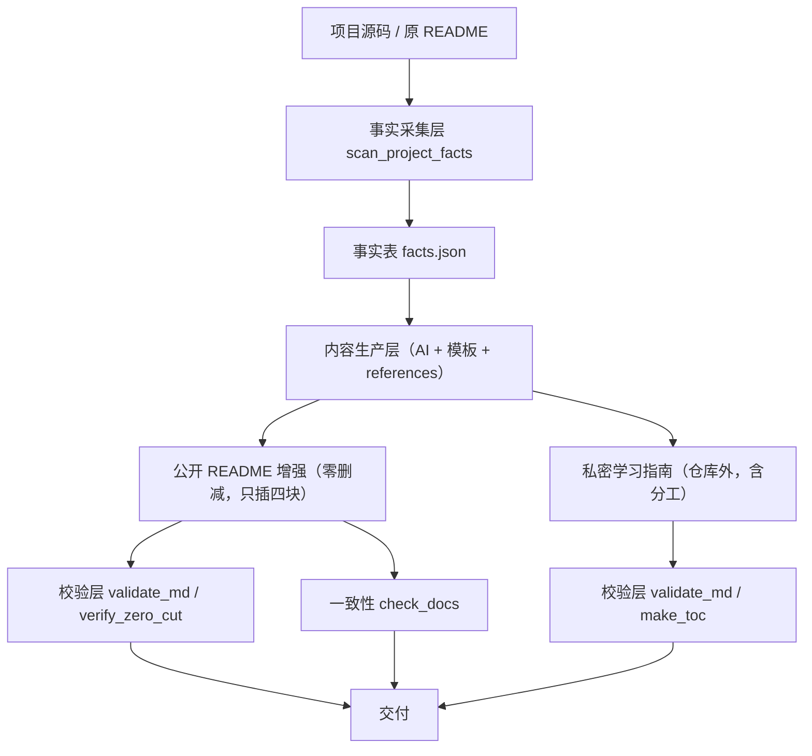

# 架构设计

## 设计目标

把"为 AI 生成项目写学习指南"这件依赖经验的工作，拆成**事实采集 → 内容生产 → 回归校验**
三段流水线；其中确定性、可重复的部分交给脚本，判断与写作交给 AI，最终质量由脚本兜底。

## 分层

### 1. 事实采集层（确定性）

`scan_project_facts.py` 只负责"客观计数"，不做主观判断：

- 统一口径：物理行、固定排除依赖/缓存目录、组件排除 `__init__.py`。
- 输出 JSON，既是写作时的唯一数字来源，也是可复核的证据。

### 2. 内容生产层（AI + 模板）

- `templates/learning-guide-template.md` 固定八章骨架，保证结构不漂移。
- `references/` 提供方法论、事实核查、写作规范、Prompt，按需加载（progressive disclosure）。
- `SKILL.md` 只保留核心流程与铁律，细节外置，避免占用过多上下文。

### 3. 校验 / 导航层（确定性兜底）

- `validate_md.py`：用围栏状态机保证结构正确（H1 唯一、围栏闭合、层级、表格）。
- `verify_zero_cut.py`：用三级比对保证原文不被静默删减。
- `make_toc.py`：用统一 slug 算法保证锚点与 GitHub/Obsidian 一致。

## 关键设计决策

| 决策 | 原因 |
|------|------|
| 脚本只用标准库 | 降低使用门槛，跨平台、零安装即可运行 |
| 每个脚本独立 CLI、返回 JSON | 可单独运行、可组合、可被其它工具解析 |
| 组件计数默认排除 `__init__.py` | 包标记不是业务组件，避免数量虚高 |
| 标题/围栏解析用状态机 | 代码块内 `#` 是注释，正则会误判 |
| 零删减比对分三级 | 精确 / 宽松 / 疑似，兼顾严格与少量格式差异 |
| 目录默认只预览，`--write` 才写回 | 防止误改，写回时自动备份 `.bak` |
| 密钥只取键名不取值 | 从工具层面杜绝凭据泄露 |

## 数据流与口径一致性

同一份文档里的规模数字，必须来自**同一次** `scan_project_facts.py` 运行，
避免不同脚本 / 不同时间口径混用导致前后矛盾。

## 扩展点

- 新增语言/框架：在 `scan_project_facts.py` 的后缀与解析函数中扩展。
- 新增校验规则：在 `validate_md.py` 增加 `check_*` 函数并加入 `validate()`。
- 新增指南模板：在 `templates/` 增加面向不同体裁的骨架（如运维手册、面试手册）。
