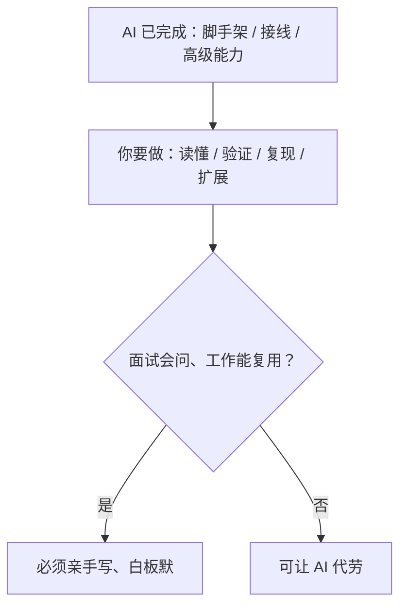

# {{项目名称}} · 从零到专家学习指南

<!--
使用说明（生成后删除本注释块）：
1. 本模板产出的是**仓库外的私密指南**（含分工与 AI 协作说明），不要并入项目 README。
2. 所有 {{...}} 占位由 scan_project_facts 结果与源码核对结果填充，禁止编造数字。
3. 填充后删除本注释块；依次运行 validate_md.py / check_docs.py / make_toc.py。
4. 若同时要增强公开 README：只补"能力矩阵 / 快速开始 / 架构 / 已知限制"四块，不写分工。
-->

> 本文件是**仓库外的私密文档**：含分工、AI 协作比例与练习安排，不随项目发布。
> 公开 README 只写能力、用法、架构与限制，两边的"怎么用"可以互相引用，但内容不重叠。

## 🎓 从零到专家：完整学习指南（AI 协作版）

<!-- 用 make_toc.py 生成折叠目录并写回本处：
python scripts/make_toc.py --path 学习指南.md --start "学习指南" \
  --levels 3-4 --details --title "学习指南目录（点击展开）" --insert-after "学习指南（AI 协作版）" --write
-->

> [!abstract] 这份指南怎么用
> {{一句话定位：AI 已搭好骨架与高级能力，你负责读懂、复现、改得动，并能讲给面试官听。}}

**今天就做这 3 件事**（约 1-2 小时，先建立正反馈）：

1. 把项目跑起来，见 [5.1](#)；
2. 上传 1 份文档、走通一次问答，见 [5.2](#)；
3. 打开核心主链路文件，按"带着问题读"清单精读，见 [5.3](#)。

**三条底线**：不看懂原理不复制；核心算法白板手写；每次只改一个变量。

---

### 一、先搞懂：这份代码是怎么来的

#### 1.1 项目现状：AI 已搭好"骨架 + 高级能力"，你负责"灵魂 + 验证"

{{用事实说明：AI 已完成到什么程度、规模多大（数字来自 scan_project_facts）、还差什么。}}

#### 1.2 学习方式的根本转变：四步闭环

{{跑起来 → 读得懂 → 复现出 → 改得动，每步给定义、产出、验收。}}

#### 1.3 一张图看懂分工：AI 负责什么 vs 你负责什么



### 二、AI 已经替你完成了什么（如何"利用"而非"抄"）

#### 2.1 已完成能力清单（含验证方式与精读优先级）

| 模块 | 关键文件 | 行数（实测） | 能力 | 验证方式 | 精读优先级 |
|------|----------|----------|------|----------|-----------|
| {{主链路}} | `{{path}}` | {{N}} | {{能力}} | {{如何跑/测}} | 🔴必看 |
| {{检索}} | `{{path}}` | {{N}} | {{能力}} | {{验证}} | 🔴必看 |

> 行数与文件数必须与 `scan_project_facts.py` 输出一致；优先级按面试/工作相关度排。

#### 2.2 正确利用 AI 成果的四步法（每个模块都这样过一遍）

1. **跑通**：用真实输入触发该模块，观察输入输出；
2. **读懂**：用"讲代码 Prompt"（见 references/04）逐函数理解；
3. **复现**：关掉源码，自己重写核心逻辑，再与源码对比；
4. **改造**：改一个变量或加一个小功能，用评测证明影响。

#### 2.3 让 AI 继续帮你的场景（放心委托）

{{脚手架、CRUD、接线、文档润色、出练习题等——逐项列出。}}

#### 2.4 让 AI 给你"讲代码"的 Prompt 模板（复制即用）

{{直接引用 references/04 的精读 Prompt，并给一个本项目的例子。}}

#### 2.5 三条红线（避免"抄完就交、一问就露馅"）

- {{核心算法不能让 AI 替你写}}
- {{架构选型的"为什么"必须自己答得出}}
- {{评测结论必须自己读数据，不直接用 AI 的总结}}

### 三、你必须亲手完成的部分（面试命根子）

#### 3.1 六大核心任务总览

| 任务 | 产出 | 验收 |
|------|------|------|
| ①跑通系统 | 可访问的全链路 | 截图/接口返回 |
| ②补 golden QA | 40-50 条用例 | JSON 校验通过 |
| ③白板默写核心算法 | 6 个算法 | 白纸默写 |
| ④跑 ≥2 轮评测 | 对照报告 | 单变量归因 |
| ⑤自主扩展 | 1-2 个功能 | 现场演示 |
| ⑥技术博客 | 1-2 篇 | 讲清选型 |

#### 3.2 任务详解

{{每个任务：为什么必做、前置条件、步骤、常见坑、完成标准。}}

#### 3.3 必须白板手写的 6 个核心算法/流程

- {{混合检索 RRF 融合（含手算例子）}}
- {{BM25 / 分词匹配}}
- {{文本切片（含 overlap）}}
- {{ReAct 循环与 Function Calling 消息协议}}
- {{Rerank 排序}}
- {{主链路编排时序}}

### 四、零基础到专家的五阶段学习路线

> [!abstract] 基础不牢？先补这些，别从头系统学
> | 不熟的 | 补到什么程度 |
> |---|---|
> | {{语言基础}} | {{够用即可的程度}} |

**路线总览（能力六层）**：环境 → 主链路 → 检索增强 → 编排生产化 → 多智能体/图谱 → 自主扩展。

#### 阶段 0：环境就绪（验证，约 0.5 周）
- 周期 / 学习内容 / 产出 / 验收：{{...}}
#### 阶段 1：跑通 + 看懂主干（朴素 RAG 全链路，约 X 周）
- 周期 / 学习内容 / 产出 / 验收：{{...}}
#### 阶段 2：四大检索深化（约 X 周）
- 周期 / 学习内容 / 产出 / 验收：{{...}}
#### 阶段 3：编排 + 生产化（约 X 周）
- 周期 / 学习内容 / 产出 / 验收：{{...}}
#### 阶段 4：前沿能力（GraphRAG / 多模态 / 微调，约 X 周）
- 周期 / 学习内容 / 产出 / 验收：{{...}}
#### 阶段 5：专家级（自主扩展 + 上线 + 面试包装，约 X 周）
- 周期 / 学习内容 / 产出 / 验收：{{...}}

### 五、手把手操作手册（手动部分怎么做）

#### 5.1 启动项目（两种方式，推荐 Docker）

> [!tip] 前置环境清单
> | 环境 | 版本 | 验证命令 | 何时需要 |
> |------|------|----------|----------|
> | Docker | {{}} | `docker --version` | 推荐，含全部依赖 |
> | Git | 最新 | `git --version` | 提交基线 |
> | 语言运行时 | {{}} | `{{}}` | 仅裸跑调试需要 |

```bash
# {{进入项目目录}}
# {{启动命令}}
# {{查看状态 / 日志 / 停止 / 重启}}
```

> [!warning] 裸跑与 Docker 配置差异
> {{数据库/向量库/环境变量的差异，避免连错。}}

> [!tip] Git 安全网（项目无 .git 时先做）
> ```bash
> git init && git add . && git commit -m "chore: 基线（AI 生成版本）"
> # 改坏了：git checkout -- .；回到历史：git log --oneline
> ```

#### 5.2 第一次上传文档全流程（建议照着点一遍）
{{步骤：建知识库 → 上传 → 等待解析/向量化 → 提问 → 看引用来源。}}

#### 5.3 核心模块精读路线（按这个顺序读，每文件带着问题读）
{{顺序表 + 每个文件"读前问题/读后自测"。}}

#### 5.4 补全 golden QA（评测的地基）
{{真实字段表（字段名来自源码）、可照抄 JSON 示例、JSON 校验命令、目标条数。}}

#### 5.5 跑评测、做对照实验（评测驱动）
```bash
# {{真实脚本与参数，如 --no-judge / --kb-id；报告输出位置}}
```
| 参数 | 作用 | 何时用 |
|------|------|--------|
| {{--no-judge}} | {{只算检索、省 token}} | 调试期 |
| {{--kb-id N}} | {{统一知识库}} | id 非 1 |

> [!tip] 控制成本
> {{3-5 条用例起步、Embedding 缓存、裁判/Rerank 按需开。}}

#### 5.6 复现核心算法
{{每个算法：先白板默写、再对照源码、再跑通、边界用例。}}

#### 5.7 配置开关地图（用开关做对照实验）
| 开关 | 作用 | 默认 | 改成什么观察什么 |
|------|------|------|----------------|
| {{RERANK_ENABLED}} | {{}} | {{}} | {{}} |

#### 5.8 部署上线
{{构建/镜像/端口/反向代理/HTTPS/踩坑记录。}}

#### 5.9 日常工具箱：调试 / 接口测试 / 前端构建
- 后端断点：{{VS Code 配置与解释器选择}}
- 接口测试：{{Swagger 路径、登录拿 token、Authorize 流程}}
- 前端调试：{{F12 Network 看 SSE、Console}}
- 前端构建：{{类型检查坑、build 与 build:no-check 区别}}

### 六、AI 协作规范（怎么用 AI 不被反噬）

#### 6.1 基本原则：70% 自己写，30% AI 辅助
{{判断标准：面试会不会考、工作能不能复用。}}

#### 6.2 什么能用 AI、什么必须自己（红线对照表）
| 场景 | 可让 AI | 必须自己 |
|------|---------|----------|
| {{}} | {{}} | {{}} |

#### 6.3 各阶段 AI 辅助比例
{{初期 60% → 中期 40% → 后期 20%。}}

#### 6.4 提问与协作规范
{{先给上下文、一次一个问题、要验证命令而非直接改码。}}

#### 6.5 安全与隐私
{{密钥脱敏、生产数据不贴外部模型。}}

### 七、代码地图 + 文档导航（迷路时看这里）

#### 7.1 目录结构精讲
{{带注释的目录树（组件数来自扫描）。}}

#### 7.2 后端模块地图
{{分层：路由→服务→检索/编排→模型→数据。}}

#### 7.3 前端页面地图
{{页面/组件/路由/状态。}}

#### 7.4 已有文档导航
| 文档 | 内容 | 什么时候读 |
|------|------|-----------|
| {{docs/...}} | {{}} | {{}} |

### 八、终极验收清单（从零基础到专家）

#### 8.1 环境与跑通
- [ ] {{五容器/服务全部健康，能访问前端与后端文档}}
- [ ] {{上传文档、走通问答、看到引用来源}}

#### 8.2 理解与复现
- [ ] {{能白板画出主链路并讲清每步输入输出}}
- [ ] {{6 个核心算法白板默写通过}}
- [ ] {{golden QA 补到 40-50 条且字段校验通过}}
- [ ] {{跑 ≥2 轮单变量评测并能解释指标变化}}

#### 8.3 改得动与面试
- [ ] {{完成 1-2 个自主扩展并能现场演示}}
- [ ] {{能讲清"为什么这么选型、为什么不选别的"}}
- [ ] {{写完 1-2 篇技术博客}}
