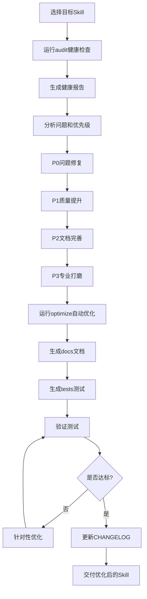

---
name: skill-optimizer
description: Skill 工程化优化器，基于 25 轮实战优化经验，提供系统化的 Skill 质量评估、自动优化、文档生成、测试验证全流程工具链。支持自动检测 Skill 类型（代码驱动型/纯文档型/混合型），按类型自适应调整评估维度和优化策略。当需要优化现有 Skill、提升 Skill 质量、完善 Skill 文档体系、为 Skill 添加测试和工程化配置时使用。支持 Skill 健康检查、自动补全文档、生成测试用例、配置 CI/CD、统一代码风格等场景。
---

# Skill 工程化优化器

> 基于对 `obsidian-knowledge-base-creator` Skill 进行 25 轮深度优化的实战经验，提炼出一套可复用的 Skill 优化方法论和工具链，帮助任何 Skill 从「能用」提升到「专业级」。

---

## 📚 快速导航

| 文档 | 用途 | 适合人群 |
|------|------|---------|
| [README.md](README.md) | 项目首页，功能概览 | 所有人 |
| [QUICKSTART.md](QUICKSTART.md) | 5 分钟快速上手 | 初学者 |
| [OPTIMIZATION-GUIDE.md](OPTIMIZATION-GUIDE.md) | 25 轮优化完整指南 | 所有用户 |
| [CHECKLIST.md](CHECKLIST.md) | 优化检查清单（100+ 项） | 优化时参考 |
| [QUALITY-STANDARDS.md](QUALITY-STANDARDS.md) | 质量标准与验收规范 | 所有用户 |
| [FAQ.md](FAQ.md) | 常见问题解答 | 遇到问题时 |
| [CHANGELOG.md](CHANGELOG.md) | 版本变更记录 | 升级时参考 |
| **本文档** | 完整功能和规范说明 | 深入了解 |

---

## 🎯 核心能力

### 0. Skill 类型自动检测（v1.7 新增）

自动检测 Skill 类型，按类型自适应调整评估维度和优化策略：

| 类型 | 检测特征 | 评估模式 | 优化策略 |
|------|---------|---------|---------|
| **代码驱动型** | 有 scripts/ 目录、≥3个 Python 文件、有 CLI 入口 | 8维度标准模式（含代码/测试/工程化） | 完整优化：文档+代码+测试+工程化配置 |
| **纯文档型** | 无 Python 代码、有 references/、Markdown 文档为主 | 8维度文档型模式（doc_structure/trigger_scenarios/output_spec/references_depth） | 精简优化：只补全文档+基础配置（.gitignore/.editorconfig） |
| **混合型** | 既有代码又有大量文档 | 11维度混合模式 | 完整优化 + 文档型专属维度 |

**检测脚本**：`scripts/skill_type_detector.py`

### 1. Skill 健康检查（audit）

自动检测 Skill 的 8 大维度健康状况（代码驱动型），纯文档型自动切换为文档型专属维度：

| 维度 | 检查项 | 代码型权重 | 文档型权重 |
|------|--------|-----------|-----------|
| 元数据完整性 | name/description/frontmatter | 15% | 15% |
| 文档完整性 | README/SKILL/CHANGELOG/FAQ 等 | 20% | 25% |
| 代码质量 | 语法/类型注解/异常处理 | 20% | —（跳过） |
| 测试覆盖 | 单元测试/集成测试 | 15% | —（跳过） |
| 工程化配置 | CI/CD/pre-commit/lint | 10% | —（跳过） |
| 模板资源 | 模板文件/示例/参考文档 | 10% | 10% |
| 易用性 | 快速上手/命令帮助/错误提示 | 5% | 5% |
| 可维护性 | 代码结构/注释/命名规范 | 5% | —（跳过） |
| **SKILL.md结构**（文档型专属） | 核心原则/使用流程/输出规范/版本信息 | — | 15% |
| **触发场景覆盖**（文档型专属） | description触发词/使用场景数/示例 | — | 10% |
| **输出规范明确性**（文档型专属） | 输出规范模块/质量检查清单/具体条目 | — | 10% |
| **references深度**（文档型专属） | references数量/平均行数/SKILL引用 | — | 10% |

### 2. 自动优化（optimize）

一键执行标准化优化操作（按 Skill 类型自适应）：

- 补全缺失文档（README/QUICKSTART/CHANGELOG/FAQ/CONTRIBUTING/SECURITY/CODE_OF_CONDUCT/INSTALLATION/USE-CASES/SUPPORT）
- 代码质量检查与类型注解提示（代码驱动型/混合型，检查不自动修改）
- 配置工程化文件（代码驱动型/混合型：.gitignore/.editorconfig/.pre-commit-config.yaml/pyproject.toml/Makefile/requirements.txt/CI-CD）
- 纯文档型精简优化：只补全文档 + 基础配置（.gitignore/.editorconfig）
- 支持 `--dry-run` 预览模式，`--only` 指定优化范围

> **注意**：测试用例生成请使用 `tests` 命令，质量检查报告请使用 `audit` 命令，SKILL.md 内容优化需手动完善。

### 3. 文档生成（generate-docs）

根据 Skill 的脚本和功能，自动生成：

- API 参考文档（函数签名/参数/返回值/示例）
- 使用示例文档
- 常见问题文档
- 贡献指南
- 安装指南

### 4. 测试生成（generate-tests）

自动生成：

- 单元测试模板（每个函数一个测试用例）
- 集成测试模板（每个命令一个端到端测试）
- 测试数据和 Mock
- 覆盖率配置

### 5. 部署一致性检查（check-install-sync，v1.9 新增）

Skill 通常有两份：你编辑的源码目录、agent 实际加载的安装目录。**改源码不会影响副本**——这是"优化完了却没生效"最常见的假象，也是最容易被审计漏掉的一项。

```bash
python scripts/check-install-sync.py ../your-skill      # 加 --json 便于接入流水线
```

自动扫描 `~/.workbuddy/skills`、`~/.claude/skills`、`~/.codex/skills` 等已知根目录，以及 `~/<任意目录>/skills`，逐个判定：

| 状态 | 含义 | 处理 |
|------|------|------|
| `LINKED` | 安装位是指向源码的链接 | 无需处理，推荐形态 |
| `IN_SYNC` | 实体目录，逐文件一致 | 可保留；建议改链接，避免下次漂移 |
| `STALE` | 实体目录，内容不同 | 打印差异文件，据此决定同步或改链接 |
| `MISMATCH` | 是链接，但指向别处 | 重新指向当前源码 |
| `ABSENT` | 该根目录没有此 Skill | 忽略 |

退出码：`0` 正常，`1` 存在 `STALE`/`MISMATCH`，`2` 路径无效——可直接接入 CI 或提交前钩子。

**固化为链接**（推荐，一劳永逸）：Windows 用 `hermes-portability` 技能的 `scripts/link-skill.ps1`（junction 不需要管理员权限，对读取方透明）；Linux/WSL 等价 `ln -sfn <源码> <安装位>`。

**两个反直觉的坑**：

1. **备份不能留在技能根目录**。`<name>.bak-<时间戳>` 里同样有 `SKILL.md`，会被多数 agent 当成**第二个同名 Skill** 扫出来；应放到技能树之外（如 `%LOCALAPPDATA%\SkillLinkBackups`）。
2. **安装位可能含 agent 写入的元数据**（如 `_user_meta.json`）。改成链接后该文件会落到源码目录，记得加进 `.gitignore`，否则每次审计都会看到"副本独有"的噪声。检查脚本已把这类平台元数据加入忽略列表。

---

## 🚀 25 轮优化方法论

### 优化阶段总览

```
阶段一：基础完善（第1-5轮）
  ├── 第1轮：核心功能验证与 Bug 修复
  ├── 第2轮：文档体系补全（README/SKILL/CHANGELOG）
  ├── 第3轮：错误处理与边界情况
  ├── 第4轮：用户体验优化（帮助信息/错误提示）
  └── 第5轮：代码结构重构

阶段二：质量提升（第6-10轮）
  ├── 第6轮：类型注解全覆盖
  ├── 第7轮：单元测试体系建设
  ├── 第8轮：集成测试体系建设
  ├── 第9轮：代码质量检查（lint）
  └── 第10轮：性能优化

阶段三：工程化（第11-15轮）
  ├── 第11轮：pre-commit 配置
  ├── 第12轮：CI/CD 流水线
  ├── 第13轮：代码覆盖率
  ├── 第14轮：项目配置标准化（pyproject/Makefile）
  └── 第15轮：跨平台兼容性

阶段四：文档深化（第16-20轮）
  ├── 第16轮：FAQ 体系建设
  ├── 第17轮：使用案例与最佳实践
  ├── 第18轮：API 参考文档
  ├── 第19轮：开发者文档（架构/测试/调试）
  └── 第20轮：社区文档（贡献/行为准则/安全）

阶段五：专业级打磨（第21-25轮）
  ├── 第21轮：安装与卸载脚本
  ├── 第22轮：示例项目与模板
  ├── 第23轮：国际化与翻译指南
  ├── 第24轮：项目治理与发布流程
  └── 第25轮：最终全面优化与验证
```

### 每轮优化的标准流程

```
1. 现状评估 → 运行 audit-skill.py，生成健康报告
2. 问题定位 → 根据报告确定本轮优化重点
3. 执行优化 → 手动或自动执行优化操作
4. 验证测试 → 运行测试确保无回归
5. 记录变更 → 【强制】同步更新 CHANGELOG.md（含版本号升级），禁止"改完代码不更 CHANGELOG"
6. 提交代码 → 符合 Conventional Commits 规范
```

> **⚠️ 强制约束**：第5步不是可选步骤。每次修改 SKILL.md / scripts/ / references/ 后，必须在同一次修改中更新 CHANGELOG.md，记录本次变更内容并按语义化版本规则升级版本号。未更新 CHANGELOG 的修改视为未完成，不得提交。

---

## 核心工作流程



---

## 📋 使用流程

### 场景一：优化一个现有 Skill

1. **评估现状**：运行 `python scripts/audit-skill.py --path <skill路径>`，生成健康报告
2. **确定优先级**：根据报告中的问题严重程度，确定优化顺序
3. **执行优化**：
   - 自动优化：`python scripts/optimize-skill.py --path <skill路径> --auto`
   - 手动优化：参考 [OPTIMIZATION-GUIDE.md](OPTIMIZATION-GUIDE.md) 逐步执行
4. **生成文档**：`python scripts/generate-docs.py --path <skill路径>`
5. **验证结果**：再次运行 audit，确认问题已解决
6. **记录变更**：【强制】同步更新 CHANGELOG.md（含版本号升级），未更新不得提交

### 场景二：从零创建一个专业级 Skill

1. **初始化**：使用模板创建基础结构
2. **开发功能**：实现核心脚本
3. **第一轮优化**：运行 audit，修复基础问题
4. **迭代优化**：按 25 轮方法论逐步提升
5. **最终验证**：通过所有检查项

### 场景三：定期维护优化

1. **每月运行 audit**：监控 Skill 健康状况
2. **每季度全面优化**：按 25 轮方法论检查
3. **每次更新后验证**：运行测试确保质量

---

## 🔧 脚本使用说明

### audit-skill.py — Skill 健康检查

```bash
python scripts/audit-skill.py --path "./my-skill" --format json --output report.json
```

**检查维度**：
- 元数据完整性（frontmatter/name/description）
- 文档完整性（15+ 种文档检查 + Markdown格式检查：表格列数一致性/双链格式有效性/表格管道符转义）
- 代码质量（py_compile语法验证/类型注解/异常处理/命名规范）
- 测试覆盖（单元测试/集成测试/覆盖率）
- 工程化配置（CI/CD/pre-commit/lint/gitignore）
- 模板资源（模板文件/示例/参考文档）
- 易用性（帮助信息/错误提示/快速上手）
- 可维护性（代码结构/注释/模块化）

**输出**：
- 总分（0-100）
- 各维度得分
- 问题清单（按严重程度排序）
- 优化建议

### optimize-skill.py — 自动优化

```bash
python scripts/optimize-skill.py --path "./my-skill" --auto --dry-run
```

**自动优化项**：
- 补全缺失文档（基于模板）
- 统一代码风格
- 添加类型注解
- 生成 .gitignore/.editorconfig
- 优化 SKILL.md 导航
- 生成 CHANGELOG 模板

**参数**：
- `--auto`：自动执行所有优化
- `--dry-run`：预览模式，只显示将执行的操作
- `--only docs`：只优化文档
- `--only code`：只优化代码
- `--only config`：只优化配置

### generate-docs.py — 文档生成

```bash
python scripts/generate-docs.py --path "./my-skill" --type all
```

**生成文档类型**：
- `api`：API 参考文档（解析函数签名和 docstring）
- `faq`：常见问题文档
- `examples`：使用示例文档
- `contributing`：贡献指南
- `installation`：安装指南
- `all`：生成所有文档

### generate-tests.py — 测试生成

```bash
python scripts/generate-tests.py --path "./my-skill" --type unit
```

**生成测试类型**：
- `unit`：单元测试（每个函数一个测试类）
- `integration`：集成测试（每个命令一个测试）
- `all`：生成所有测试

---

## 📐 质量标准

### 专业级 Skill 的 10 大标准

| 标准 | 要求 | 验收方式 |
|------|------|---------|
| 1. 功能完整 | 所有声明的功能可正常使用 | 集成测试 100% 通过 |
| 2. 文档完善 | 15+ 种文档齐全 | audit 文档维度 ≥90 分 |
| 3. 代码质量 | 0 错误 0 警告 | lint 通过 |
| 4. 类型安全 | 类型注解 100% 覆盖 | mypy 通过 |
| 5. 测试充分 | 单元测试 + 集成测试 | 覆盖率 ≥80% |
| 6. 工程化 | CI/CD + pre-commit + lint | 配置文件齐全 |
| 7. 易用性 | 5 分钟可上手 | QUICKSTART 完整 |
| 8. 健壮性 | 异常处理 + 边界情况 | 错误测试通过 |
| 9. 跨平台 | Windows/macOS/Linux | 多平台测试通过 |
| 10. 可维护 | 代码结构清晰 + 注释 | 代码审查通过 |

### 评分等级

| 等级 | 分数 | 状态 | 说明 |
|------|------|------|------|
| S | 95-100 | 🏆 专业级 | 可发布到官方市场 |
| A | 85-94 | ✅ 优秀 | 可公开分享 |
| B | 70-84 | ⚠️ 良好 | 可自用，需优化 |
| C | 50-69 | ❌ 一般 | 需要大幅优化 |
| D | <50 | 🔴 较差 | 建议重构 |

---

## 📁 标准 Skill 目录结构

```
my-skill/
├── SKILL.md                    # 核心文档（必须）
├── README.md                   # 项目首页
├── QUICKSTART.md               # 快速上手
├── INSTALLATION.md             # 安装指南
├── CHANGELOG.md                # 版本记录
├── FAQ.md                      # 常见问题
├── CONTRIBUTING.md             # 贡献指南
├── SECURITY.md                 # 安全策略
├── CODE_OF_CONDUCT.md          # 行为准则
├── API.md                      # API 参考
├── ARCHITECTURE.md             # 架构文档
├── TESTING.md                  # 测试指南
├── DEBUGGING.md                # 调试指南
├── USE-CASES.md                # 使用案例
├── SUPPORT.md                  # 支持指南
├── LICENSE                     # 许可证
├── .gitignore                  # Git 忽略
├── .editorconfig               # 编辑器配置
├── .pre-commit-config.yaml     # pre-commit 配置
├── pyproject.toml              # 项目配置（Python）
├── Makefile                    # 构建工具
├── requirements.txt            # 依赖
├── main.py                     # 主入口
├── scripts/                    # 脚本目录
│   ├── __init__.py
│   ├── module1.py
│   └── module2.py
├── tests/                      # 测试目录
│   ├── unit/
│   │   └── test_module1.py
│   └── integration/
│       └── test_commands.py
├── templates/                  # 模板目录
│   └── template1.md
├── references/                 # 参考文档
│   └── reference1.md
└── examples/                   # 示例项目
    └── example1/
```

---

## ✅ 优化检查清单（核心 50 项）

### 元数据（5 项）
- [ ] SKILL.md 有正确的 frontmatter（name/description）
- [ ] description 清晰描述功能和触发场景
- [ ] 版本号规范（语义化版本）
- [ ] 许可证明确
- [ ] 作者信息完整

### 文档（11 项）
- [ ] README.md 包含功能介绍/安装/使用/贡献
- [ ] QUICKSTART.md 5 分钟可上手
- [ ] CHANGELOG.md 按版本记录变更
- [ ] **【强制】本次修改已同步更新 CHANGELOG.md**（修改了 SKILL/scripts/references 后必须在 CHANGELOG 中记录，含版本号升级；未更新视为未完成）
- [ ] FAQ.md 覆盖 10+ 常见问题
- [ ] API.md 包含所有公开函数
- [ ] CONTRIBUTING.md 有明确的贡献流程
- [ ] SECURITY.md 有安全报告流程
- [ ] 代码有足够的注释和 docstring
- [ ] 示例代码可运行
- [ ] 文档链接无死链

### 代码（10 项）
- [ ] 语法正确，无运行时错误
- [ ] 类型注解 100% 覆盖
- [ ] 所有函数有 docstring
- [ ] 异常处理完善（try/except）
- [ ] 输入参数验证
- [ ] 命名规范（PEP8）
- [ ] 代码模块化，单一职责
- [ ] 无硬编码配置
- [ ] 日志记录合理
- [ ] 无安全漏洞（注入/路径遍历等）

### 测试（8 项）
- [ ] 单元测试覆盖核心函数
- [ ] 集成测试覆盖主要流程
- [ ] 测试可重复运行
- [ ] 测试有断言
- [ ] 边界情况测试
- [ ] 错误情况测试
- [ ] 覆盖率 ≥80%
- [ ] CI 中自动运行测试

### 工程化（7 项）
- [ ] .gitignore 配置正确
- [ ] .editorconfig 统一代码风格
- [ ] pre-commit 配置（lint/format/test）
- [ ] CI/CD 流水线（GitHub Actions）
- [ ] lint 配置（flake8/ruff/pylint）
- [ ] 代码格式化（black/isort）
- [ ] 依赖版本锁定

### 易用性（5 项）
- [ ] 命令行帮助信息完整（--help）
- [ ] 错误提示清晰友好
- [ ] 默认参数合理
- [ ] 支持 --dry-run 预览模式
- [ ] 输出格式统一

### 可维护性（5 项）
- [ ] 代码结构清晰
- [ ] 模块化设计
- [ ] 配置与代码分离
- [ ] 有架构文档
- [ ] Git 提交信息规范

---

## 📝 完整使用示例

### 示例 1：优化一个现有 Skill

```bash
# 步骤1：健康检查
python scripts/audit-skill.py --path "./my-skill"

# 步骤2：查看报告，确定优化重点
# 假设报告显示：文档缺失 40%，测试覆盖 0%，无工程化配置

# 步骤3：自动优化文档和配置
python scripts/optimize-skill.py --path "./my-skill" --auto --only docs,config

# 步骤4：生成测试
python scripts/generate-tests.py --path "./my-skill" --type all

# 步骤5：手动优化代码（添加类型注解/异常处理）
# 参考 OPTIMIZATION-GUIDE.md 第6-10轮

# 步骤6：再次检查
python scripts/audit-skill.py --path "./my-skill"

# 步骤7：更新 CHANGELOG
```

### 示例 2：从零创建专业级 Skill

```bash
# 步骤1：创建基础结构（手动或使用模板）
mkdir my-skill
cd my-skill
# 创建 SKILL.md, main.py 等

# 步骤2：实现核心功能
# 编写脚本

# 步骤3：第一轮优化（基础完善）
python scripts/audit-skill.py --path "."
python scripts/optimize-skill.py --path "." --auto

# 步骤4：按 25 轮方法论迭代
# 参考 OPTIMIZATION-GUIDE.md

# 步骤5：最终验证
python scripts/audit-skill.py --path "."
# 目标：总分 ≥90
```

---

## 🎯 优化优先级矩阵

| 问题类型 | 严重程度 | 修复难度 | 优先级 |
|---------|---------|---------|--------|
| 功能 Bug | 🔴 高 | 中 | P0 |
| 安全漏洞 | 🔴 高 | 高 | P0 |
| 文档缺失 | 🟠 中 | 低 | P1 |
| 无测试 | 🟠 中 | 中 | P1 |
| 无类型注解 | 🟡 低 | 低 | P2 |
| 代码风格 | 🟡 低 | 低 | P2 |
| 无 CI/CD | 🟡 低 | 中 | P2 |
| 性能问题 | 🟠 中 | 高 | P1 |
| 易用性问题 | 🟠 中 | 低 | P1 |
| 可维护性 | 🟡 低 | 高 | P3 |

---

## 📊 优化效果度量

### 优化前 vs 优化后对比

| 指标 | 优化前（典型） | 优化后（目标） | 提升 |
|------|--------------|--------------|------|
| audit 总分 | 40-60 | 90+ | +50% |
| 文档数量 | 2-3 | 15+ | +400% |
| 测试覆盖率 | 0% | 80%+ | +80% |
| 类型注解覆盖 | 0% | 100% | +100% |
| 代码质量问题 | 10+ | 0 | -100% |
| CI/CD | 无 | 有 | +100% |
| 用户上手时间 | 30 分钟+ | 5 分钟 | -83% |

---

## 🚀 统一 CLI 入口（skill-opt.py）

```bash
# Skill 类型检测（查看评估模式和优化范围）
python skill-opt.py type --path "./my-skill"

# 健康检查（按类型自适应维度）
python skill-opt.py audit --path "./my-skill"

# 自动优化（按类型过滤操作）
python skill-opt.py optimize --path "./my-skill" --auto

# 生成文档（纯文档型自动跳过API/架构文档）
python skill-opt.py docs --path "./my-skill" --type all

# 生成测试（纯文档型自动跳过）
python skill-opt.py tests --path "./my-skill" --type all

# 一键全流程（检查→优化→文档→[测试]→验证，按类型自适应）
python skill-opt.py all --path "./my-skill"

# 批量优化（一次优化目录下所有 Skill，生成批量报告）
python skill-opt.py batch --path "./skills-dir" --output batch-report.json

# 优化前后对比报告
python skill-opt.py diff --before before-report.json --after after-report.json

# 显示帮助信息
python skill-opt.py info
```

---

## 📝 版本更新详情

各版本的详细变更记录请查看 [CHANGELOG.md](CHANGELOG.md)。

**主要版本里程碑：**
- **v1.0**：初始版本，audit 脚本 + 25 轮优化方法论
- **v1.1**：自动优化脚本 + 文档生成
- **v1.2**：测试生成 + 质量标准
- **v1.3**：统一 CLI 入口 + 完整文档体系
- **v1.4**：CI/CD 配置生成 + 跨平台支持
- **v1.5**：最终全面优化，达到专业级标准
- **v1.6**：修复类型注解检测bug、新增Markdown格式检查（表格列数/双链格式）、新增py_compile语法验证
- **v1.7**：新增 Skill 类型自动检测（code-driven/doc-only/hybrid），audit 按类型动态调整维度和权重（纯文档型新增 doc_structure/trigger_scenarios/output_spec/references_depth 4个维度），optimize 按类型过滤操作（纯文档型自动跳过代码/高级工程化配置，只补全文档和基础配置），解决纯文档型 Skill 被代码/测试/工程化维度拉低分数的问题
- **v1.8**：深度优化统一 CLI 入口 skill-opt.py（修复导入路径bug，之前根本无法运行；新增 type/batch/diff 三个命令；纯文档型自动跳过测试生成；完善错误处理和日志），类型感知改造 generate-tests.py 和 generate-docs.py（纯文档型自动跳过不适用的文档类型），批量优化支持一次优化目录下所有 Skill 并生成对比报告

---

> **最后更新**：2026-10-09
>
> **版本**：v1.8.1
>
> **基于**：obsidian-knowledge-base-creator 25 轮优化实战经验 + 多类型 Skill 自适应优化 + 批量优化与对比报告
