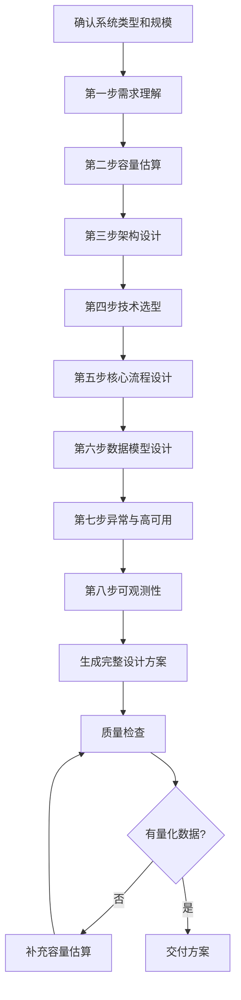

# 系统设计方案生成器

> 为高并发/高可用/分布式系统生成**从需求到部署**的完整设计方案，包含容量评估、架构设计、技术选型、trade-off 分析。

---

## 核心原则

1. **需求驱动**：先明确功能需求和非功能需求（QPS、延迟、可用性、数据量），再设计方案
2. **容量评估**：所有设计决策基于量化的容量估算（用户量、QPS、存储、带宽），不是拍脑袋
3. **分层设计**：接入层 → 应用层 → 服务层 → 数据层 → 基础设施层，层层清晰
4. **trade-off 分析**：每个技术选型都说明优势、劣势、为什么选这个、替代方案是什么
5. **可演进**：方案支持从简单到复杂的演进（单体 → 微服务 → 分布式），不一步到位过度设计

---

## 系统设计八步法

### 第一步：需求理解（5分钟）
- 功能需求：核心功能列表
- 非功能需求：QPS、延迟、可用性、数据量、一致性要求
- 用户规模：DAU/MAU、峰值QPS、增长预期
- 约束条件：技术栈限制、预算、团队规模、时间要求

### 第二步：容量估算（10分钟）
- QPS 估算：总 QPS = DAU × 日均请求数 / 86400 × 峰值系数（3-5倍）
- 存储估算：日增量 × 保留天数 × 副本数 × 冗余系数（1.5）
- 带宽估算：QPS × 平均响应大小 × 8（bit）
- 缓存估算：热点数据量 × 缓存比例 × 副本数
- 服务器估算：QPS / 单台承载量 × 冗余系数（1.5-2）

> 完整的容量估算公式表和示例详见 [references/system-design-templates.md](references/system-design-templates.md)

### 第三步：架构设计（15分钟）
- 整体架构图（分层 + 模块 + 数据流）
- 核心模块划分及职责
- 模块间通信方式（同步/异步、RPC/消息队列）
- 数据流走向（写入路径、读取路径）
- 部署架构（多机房/多可用区/CDN）

### 第四步：技术选型（10分钟）
- 每层的技术选型及理由
- 替代方案对比
- trade-off 分析
- 与现有技术栈的兼容性

### 第五步：核心流程设计（15分钟）
- 核心业务流程（时序图）
- 关键路径的性能优化点
- 异步化设计（哪些操作可以异步）
- 缓存策略（缓存什么、缓存多久、如何更新）

### 第六步：数据模型设计（10分钟）
- 核心表结构（字段、类型、索引）
- 分库分表策略（分片键、分片方式）
- 数据一致性方案（强一致/最终一致）
- 数据归档与清理策略

### 第七步：异常与高可用设计（10分钟）
- 故障场景分析（单点故障、网络分区、雪崩）
- 限流策略（令牌桶/漏桶、分布式限流）
- 熔断降级（熔断条件、降级方案）
- 重试与幂等（重试策略、幂等设计）
- 数据备份与恢复（RPO/RTO）

### 第八步：可观测性与扩展性（5分钟）
- 监控指标（QPS、延迟、错误率、资源使用率）
- 日志方案（结构化日志、日志收集、链路追踪）
- 告警策略（阈值、告警渠道、升级机制）
- 扩展性设计（水平扩展、垂直扩展、功能扩展）

---

## 使用示例

**输入**："设计一个支持 1000 万 DAU 的短视频 App 后端系统，重点关注高并发读写和 Feed 流推送"

**输出**：
- 八步法完整设计方案：
  - 需求理解（功能需求：视频上传/播放/点赞/评论/关注/Feed流；非功能需求：1000万DAU、峰值QPS 5万、延迟 <200ms、可用性 99.99%）
  - 容量估算（日存储增量 50TB、总存储 10PB、带宽 50Gbps、应用服务器 500 台、缓存 2TB）
  - 架构设计（接入层 CDN+Nginx → 应用层微服务 → 服务层消息队列+搜索 → 数据层 MySQL分库分表+Redis+对象存储+ES）
  - 技术选型（每层技术选型及 trade-off 分析，如 Kafka vs RocketMQ）
  - 核心流程（视频上传流程、Feed 流推送流程、点赞计数流程，3 个时序图）
  - 数据模型（用户表、视频表、评论表、关注关系表、Feed Timeline 表，分片策略）
  - 异常与高可用（限流、熔断、降级、重试、幂等、多机房容灾）
  - 可观测性（监控指标、日志、链路追踪、告警阈值）
- 架构图（分层 + 模块 + 数据流）
- 扩展方向（水平扩展、功能扩展）
- 与 `[[系统设计]]` `[[高并发]]` `[[Feed流]]` 等知识库笔记双向链接

---

## 核心工作流程

---

## 工作流程

### 场景一：完整系统设计方案

1. 确认系统类型和规模（如"设计一个支持1000万DAU的短视频App"）
2. 按八步法生成完整方案
3. 每个步骤有量化数据和具体设计
4. 包含架构图（文字描述/Mermaid）、容量估算表、技术选型对比表
5. 包含至少 3 个核心流程的时序图
6. 包含异常处理和高可用设计
7. 包含可观测性和扩展性设计

### 场景二：单一问题深度设计

1. 确认具体问题（如"如何设计秒杀系统的防超卖"、"如何实现Feed流的推送"）
2. 聚焦该问题，生成深度方案：
   - 问题分析（难点在哪）
   - 多种方案对比（至少3种）
   - 推荐方案及理由
   - 核心实现细节
   - 异常处理
   - 性能指标
3. 提供伪代码或核心代码片段

### 场景三：系统设计面试题解析

1. 确认面试题（如"设计一个短链接系统"）
2. 按面试答题结构生成（详见 [references/system-design-templates.md](references/system-design-templates.md) 的面试答题结构）
3. 提供面试官可能的追问方向及答案

---

## 典型系统设计模板参考

> 4 种典型系统（电商秒杀、社交Feed、即时通讯、RAG知识库）的完整设计模板（核心难点、架构要点、关键技术）详见 [references/system-design-templates.md](references/system-design-templates.md)，生成对应系统方案时按模板执行。

| 系统类型 | 核心难点 | 关键技术 |
|---------|---------|---------|
| 电商秒杀 | 高并发读写、防超卖、防刷 | Redis Lua、消息队列、分布式锁、限流 |
| 社交 Feed | Feed生成、推拉模式、热点用户 | Redis ZSet、异步推送、混合模式 |
| 即时通讯 | 长连接、消息可靠性、离线消息 | WebSocket、雪花算法、ACK机制 |
| RAG 知识库 | 检索质量、生成质量、评估 | 混合检索、Reranker、查询改写 |

---

## 输出规范

1. 方案必须有量化的容量估算（具体数字，不是"很多""很高"）
2. 架构图必须清晰，分层明确，数据流方向清楚
3. 技术选型必须有对比和 trade-off 分析，不是只列技术名
4. 核心流程必须有时序图，包含正常流程和异常流程
5. 数据模型必须有表结构和索引设计
6. 高可用设计必须覆盖至少 3 种故障场景
7. 可观测性必须有具体的监控指标和告警阈值
8. 所有设计决策必须说明"为什么"，不是只说"是什么"

---

## 质量检查清单

- [ ] 方案有量化的容量估算（具体数字，不是"很多""很高"）
- [ ] 架构图清晰，分层明确，数据流方向清楚
- [ ] 技术选型有对比和 trade-off 分析，不是只列技术名
- [ ] 核心流程有时序图，包含正常流程和异常流程
- [ ] 数据模型有表结构和索引设计
- [ ] 高可用设计覆盖至少 3 种故障场景
- [ ] 可观测性有具体的监控指标和告警阈值
- [ ] 所有设计决策说明"为什么"，不是只说"是什么"
- [ ] 八步法每步都有实质内容，不遗漏
- [ ] 典型系统模板与实际场景匹配

---

## 与其他 Skill 的协作

- **与 `interview-prep-coach` 协作**：系统设计面试题用本 skill 生成方案，面试教练在此基础上提炼答题框架
- **与 `project-based-learning` 协作**：项目方案中的架构设计用本 skill 生成深度方案
- **与 `tech-concept-deep-dive` 协作**：方案中涉及的核心技术概念（如分布式锁、消息队列）用深度拆解器生成详细笔记
- **与 `learning-path-planner` 协作**：系统设计能力纳入学习路线的后期/专家阶段
- **与 `cheatsheet-generator` 协作**：容量估算公式、典型系统架构整理成速查表

---

> **版本**：v1.0.0
>
> **最后更新**：2026-08-31
>
> **基于**：skill-optimizer 25 轮优化方法论 + skill-creator-for-work 规范

