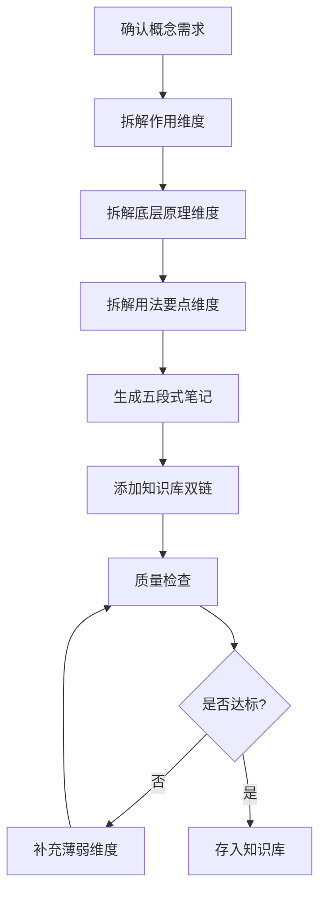

# 技术概念三位一体深度拆解器

> 对技术概念进行**作用→原理→用法**三维度深度拆解，拒绝浅层解释，确保每个概念都理解本质、能落地实践。

---

## 核心原则

1. **三位一体强制**：每个概念必须同时涵盖作用、底层原理、用法要点三个维度，缺一不可
2. **原理到源码**：高级及以上难度的概念必须深入到源码层面，提供核心代码片段和注释
3. **问题导向**：从"解决什么问题"出发，而不是从"是什么"出发，理解技术的价值
4. **实践落地**：用法要点必须有可运行的代码示例、最佳实践、常见坑，不是空泛的"注意性能"
5. **批判思维**：包含 trade-off 分析，说明技术的优势和劣势，不盲目吹捧

---

## 三位一体拆解模板概览

> 完整的三位一体拆解模板（每个维度的详细结构、示例、质量检查清单）详见 [references/deep-dive-template.md](references/deep-dive-template.md)，拆解技术概念时按模板执行。

| 维度 | 核心问题 | 关键产出 |
|------|---------|---------|
| 一、作用 | 解决什么问题 | 一句话定义、解决的问题表、适用/不适用场景、与相关概念区别 |
| 二、底层原理 | 核心逻辑 | 核心机制、架构图、工作流程时序图、关键数据结构、源码片段（L3+）、设计决策trade-off |
| 三、用法要点 | 怎么用 | 可运行代码示例、配置要点表、最佳实践、常见问题表、性能优化表、调试技巧 |

---

## 核心概念与源码阅读路线概览

> 各技术栈的核心概念清单（按优先级排序）、难度、源码可分析性、拆解重点、源码阅读路线详见 [references/concepts-and-source-roadmap.md](references/concepts-and-source-roadmap.md)，选择拆解对象时参考清单。

| 技术栈 | 核心概念数量 | 源码可分析占比 | 代表概念 |
|--------|------------|--------------|---------|
| Java | 20+ | ~60% | Spring IoC/AOP/事务、JVM GC/类加载、AQS、ConcurrentHashMap |
| 前端 | 15+ | ~70% | Vue3响应式、虚拟DOM、Diff算法、Vite HMR、事件循环 |
| Python | 10+ | ~50% | FastAPI依赖注入、异步事件循环、GIL、装饰器、元类 |
| AI工程 | 15+ | ~40% | Transformer注意力、RAG检索、Agent规划、Embedding、Prompt工程 |
| 数据库/分布式 | 15+ | ~30% | MySQL索引/事务、Redis数据结构、分布式锁、CAP、消息队列 |

---

## 使用示例

**输入**："帮我深度拆解一下 Spring 的事务传播机制，要包含源码分析"

**输出**：
- 作用：事务传播是什么、解决什么问题、7 种传播行为适用场景
- 底层原理：TransactionInterceptor 拦截流程、事务同步管理器、三级缓存、源码片段
- 用法要点：@Transactional 注解配置、常见坑（自调用不生效、异常被 catch）、性能优化
- 生成五段式笔记，存入知识库，添加 `[[Spring事务]]` `[[AOP]]` 等双链

---

## 核心工作流程

---

## 工作流程

### 场景一：完整三位一体拆解

1. **确认概念**：
   - 技术概念名称
   - 所属技术栈和分类
   - 难度级别（入门/进阶/高级/专家）
   - 是否需要源码分析（L3+ 必须）
   - 用户的具体疑问（如果有）

2. **拆解「作用」维度**（按 [references/deep-dive-template.md](references/deep-dive-template.md) 模板）：
   - 一句话定义（准确、无循环定义）
   - 解决的问题（每个问题说明"没有它会怎样"）
   - 适用场景和不适用场景
   - 与相关概念的区别（对比表）

3. **拆解「底层原理」维度**：
   - 核心机制（2-3段话，说明"怎么做到的"）
   - 架构设计（架构图+模块职责表）
   - 工作流程（1-2个核心流程，时序图+步骤说明）
   - 关键数据结构（字段和作用表）
   - 源码片段（L3+ 必须，带详细注释）
   - 设计决策与 trade-off（决策表）

4. **拆解「用法要点」维度**：
   - 基础用法代码示例（可直接运行，含导入和配置）
   - 配置要点表（默认值、可选值、影响）
   - 最佳实践（3-5条，每条说明"为什么"）
   - 常见问题表（至少3个，现象→原因→解决方案）
   - 性能优化表（方法+预期效果+适用场景）
   - 调试技巧（工具/命令+常见错误含义）

5. **生成拆解笔记**：
   - 按五段式结构整理（概述→原理→实操→问题→拓展）
   - 添加 Frontmatter（title/category/tags/difficulty/pre）
   - 所有技术概念添加 `[[]]` 双链
   - 标注前置知识（pre 字段）
   - 存入知识库对应分类

6. **质量检查**：按 [references/deep-dive-template.md](references/deep-dive-template.md) 的质量检查清单逐项验证

### 场景二：单一维度深度拆解

1. 确认要拆解的维度（如"只讲底层原理"、"只讲用法"）
2. 按该维度的模板生成深度内容
3. 简要提及其他两个维度（一句话概括，不展开）
4. 标注"完整拆解请参考三位一体模板"

### 场景三：概念对比拆解

1. 确认要对比的 2-3 个概念
2. 分别拆解每个概念的核心要点
3. 生成对比分析：
   - 核心区别表（定义、机制、适用场景、性能、优缺点）
   - 选型决策树（什么情况下选哪个）
   - 混合使用场景（能否一起用，怎么配合）
4. 生成对比笔记

### 场景四：现有笔记深化

1. 读取现有笔记的内容
2. 评估当前深度（哪个维度薄弱）
3. 针对薄弱维度生成深化内容
4. 整合到现有笔记中（保留原有内容，补充深化部分）
5. 更新难度评级（如果内容深度提升）
6. 质量检查

---

## 输出规范

1. 三位一体拆解必须三个维度都有实质内容，无占位符
2. 一句话定义必须准确，避免循环定义（如"索引就是用来索引的"）
3. 底层原理必须说明"怎么做到的"，不是只说"是什么"
4. L3+ 难度必须有源码片段，带详细注释，说明关键逻辑
5. 代码示例必须可直接运行，包含完整的导入和配置
6. 常见问题表至少 3 个问题，每个有现象、原因、解决方案
7. 设计决策必须有 trade-off 分析，说明优势和劣势
8. 所有技术概念添加 `[[]]` 双链，与知识库关联
9. 有前置知识说明（pre 字段），标注学习本概念需要先掌握什么
10. 难度与内容深度匹配（入门不要求源码，专家必须有源码和性能分析）

---

## 质量检查清单

- [ ] 三位一体拆解三个维度都有实质内容，无占位符
- [ ] 一句话定义准确，避免循环定义（如"索引就是用来索引的"）
- [ ] 底层原理说明"怎么做到的"，不是只说"是什么"
- [ ] L3+ 难度有源码片段，带详细注释，说明关键逻辑
- [ ] 代码示例可直接运行，包含完整的导入和配置
- [ ] 常见问题表至少 3 个问题，每个有现象、原因、解决方案
- [ ] 设计决策有 trade-off 分析，说明优势和劣势
- [ ] 所有技术概念添加 `[[]]` 双链，与知识库关联
- [ ] 有前置知识说明（pre 字段），标注学习本概念需要先掌握什么
- [ ] 难度与内容深度匹配（入门不要求源码，专家必须有源码和性能分析）

---

## 常见问题

> 使用本 Skill 时的常见问题和解答详见 [references/faq.md](references/faq.md)，包含：三位一体是否必须都写、拆解需要多长时间、源码片段从哪来、如何与知识库联动、如何判断拆解质量等 7 个高频问题。

---

## 与其他 Skill 的协作

- **与 `obsidian-knowledge-base-creator` 协作**：拆解笔记按知识库标准生成，存入对应分类，与现有笔记联动
- **与 `source-code-reader` 协作**：需要源码分析时，用源码阅读助手生成详细的源码阅读笔记，拆解器引用源码分析
- **与 `code-practice-generator` 协作**：用法要点中的代码示例可用代码实践生成器扩展为完整的可运行项目
- **与 `note-quality-evaluator` 协作**：拆解笔记生成后，用质量评估器检查内容深度和准确性
- **与 `knowledge-review-spaced` 协作**：拆解笔记纳入复习计划，间隔重复巩固深度理解
- **与 `paper-reader` 协作**：AI 方向的概念可结合论文精读，理解技术的原始设计思想
- **与 `cheatsheet-generator` 协作**：拆解中的核心要点和常见问题整理成速查表
- **与 `ai-assisted-coding` 协作**：先用 AI 苏格拉底式引导建立直觉，再按三位一体结构固化为严谨笔记，关键结论用官方源码核验

---

> **版本**：v1.0.0
>
> **最后更新**：2026-08-31
>
> **基于**：skill-optimizer 25 轮优化方法论 + skill-creator-for-work 规范

