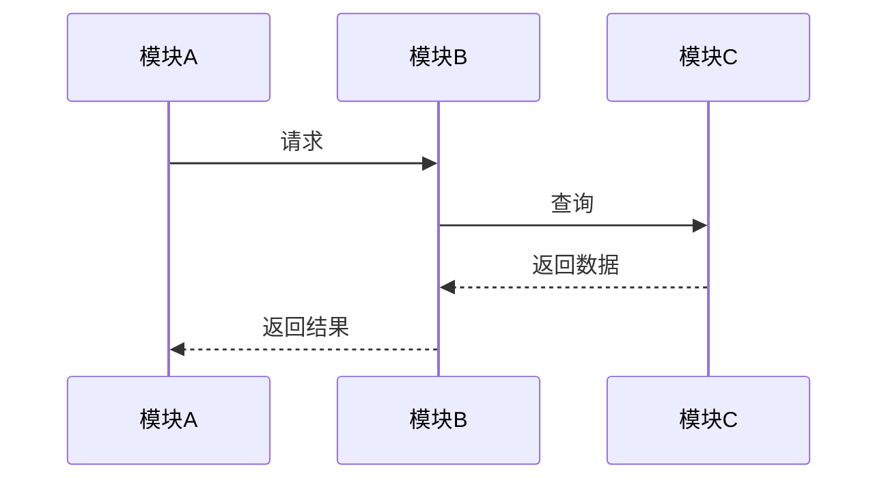

# 三位一体深度拆解模板

> 供 tech-concept-deep-dive 拆解技术概念时参考，按三位一体模板的每个维度执行。

---

## 三位一体拆解总览

每个技术概念必须同时涵盖三个维度：

| 维度 | 核心问题 | 解决什么 | 产出 |
|------|---------|---------|------|
| 一、作用 | 这个技术是什么、解决什么问题、什么时候用 | 建立认知，理解价值 | 定义、适用场景、解决的问题、与相关概念的区别 |
| 二、底层原理 | 核心机制、架构设计、工作流程、关键算法 | 深入本质，理解为什么 | 核心机制、架构图、工作流程、关键数据结构、源码片段 |
| 三、用法要点 | 怎么用、最佳实践、常见坑、性能优化 | 落地实践，会用会调 | 代码示例、配置要点、最佳实践、常见问题表、性能优化 |

---

## 一、作用（解决什么问题）

### 1.1 一句话定义
用一句话准确描述这个技术是什么，避免模糊或循环定义。

**模板**：`XXX 是一种用于 [场景] 的 [技术类型]，通过 [核心机制] 实现 [核心价值]。`

**示例**：
- Redis 是一种用于高性能缓存和数据存储的内存数据库，通过内存存储和多种数据结构实现微秒级响应。
- Vue3 响应式系统是一种用于前端状态管理的 reactive 系统，通过 Proxy 拦截和依赖收集实现数据驱动视图更新。

### 1.2 解决的问题
列出这个技术解决了什么具体问题，每个问题说明"没有它会怎样"。

**模板**：
| 问题 | 没有它的痛点 | 它的解决方案 |
|------|------------|------------|
| 问题1 | XXX | XXX |
| 问题2 | XXX | XXX |

### 1.3 适用场景
列出什么情况下应该用这个技术，什么情况下不应该用。

**模板**：
**适用场景**：
- 场景1：XXX
- 场景2：XXX

**不适用场景**：
- 场景1：XXX（原因）
- 场景2：XXX（原因）

### 1.4 与相关概念的区别
列出容易混淆的相关概念，说明核心区别。

**模板**：
| 概念 | 核心区别 | 适用场景 |
|------|---------|---------|
| 概念A | XXX | XXX |
| 概念B | XXX | XXX |
| 本技术 | XXX | XXX |

---

## 二、底层原理（核心逻辑）

### 2.1 核心机制
用 2-3 段话说明核心工作机制，避免只说"是什么"，要说"怎么做到的"。

**模板**：
`XXX 的核心机制是 [机制描述]。当 [触发条件] 时，系统会 [步骤1] → [步骤2] → [步骤3]，最终实现 [结果]。关键在于 [核心洞察]。`

### 2.2 架构设计
画出或描述整体架构，说明各模块的职责和关系。

**模板**：
```
[上层模块]
    ↓ 调用/依赖
[核心模块] → [辅助模块1]
    ↓           ↓
[底层模块] → [存储/IO]
```

**模块说明**：
| 模块 | 职责 | 关键类/函数 |
|------|------|-----------|
| 模块1 | XXX | ClassA / funcB |
| 模块2 | XXX | ClassC / funcD |

### 2.3 工作流程
选择 1-2 个最核心的流程，画出时序图或步骤说明。

**模板**：
**流程：XXX**
1. 步骤1：[触发] → [动作] → [结果]
2. 步骤2：[触发] → [动作] → [结果]
3. 步骤3：[触发] → [动作] → [结果]

**时序图**（Mermaid）：


### 2.4 关键数据结构
列出核心数据结构，说明字段和作用。

**模板**：
| 数据结构 | 作用 | 核心字段 |
|---------|------|---------|
| 结构1 | XXX | field1（类型，作用）、field2（类型，作用） |
| 结构2 | XXX | field1（类型，作用） |

### 2.5 源码片段（L3+ 要求）
对于高级及以上难度的概念，提供核心源码片段，带详细注释。

**模板**：
```java/python/typescript
// 核心方法：XXX
// 作用：XXX
// 关键逻辑：XXX
public ReturnType coreMethod(Param param) {
    // 步骤1：XXX
    Step1Result r1 = step1(param);
    
    // 步骤2：XXX（关键：为什么这样做）
    Step2Result r2 = step2(r1);
    
    // 步骤3：XXX
    return step3(r2);
}
```

### 2.6 设计决策与 trade-off
说明关键设计决策的理由，以及优势和劣势。

**模板**：
| 决策 | 选择 | 优势 | 劣势 | 为什么这样选 |
|------|------|------|------|------------|
| 决策1 | 方案A | XXX | XXX | 因为XXX |
| 决策2 | 方案B | XXX | XXX | 因为XXX |

---

## 三、用法要点（实操示例）

### 3.1 基础用法代码示例
提供最小可运行的代码示例，包含导入、配置、使用。

**模板**：
```java/python/typescript
// 导入
import xxx from 'xxx';

// 配置/初始化
const instance = new XXX({
  key1: 'value1',  // 说明
  key2: 'value2',  // 说明
});

// 使用
const result = instance.doSomething(input);
console.log(result);
```

### 3.2 配置要点
列出关键配置项，说明默认值、可选值、影响。

**模板**：
| 配置项 | 默认值 | 可选值 | 说明 | 影响 |
|--------|--------|--------|------|------|
| config1 | default | option1/option2 | XXX | XXX |
| config2 | default | 数值范围 | XXX | XXX |

### 3.3 最佳实践
列出 3-5 条最佳实践，每条说明"为什么"。

**模板**：
1. **实践1**：XXX。原因：XXX。
2. **实践2**：XXX。原因：XXX。
3. **实践3**：XXX。原因：XXX。

### 3.4 常见问题表
列出常见问题、原因、解决方案，这是五段式笔记中「问题」模块的核心。

**模板**：
| 问题 | 现象 | 原因 | 解决方案 |
|------|------|------|---------|
| 问题1 | XXX | XXX | XXX |
| 问题2 | XXX | XXX | XXX |
| 问题3 | XXX | XXX | XXX |

### 3.5 性能优化
列出性能优化点，每个说明优化方法和预期效果。

**模板**：
| 优化点 | 优化方法 | 预期效果 | 适用场景 |
|--------|---------|---------|---------|
| 优化1 | XXX | 性能提升 X% | XXX |
| 优化2 | XXX | 内存减少 X% | XXX |

### 3.6 调试技巧
列出常用的调试方法和工具。

**模板**：
- 方法1：XXX（工具/命令）
- 方法2：XXX（工具/命令）
- 常见错误信息及含义：
  - `ErrorA`：原因 → 解决
  - `ErrorB`：原因 → 解决

---

## 拆解质量检查清单

生成深度拆解笔记后，按以下清单检查质量：

### 作用维度
- [ ] 一句话定义准确，无循环定义
- [ ] 解决的问题具体，有"没有它会怎样"的说明
- [ ] 适用场景和不适用场景都列出
- [ ] 与相关概念的区别清晰

### 原理维度
- [ ] 核心机制说明"怎么做到的"，不是只说"是什么"
- [ ] 架构图清晰，模块职责明确
- [ ] 核心流程有时序图或详细步骤
- [ ] 关键数据结构有字段说明
- [ ] L3+ 难度有源码片段和注释
- [ ] 设计决策有 trade-off 分析

### 用法维度
- [ ] 代码示例可直接运行，包含导入和配置
- [ ] 配置要点有默认值和影响说明
- [ ] 最佳实践有"为什么"
- [ ] 常见问题表至少 3 个问题，有原因和方案
- [ ] 性能优化有预期效果
- [ ] 有调试技巧

### 整体
- [ ] 三个维度都有实质内容，无占位符
- [ ] 技术概念添加了 `[[]]` 双链
- [ ] 有前置知识说明（pre 字段）
- [ ] 难度与内容深度匹配
